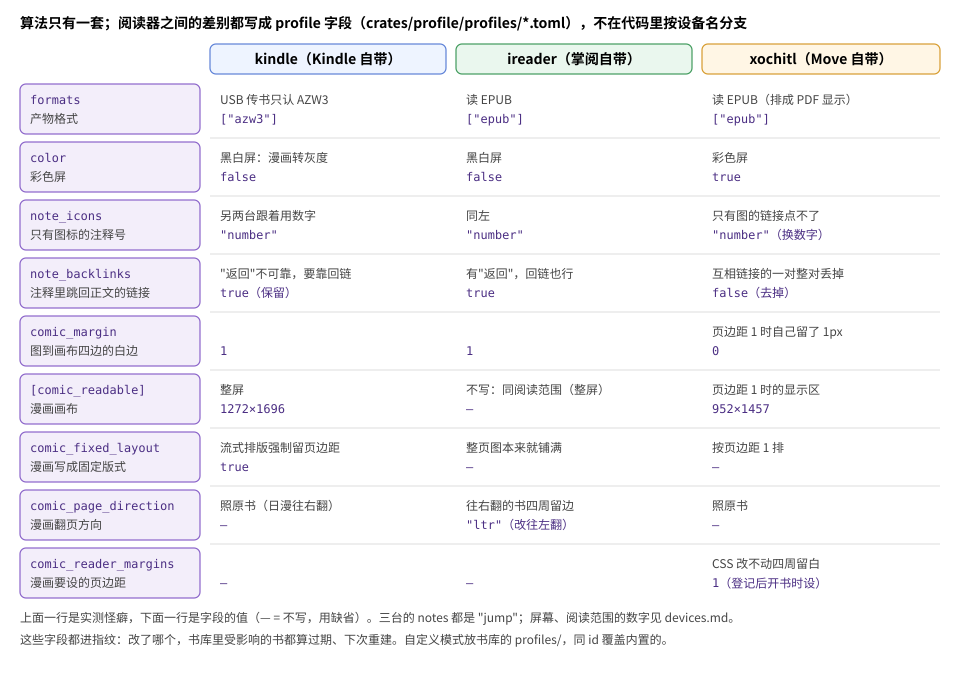
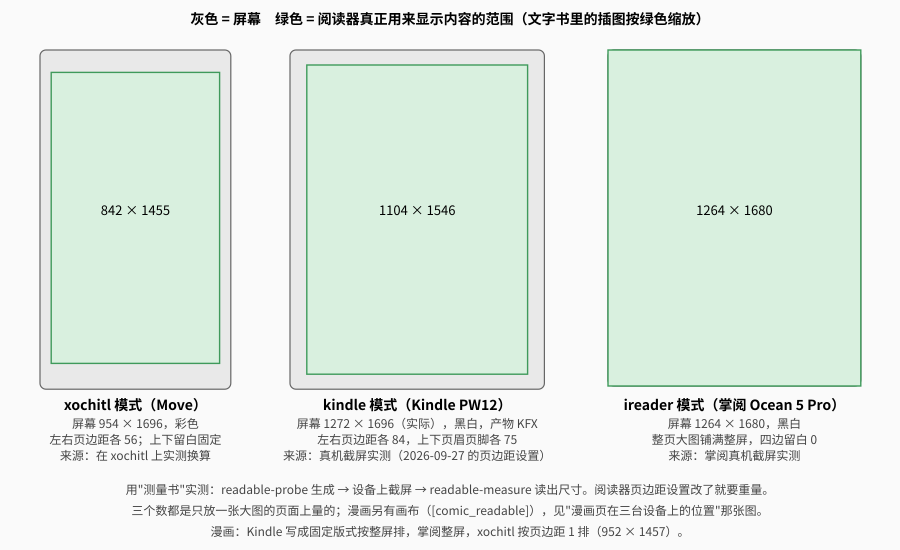
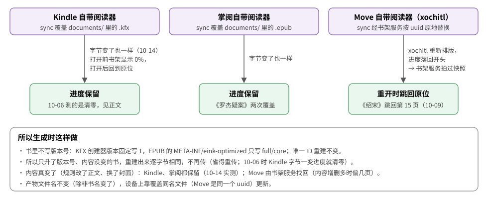

# 设备与阅读模式

## 速查（2026-10-12 汇总）

**做排版、对齐类的改动前先读这一节**；细节和来由在各专题文档（[KFX](kfx.md)、[排版](typesetting.md)），新结论两边一起改。表里的数字是**缺省字号、用户当前设置**下量的（Kindle 行距、掌阅字号改了要重量：profile 的 `line_px`、`em_px`）。2026-10-31 以前这里还有 Move（xochitl）一列：Move 卖了、模式删了，只有它开的怪癖字段和改写还在（字段表的「为什么」里留着来由，git 历史 `5fd0897` 有完整的 Move 结论和 docs/xochitl.md）。

### 共性和总原则

- **以 Kindle 为准**：Kindle 读我们的 KFX（写出器照 Send to Kindle 的样本对齐，验收 ≥99.8%）；掌阅读只修复的 EPUB，`kindle_rules` 把会看起来不一样的地方改写成「显示出来和 Kindle 一样」（验收 ≥99.5%，含插图，按**实际显示**算，不是按 CSS 值）。正文字体不算（都用阅读器自己的字体）。
- **不认的写法做成 profile 字段**，代码里不按设备名分支；改写只改值、加类和我们自己的外链样式表（`eink-*.css`，选择器 `html body 标签.类`，不用 `!important`），书里的文字一个不动。
- **算「Kindle 上什么样」一律读原来的 CSS**：垫图、背景图位置、分页估算都在竖直间距换算之前做（`repair_entries` 里竖直换算最后跑）。
- **都没有可靠的「返回」和进度同步**；覆盖产物后 Kindle、掌阅进度保留（Kindle 2026-10-14 实测；10-06 测的是字节一变就清零）。
- 各台都按自己的阅读器缺省样式排没写样式的标签，所以我们给掌阅挂 `eink-ua.css`（同写出器的 UA 表）。

### 单位和竖直间距

| | Kindle（KFX） | 掌阅 |
|---|---|---|
| 内容区（px） | 1104×1546（屏 1272×1696） | 1264×1680（整屏） |
| 正文一行 | 63（`line_px`） | 54.5 |
| 字号 1em | 39（`font_px`，图片宽度用） | 37.5（`em_px`） |
| 竖直 1em/1rem 的边距 | **52.5**（写出器写行高倍数，按行距换算 = 一行/1.2） | 37.5 |
| `%` 边距 | 按 32em 页宽（左右按包含块宽） | 按内容区宽 |
| `px` | 写出器按 0.45pt/px | 屏幕像素 |
| 左右外边距 `px` | 0.45pt/px（50px 约 73 个屏幕像素） | 屏幕像素 → 块上的折成 em（KINDLE_RULES 24，真机 50px 挪 71；左右内边距、首行缩进的 px 同样，KINDLE_RULES 25） |
| `pt` | 12pt = 1em | **当成 px（坏的）** |
| 段落 `line-height` | 认（按全书正文行高归一） | 不带单位的不认（`2`），**长度认**（`3em`，2026-10-13 探针 Q80、Q84）；缺省一行 58px → 照 Kindle 写成 em（KINDLE_RULES 25，《飘》正文 1.8em 一行 69 → 58–60px 真机 ✓） |
| 别的块（标题、div、li、td）的 `line-height` | 认（同上） | 同段落：不带单位的不认（行内也不认），长度认（Q81–Q83）→ 同上（KINDLE_RULES 25） |
| 标题（h1–h6）的 `font-size` | 认（按正文归一） | 认 |
| 块末尾的 `<br/>` | 不排 | 不排 |
| `margin-top` | 认 | 认 |
| `padding-top`、`border-top`、`position:relative;top` | 认 | 认 |

→ 掌阅的上下外边距、内边距照 Kindle 换算成占内容区高同样的比例（KINDLE_RULES 14，em×1.52，%/px/pt 折成屏幕像素）。

### CSS 认不认

| | Kindle（写出器） | 掌阅 |
|---|---|---|
| 外链样式表 | 认 | 认 |
| `<style>` | 认 | 认 |
| 行内 `style` | 认 | 认 |
| `!important` | 照层叠 | **带它的声明不起作用**（只有这一条、没有冲突的也不起作用：`margin-left:2em !important` 不挪、`text-align:center !important` 不居中、行内 `text-decoration:underline !important` 不画，2026-10-13 探针 Q28、Q85、Q86）→ 去掉 `!important`，靠它胜出的值写进行内（KINDLE_RULES 25，《克莱因壶》引文署名靠右真机 ✓） |
| 优先级相同 | 后者胜 | 后者胜 |
| `rgba()` | 写出器合成 | **整条作废**（换成不透明色） |
| `display:none` | 认 | 认（`linear="no"` 的页露出过「里程碑」，那是 spine 不是这个） |
| `page-break-before/after: always` | Send to Kindle 另起一节（写出器 21 照做，真机 ✓） | 认 |
| 只有空白的段落（`<p>&nbsp;</p>`、`<p><br/></p>`、块间 `<br/>`） | **不出节点**，下一块上外边距折叠后加 0.6 × 空段行高 | 排一整行（`<p><br/></p>` 更高）；`height`/`font-size` 不认，`display:none` 认 |
| 外边距折叠 | 照 CSS（写出器） | 折叠 |
| 放不下时的大段上外边距 | **挪到下一页页首、丢掉边距** | 照加（推到页底） |
| `hyphens:auto` | 不认 | 不认 |
| `rem` | 认 | **不认**（整条声明当没写，Q53）→ 字号以外的改成 em、字号的折成 px（KINDLE_RULES 25，《克莱因壶》首行缩进真机 ✓；《福尔摩斯》行内字号本来就由字号归一折成 px） |
| `letter-spacing` | 写出器照写（没真机核） | **不认**（Q19）→ 没有别的写法，补字距只能往书里加字，不处理 |
| 字号的 `px`、`pt` | px 按 0.75pt（16px＝1em），12pt＝1em | px 是 CSS 像素（同 Kindle，Q21），**pt 当 px**（18pt 只有 1.125em，Q23）→ 字号归一时折成 px（KINDLE_RULES 5；`html` 上写了字号的书除外） |
| 负的外边距 | 照写 | 认（伸到屏幕边为止，Q75–Q79） |
| 块的 `width` | 照写 | 认（Q30） |
| 行内元素、行内图的左右内外边距 | 照写（px 按 0.45pt） | 认，px 是屏幕像素（Q88–Q94）→ px 的折成 em（KINDLE_RULES 28；优化后的测试书真机 30px 挪 43，换算 42） |
| 列表项的上下内边距、外边距 | 照写 | 都认（Q95、Q96） |
| 单元格的内边距 | 照写（px 按 0.45pt） | 认（类规则、行内），px 是屏幕像素（Q97–Q99） |
| 没有项目符号的列表项（`list-style-type:none`）的左右内边距 | 照写 | 认 |
| 单元格的竖直对齐 | 照写；没写的居中（Send to Kindle 同） | **缺省顶端对齐**，`middle` 认（Q105、Q106）→ 一行两格以上、Kindle 上居中的写 `vertical-align:middle`（KINDLE_RULES 29，profile `cell_middle`） |
| 行内 `super`/`sub`、图的 `vertical-align` | 照写（图的数值不写）；`<sup>` 标签和 `vertical-align:super` 写成同一个值 | `span` 上的不认（长度、`position:relative` 也不认），`<sup>`/`<sub>` 标签认（Q100、Q101、Q120–Q123）→ 里面包一层标签（KINDLE_RULES 29，profile `inline_valign`；优化后的测试书真机同 `<sup>`）；行内图压到一行高，竖直对齐看不出 |
| 列表符号、块高、`min-height`、flex、定位、`<hr>`、`margin:auto` | 列表符号照写；块的 `height` 当 `min-height` 写（Send to Kindle 同）；flex、定位不写 | `decimal`、`none` 认，`cjk-ideographic` 不画符号；块高当固定高、`min-height` 认；flex、定位不认；`<hr>` 照 CSS（点线照画）；定宽块 `margin:auto` 居中（Q107–Q124） |
| 单元格的宽度 | **不压窄**（写成表格列宽百分比，字横排；Q127–Q129 真机） | 照 CSS、属性压窄（字竖排；`width:auto` 不认）→ 照 Kindle 的算法写成行内 `width:P%`（KINDLE_RULES 31，profile `cell_width`；真机横排） |
| 空的 `inline-block`（《狼厅》注释图标） | **画出黑圆点**（插零宽空格，Q125 真机） | 不画 |
| 行内元素的左右边距、长度写的竖直对齐、`position:relative` | 都认（Q88–Q92、Q122、Q123 真机） | 边距认（px 折 em）；竖直对齐、定位不认 |
| 左右边距的 em、pt | 按页宽百分比显示（一页按 32 个 em 折） | 一行约 31 个 em，差 2–3%，不改 |
| body 的左右边距 | 按文件：文件里有负外边距的那一侧才加 | 样式表全书共用 → 和多数不一样的文件 body 加类单独写（KINDLE_RULES 31，`eink-body.css`） |
| 定宽块的 `margin:auto` | 两边 auto **不居中**（Q124 真机）；只有左边 auto 的**靠右**（《梁羽生》卷名、《绍宋》「内容简介」真机） | 居中 → 两边 auto 的左边写成 0（KINDLE_RULES 31，profile `margin_auto`）；只有左边 auto 的照 CSS 靠右、不动 |
| `float` | **不浮动**（写出器不写；Q133、Q134 真机） | 认：标题、段落浮到一边 → 标题上的写成 `none`（KINDLE_RULES 33，profile `float`），段落上的同样（KINDLE_RULES 39，探针 Q148） |
| 页首块的负上外边距配上内边距 | 盒子往上推出页面、看不见的那截不占地方（《梁羽生》卷名真机） | 页首的负外边距不往上拉、整个盒子分页（卷名拆到三页）→ 上外边距 0、上内边距减去推出去的（KINDLE_RULES 33） |
| 块、单元格的边框；`<style>`、行内的字号 em | 照写 | 照 CSS 画（左边线、全框、单元格类规则；相邻单元格的边框不管写没写 `collapse` 都并成一条）；字号 em、px 照 CSS（Q49–Q51、Q117–Q119） |

### 背景图

| | Kindle | 掌阅 |
|---|---|---|
| 画在哪 | 只在内容区 | 照 CSS |
| 定位范围 | **body 盒子**：body 只到最后一块的下外边距，`bottom` 的图贴着它（卷首页插图和标题叠在一起）；`cover` 按整页 | 整屏 |
| `no-repeat`、`background-size`、`position` | 认 | 认；**`auto` 高把图拉长到整页高**（像素宽高、`contain` 才按比例） |
| `html` 上的背景 | — | 背景色不认 |

→ 掌阅：整页背景图写成像素尺寸、位置（KINDLE_RULES 12、13）。

### 图片

| | Kindle | 掌阅 |
|---|---|---|
| 没写宽度的独立图 | 原图像素 1:1（宽过内容区缩进来） | 原图像素 |
| `px`/`em` 宽度 | 折成 em、跟着字号 | px 是屏幕像素 |
| 只写高 | 不管高 | — |
| 写了宽度的块级图居中 | 写 `$580`（写出器 21；写 `$34` 不居中） | 照 `text-align` |
| 透明 PNG | **透明处画成黑色** → 写出器合成白底 | 正常 |
| 图块在页尾放不下 | 挪页 | 挪页 |
| 行内小图 | 写出器 20 嵌在字里 | 照 CSS |
| WebP（2026-10-19 测试书「测试-WebP」：有损、无损、透明、动图、CSS 背景图、行内小图、封面） | KFX 没有 WebP 的格式类型：读书时无损转成 PNG（`imgopt::webp_to_png`）；真机 ✓（有损、无损、透明、行内、封面）；动图当时丢掉、空着 → 写出器 24 起取第一帧（维护者定；真机 ✓） | **都认**（adb 截屏 ✓）：透明处露出纸色、CSS 背景图照画、**动图显示第一帧** |

→ 掌阅的图片宽度由 `kindle_images` 改写成和 Kindle 一样大（KINDLE_RULES 9）。

### 别的怪癖（细节见各文档）

- **Kindle**：KFX 容器 id 四处一起改；资源符号排最后；固定版式漫画；注释弹窗按回链配对；没嵌入的正文字体写 `default`；进度在 `.sdr/*.yjf`。
- **掌阅**：整页大图铺满整屏；RTL 书整页图不铺满（漫画改 LTR）；MOBI 词典放 `iReader/dict/`；adb 截屏要从文件管理器点开书（`uiautomator dump` 找坐标）；书架缓存列表要进出一次目录才刷新。书架（2026-10-16 看过）按书所在的那一级文件夹分组（只有一层：「优秀漫画/死亡筆記」成「死亡筆記」组）；**2026-10-19 查书架数据库**（`/data/data/com.zhangyue.iReader.Eink/databases/iReader.db` 的 `booklist`，WAL 模式，读要连 `-wal` 一起拷）：分组是 `type=55` 的行、`folder_full_path` 是对应的文件夹，书和分组的 `ext_int1` 是所在分组的 id（0＝顶层）；新文件夹建的分组挂在上一级文件夹的分组下面（推测，置信度中）：有书直接放进 `documents/` 顶层时建出「documents」分组以后，新的文件夹分组都套在它里面（书架先显示「documents」、点进去才是各个文件夹，这之前建的「科幻神话」等照旧在顶层），同名的分组名字后面加「1」；存储根目录的书在书架顶层。维护者看过后说不改（不改数据库、不换放的位置：「不放 documents 根目录太乱了」）。**新书拔掉 USB 时才导入书架**（MTP 写进去、重启掌阅、启动 `UsbImportService` 都不导入）；掌阅的 adb shell 是 root（`uid=0`），能读应用私有数据。展示方式只有六宫格、十六宫格（带书里的封面）和列表模式（只有书名，没有封面和详情）；「应用 → 文件管理」是系统文件管理器，EPUB 只显示通用图标、出不了封面（缩略图由系统媒体服务给，不读 EPUB），列表模式多一行时间、大小。Android 上装的应用写进 `Android/data/*/files/` 的 `.txt` 也会被收进书架（2026-10-16 KOReader 时期的设置探针 `report.txt`，已卸载）。

### 怎么验证（不靠肉眼猜）

- **Kindle**：维护者同时点左上、右下角截屏（**要先拔 USB**），文件在 `Internal Storage/screenshots/`；Send to Kindle 的样本在 `documents/Downloads/Items01/`（维护者会清掉，要用时请维护者推一份），`kfx-dump --json` 看结构。
- **掌阅**：USB 或无线调试（`adb connect <IP>:<端口>`，2026-10-19 起维护者改用 Wi-Fi，端口每次打开无线调试会变，问维护者要）；`adb exec-out screencap -p`；打开书走文件管理器 `com.android.documentsui/com.szzy.ireader.ink.fileexplorer.ui.activity.MainActivity` + `uiautomator dump`；翻页在空白处横向 swipe。**怪癖测试书 `tools/quirks/probe.py ireader`** 一条命令全自动：每章标记换成条码图、推进 `documents/测试/`（每次换文件名，同名的书掌阅记着读到哪）、点开、逐页截屏认条码、逐行量（2026-10-13，87 个探针 174 页约 10 分钟）。
- 量位置：按文字行的墨迹（灰度 < 140 的行）找行顶，各台换算成占内容区高的比例再比。测试书放临时目录，导入设备的测试书用完删掉。

## 阅读模式和它的字段

优化按**阅读模式**（profile）来：一种阅读软件在一块屏幕上的样子，一个模式出一份产物。每个模式是一个 TOML 文件，文件名就是 id（`--device=` 的值）。
内置的在 `crates/profile/profiles/`，编译时整个目录嵌进程序，**增删模式只要增删文件，不用改代码**。

| 模式 | 给谁读 | 产物 | 屏幕（截图像素） | 文字书阅读范围 | 漫画画布 | 黑白彩色 |
|---|---|---|---|---|---|---|
| `kindle` | Kindle Paperwhite 12 代签名版自带阅读器 | KFX（漫画固定版式） | 1272×1696，300ppi | 1104×1546 | 1272×1696（整屏，固定版式） | 黑白 |
| `ireader` | 掌阅 Ocean 5 Pro 自带阅读器 | EPUB | 1264×1680，300ppi | 1264×1680 | 1264×1680（整屏） | 黑白 |

### 怪癖 → 字段

算法只有一套（`OptimizeOpts::for_profile`），阅读器之间的差别全写成字段，**不在代码里按设备名分支**。每个字段对应一条真机上踩到的怪癖：



| 字段（缺省） | 意思 | `kindle` | `ireader` | 为什么（实测怪癖） |
|---|---|---|---|---|
| `formats`（必填） | 产物格式 | `["kfx"]` | `["epub"]` | Kindle 自带阅读器 USB 传书不认 EPUB；`kfx` 是先按同样规则优化出 EPUB 再转（AZW3 写出器 2026-10-09 删了，KFX 取代） |
| `color`（必填） | 彩色屏 | `false` | `false` | 黑白屏的漫画转 256 级灰度 |
| `[screen]`、`[readable.<格式>]` | 屏幕、真实可阅读范围（不写 = 屏幕） | 1272×1696、1104×1546 | 整屏 | 阅读器各自留页边距、页眉页脚，见[可阅读范围](#可阅读范围) |
| `notes`（必填） | 完整优化时注释怎么写：`"jump"` 普通链接、注释搬到章末；`"popup"` 再标上 `epub:type="noteref"` + `<aside epub:type="footnote">`。**只修复时不生效**（xochitl 只用它的搬移部分） | jump | popup | 掌阅自带阅读器认弹窗（2026-10-05 真机）；xochitl 只认同文件跳转。Kindle 的弹窗由 KFX 写出器自己配（见[排版 · 注释](typesetting.md#3-注释完整优化弹窗小一号)） |
| `note_icons`（`"keep"`） | 只有图标的注释标号：保留图标，或换成上标数字。只修复时只在开了 `repair_note_links` 时生效 | number | number | xochitl 里只有图的链接点不了、CSS 限不住图标；另两台也用数字，都验证过能跳 |
| `note_backlinks`（`true`） | 保留注释里"跳回正文"的回链。只修复时同上 | 保留 | 保留 | Kindle 点注释后没有可靠的"返回"，要靠回链；xochitl 遇到互相链接的一对会整对丢掉（正向也点不动） |
| `comic_margin`（1） | 漫画的图到画布四边的白边（像素） | 1 | 1 | xochitl 页边距设成 1 后自己就留了 1px |
| `[comic_readable]`（= 阅读范围） | 漫画画布 | 1272×1696 | 不写 | 漫画要贴屏幕边，画布和文字书的阅读范围不同 |
| `comic_fixed_layout`（`false`） | 漫画写成固定版式 | `true` | — | Kindle 流式排版强制留页边距（最小档左右 101px），固定版式才按画布 1:1 整页显示 |
| `background_images`（`false`） | 保留 CSS 背景图（`background` 简写拆成背景色、背景图、重复、位置等分项） | `true` | `true` | xochitl 不认 `no-repeat`，把背景图平铺满页盖住正文；掌阅不认 `background` 简写（2026-10-05 真机对照书），拆开写就正常 |
| `background_sizing`（`true`） | 保留背景图时也留 `background-size`、`background-attachment`；去掉时整页背景图（`body`/`html` 上的）按原书的尺寸意图预先缩好、一律不超出阅读范围（整张图看得见；v48、v49，见[排版 · 背景图](typesetting.md#1-解开字体字号行高的锁别的样式不动)） | 留 | 去掉 | 掌阅写了尺寸会把图挤变形、不写又按图自身像素显示（大图只露出一角），所以去掉尺寸、图预先缩好；Kindle 留着（和 Amazon 写法一致） |
| `css_rgba`（`true`） | 阅读器认 CSS 的 `rgba()` 颜色；`false` 时换成 `#rrggbb`（不透明的颜色不变，半透明按白底混合，全透明写 `transparent`；v49） | 认 | 不认 | 掌阅把 `rgba()` 那条声明整条作废（《绍宋》深红底色显示成白底），`rgb()`、`#rrggbb` 认（2026-10-06 真机测试书）。只修复的文字书里由 `kindle_rules` 照这个字段换（KINDLE_RULES 8：《飘》「第一卷」标题的半透明白条作废后字压在插图上看不见，2026-10-12） |
| `caption_fit`（`false`） | 带图注、按满宽显示会超出一页的图给 `` 写行内宽度百分比，图和图注同页（v50，见[排版 · 插图](typesetting.md#8-插图)） | 开 | 开 | 掌阅、Kindle 不认多看图集，竖长的人物图撑满一页、图注掉到下一页；掌阅不认 `max-height`、`page-break-inside`，宽度百分比认（2026-10-06 真机 adb 截屏）；KFX 写出器只认图片宽度。xochitl 没测过（也不认行内样式） |
| `background_no_repeat`（`true`） | 阅读器认背景图的 `no-repeat`；`false` 时（阅读器从内容区左上角按原始像素平铺、铺满整页）只修复的文字书（`kindle_rules`）里整页背景图做成整屏大小的一块（内容区照 Kindle 画、其余白色，KINDLE_RULES 10），别的写了不平铺（`no-repeat`、`repeat-x`、`repeat-y`……）的背景图去掉，背景色照留，本来就平铺的照留（KINDLE_RULES 8） | 认 | 认 | xochitl 背景图一律从某个原点按原始像素平铺，`no-repeat`、`background-size`、`background-position` 都不管：大图一块超出整页、显得偏到一边被裁掉（《飘》「第一卷」），小图铺满一页（2026-10-12 测试书 12+8 种写法）。掌阅认 `background-size`（同一测试书） |
| `background_auto_height`（`true`） | 阅读器认背景尺寸里的 `auto` 高；`false` 时只修复的文字书（`kindle_rules`）里整页背景图照 Kindle 上的大小、位置写成屏幕像素的 `background-size`、`background-position`（KINDLE_RULES 13） | 认 | 不认 | 掌阅 `100% auto`、`1264px auto` 都把图拉长到整页高，写成像素宽高、`contain` 才按比例；定位范围是整屏（2026-10-12 测试书「测试-掌阅背景」） |
| `image_sizing`（`css`） | 阅读器怎么定图片尺寸：`device-px`＝照 CSS 但 px 是屏幕像素，`percent`＝只认百分比宽度。只修复的文字书（`kindle_rules`）按它把图片宽度改写成显示出来和 Kindle 一样大（`wash/kindle_images.rs`，KINDLE_RULES 9） | （KFX 写出器） | `device-px` | 2026-10-12 测试书「测试-插图」三台量：不写宽度的 300px 小图 Kindle 27%、掌阅 25%、Move **98%**；宽 300px 的 Kindle 66%（px 折成 em 跟着字号）、掌阅 **26%**、Move **100%**；宽 10em、只写高的 Move 都拉满一行；比一页还高的都缩到一页高。改写后 Move 逐张和 Kindle 一致，掌阅 em 写的按自己的字号（1em≈37.4px，Kindle 39px） |
| `font_px`（不写） | 缺省字号下 1em 的屏幕像素：掌阅、Move 照它把 em 写的图片宽度折成 Kindle 上的大小 | 39 | — | 测试书宽 10em 的图在 Kindle 上 392px |
| `image_alpha`（`true`） | 阅读器能正确显示图片的透明通道；`false` 时正文 ``/SVG `<image>` 用到的、有透明像素的 PNG 先合成到白底（CSS 背景图不动；v50） | 不能 | 能 | Kindle（KFX）把透明处显示成黑色（《绍宋》章标题图，2026-10-06 真机；《飘》章头图整块黑，2026-10-12），掌阅显示正确。只修复以后优化器不再合成；KFX 写出器 18 起写进 KFX 时合成（只对 Kindle，书里的 EPUB 不动，2026-10-12 定，真机 ✓） |
| `text_repair_only`（`false`） | 文字书只修复：EPUB 3 规范整理和目录到节，文字、图片、样式一概不动（图片的例外是 `image_gamma`）；上面 `background_images` 到 `image_alpha` 这些文字书的规则都不生效，注释的规则只在开了 `repair_note_links` 时生效（见[排版 · 只修复](typesetting.md#只修复各模式的文字书)） | `true` | `true` | 2026-10-08 定：不动书里任何文字、图片、格式、样式。漫画不受影响 |
| `kindle_rules`（`false`） | 只修复的文字书照 Send to Kindle 的规则统一：标签缺省样式 `eink-ua.css`、正文字体用阅读器字体、body 左右边距不要、文字对比度 4.5（见[排版 · 只修复](typesetting.md#只修复各模式的文字书)） | — | `true` | 2026-10-08 定三台统一一套规则；Kindle 由 KFX 写出器照做 |
| `repair_note_links`（`false`） | 只修复时仍保证注释能点：注释搬进本章、改同文件锚点，按 `note_backlinks`、`note_icons` 处理 | — | — | xochitl 只认同文件 `#锚点`、只有图的链接点不了（2026-10-08：xochitl 只保障注释可跳） |
| `margin_top`（`true`）＋ `[page_top]` | 阅读器认 `margin-top`；`false` 时只修复的文字书（`kindle_rules`）每章开头写了上边距的垫透明空白图或行内窄图推到 Kindle 的位置（`wash/top_spacer.rs`，KINDLE_RULES 11、20）。`[page_top]` 是垫图要的这台尺寸（屏幕像素）：垫图后阅读器自己加的空 `gap_heading_per_em`、`gap_other`，行内窄图的基数 `strut_base_per_em`；`margin_top = false` 时必须写 | 认 | 认 | xochitl 不认 `margin-top`、`padding-top`，页首的空元素不占地方（2026-10-12「测试-标题位置」、10-13「测试-行内垫图」） |
| `display_none`（`true`） | 阅读器认 `display:none`；`false` 时去掉隐藏的元素（`wash/hidden.rs`）、空段去掉而不是加类藏起来（`wash/blank_fold.rs`） | 认 | 认 | 2026-10-12「测试-隐藏」：xochitl 行内、外链的 `display:none` 都不认，《飘》《春雪》版权页露出「版权信息」大标题 |
| `trailing_br_line`（`false`） | 块末尾的 `<br/>` 多排一行；`true` 时去掉（`wash/blank_fold.rs`，KINDLE_RULES 20） | 不排 | 不排 | 2026-10-13「测试-末尾br」：Move 段落多 50px、1.5em 标题多 75px |
| `line_height_except_p`（`false`） | `<p>` 不认外链、`<style>` 里的 `line-height`（行内的认），别的块按阅读器缺省行距的倍数认；`true` 时块的行距照 Kindle 归一、写进行内（`wash/block_style.rs`，KINDLE_RULES 20；`<p>` 是 26） | — | — | 2026-10-13「测试-行距」：《三体》标题两行 Move 179px、Kindle 约 123 |
| `heading_font_keywords`（`false`）＋ `[heading_sizes]` | 标题的 `font-size` 只认关键字；`true` 时标题字号照 Kindle 写成最接近的关键字（`wash/block_style.rs`，KINDLE_RULES 21）；最近的也差 3% 以上的改成 `<div>`（`wash/heading_div.rs`，KINDLE_RULES 32，2026-10-14 定）。`[heading_sizes]` 是量出来的大小（正文 1em＝1）：`keywords`（关键字 → 大小）、`tags`（h1–h6 按标签固定的），这时必须写 | — | — | 2026-10-13「测试-标题字号」1–4：em、px、pt、% 一概不认 |
| `heading_center`（`false`） | 标题自己没写 `text-align` 时居中（`inherit` 也不认）；`true` 时照 Kindle 继承来的对齐写明（`wash/block_style.rs`，KINDLE_RULES 32） | — | `true` | 2026-10-14 探针「测试-标题对齐」 |
| `em_root`（`false`） | em 一律按根字号算（字号的 em、%、边距、缩进的 em），字号的 px 是屏幕像素；`true` 时换成按根的值（`wash/root_em.rs`，KINDLE_RULES 32） | — | — | 2026-10-14 探针「测试-div探针」4–7 |
| `inline_css_lengths`（`true`） | 行内 `style`、`<style>`、最后一条不带分号又紧挨 `}` 的声明里的 em 照 CSS 排；`false` 时只修复的文字书里写 em 的挪进外链样式表（`wash/inline_css.rs`，KINDLE_RULES 22） | — | — | 2026-10-13「测试-怪癖」：xochitl 这几种写法 em 按 23px，字号、首行缩进的 em 不认 |
| `padding`、`borders`、`heading_margins`（都是 `true`） | 认内边距、画边框、认 h1–h6 的上下外边距；`false` 时只修复的文字书里左右内边距并进外边距、上下内边距和标题外边距照 Kindle 写到相邻块认的一侧、上下边框插横线图（`wash/box_fix.rs`，KINDLE_RULES 23） | — | — | 2026-10-13「测试-怪癖」Q05–Q07、Q12、Q39、Q40、Q65–Q74：xochitl 内边距不认（背景色画）、边框不画、标题外边距不认（前后自带空），图能画 |
| `px_margins`、`percent_margins`（都是 `true`） | 左右外边距写 px 时和 Kindle 一样大、写 % 时按包含块宽；`false` 时只修复的文字书里块上的折成 em（px 按 0.45pt、% 按内容区宽；`wash/box_fix.rs`，KINDLE_RULES 24） | — | `px_margins = false` | 2026-10-13：两台 px 是屏幕像素（Kindle 按 0.45pt），Move 的 % 当 px；修后掌阅、Move 真机 50px 都挪 71（Kindle 换算 1.875em） |
| `rem`、`important`、`line_height_numbers`（都是 `true`） | 认 `rem`、认 `!important`、认不带单位的 `line-height`；`false` 时只修复的文字书里 rem 改成 em（字号的折成 px）、去掉 `!important`（靠它胜出的值写进行内）、行距照 Kindle 写成 em（`wash/css_compat.rs`、`wash/block_style.rs`，KINDLE_RULES 25；`line_height_numbers = false` 要写 `line_px`、`em_px`） | — | 都是 `false` | 2026-10-13「测试-怪癖-掌阅」Q28、Q53、Q80–Q86 |
| `block_width`、`negative_margins`（都是 `true`） | 认块的宽度、认负的外边距；`false` 时只修复的文字书里块的宽度折成左右外边距、页中间相邻两块的负外边距照 Kindle 写成非负的间距（`wash/box_fix.rs`，KINDLE_RULES 28） | — | — | 2026-10-13 探针 Q08、Q30、Q75–Q79 |
| `cell_width`、`margin_auto`（都是 `true`，同 CSS） | 按单元格的 CSS 宽度压窄格子、按 `margin:auto` 让定宽块居中；Kindle 都不（真机）。单元格的宽度两台都照 Kindle 写成列宽百分比（`true` 写行内 `width:P%`，`false` 写 `width` 属性），`margin_auto = true` 时两边 auto 的定宽块左边的 auto 写成 0（`wash/box_fix.rs`，KINDLE_RULES 31；只有左边 auto 的 Kindle 靠右，不动，33）。`float`（缺省 `true`）：认浮动，标题上的写成 `none`（Kindle 不浮动，KINDLE_RULES 33） | — | 都是 `true` | 2026-10-14 探针 Q124、Q127–Q129、Q133、Q134，Kindle 截图 |
| `cell_middle`、`inline_valign`（都是 `true`） | 单元格缺省竖直居中（同 Kindle）、认行内元素上 `vertical-align` 的上标下标；`false` 时只修复的文字书里一行两格以上、Kindle 上居中的单元格行内写 `vertical-align:middle`（`wash/box_fix.rs`），写了 super/sub 的行内元素里面包 `<sup>`/`<sub>`（`wash/sup_sub.rs`；KINDLE_RULES 29） | — | 都是 `false` | 2026-10-14 探针 Q100–Q106、Q120–Q123 |
| `em_px`、`line_px`（不写） | `em_px`：这台缺省字号下 CSS 1em 的屏幕像素，竖直间距照 Kindle 换算用（KINDLE_RULES 14）；`line_px`：正文一行的像素（kindle：一 rem 竖直 = 它 / 1.2；掌阅：缺省行距，行距照 Kindle 写成 em 用） | `line_px` 63 | `em_px` 37.5、`line_px` 58 | 2026-10-12「测试-竖直间距」：Kindle 按行距排边距，同样 1em 占页高多一半 |
| `comic_gamma`（不写＝不加深） | 漫画页中间调加深的伽马（`255·(v/255)^γ`，黑白两端不动）：内容是灰度的页才加深，黑白屏上转成灰度的页都算，彩色屏上彩页原样；装饰小图不动（`imgopt::prepare_comic_page_limited`，c55） | 1.1 | 1.1 | 2026-10-16 两台真机比过原样 / 1.2 / 1.3 / 1.45：黑白页加深明显更好，选 1.45；2026-10-21 先改成 1.3，同日掌阅上比过 1.1 / 1.2 / 1.3（《浪客行》卷07）选 1.1；Move 彩页提对比度、锐化、饱和度看不出区别。Kindle 2026-10-26 跟着开 1.1，10-27 真机比过原样 / 1.1（《浪客行》卷07）选 1.1 |
| `comic_autocontrast`（`false`） | 漫画页拉满对比度（照 KCC 的自动对比度）：内容是灰度的页按裁边后、缩放前整页最黑 → 0、最白 → 255 线性拉开，再做 `comic_gamma`；灰度范围不到 159 的页不拉（`imgopt::autocontrast_lut`，c57） | `true` | — | 2026-10-30 Kindle 真机比过《死亡筆記》卷07 现状 / 拉满 + 伽马 1.1 / 只拉满（同 KCC 默认），维护者选拉满 + 伽马；同日再比拉满 + 1.1 / 拉满 + 1.2，选 1.1。掌阅、Move 是旧设备，没比过 |
| `comic_trim_specks`（`false`） | 漫画页裁白边不让扫描杂点挡住：裁过白边后，小块、离主体远、附近没有成堆小块的暗点不算内容，再收一次边（`comiccrop.rs`，c58） | `true` | — | 2026-10-30 维护者定（《哆啦A夢》卷01 挡住裁白边的多是灰尘）。旧设备没开 |
| `comic_upscale`（`true`） | 比框小的 JPEG 漫画页预先放大到框（Lanczos3，最多 3 倍）；`false` 时同 PNG，原尺寸按比例补白、交给阅读器放大（`imgopt::comic_layout`，c59 加的字段） | — | — | 2026-09-29 为 KOReader 加的（它按原像素显示）；2026-10-30 Kindle 上比过《竹光侍》卷01 预先放大 / 不放大，维护者选预先放大 |
| `cover_thumb_aspect`（不写） | 书架缩略图的宽高比：封面居中裁成这个比例另存 `eink-thumb.jpg`，只给书架用，书里的封面页不动（文字书、漫画都做；`wash::add_cover_thumbnail`，v64/c59） | 0.65 | — | 2026-10-30 封面比例测试书在 Kindle 书架截图量的：封面框宽度固定、0.65（网格 344×531）；维护者定只裁缩略图，新设备到了量它们的框再开 |
| `comic_page_numbers`（`false`） | 漫画页裁掉页码：内容最底下像页码的小块、上方空着，按在内容的左、右、正中分，整卷同一位置 ≥5 页且 ≥2% 才裁（`comiccrop.rs`，c58）；推翻「不删内容」里的这一项 | `true` | — | 2026-10-30 Kindle 上看《迷宮飯》卷01 测试书「字更清晰、没有裁错」 |
| `image_gamma`（不写＝不加深） | 文字书正文插图中间调加深的伽马：正文 ``/SVG `<image>` 用到、不在 CSS 里、内容是灰度、短边 ≥ 200、不透明的 JPEG/PNG，只修复也做；JPEG 按原图质量重编码（`imgopt::darken_gray_image`，v59） | 1.1 | 1.1 | 同日比过金庸木刻、水墨，福尔摩斯网点图，罗杰疑案线条图，选 1.3；2026-10-21 改成 1.1，同漫画（插图没另比）；Kindle 2026-10-26 跟着开，10-27 真机比过《罗杰疑案》插图选 1.1。正文是阅读器画的，不受影响 |
| `comic_format`（不写） | 漫画另用一种产物格式（要在 `formats` 里） | — | — | 内置模式都不写（kindle 2026-10-05 曾写 `azw3`，KFX 固定版式真机通过后去掉），留给自定义模式；写了时是不是漫画按优化器的判定 |
| `comic_page_direction`（照原书） | 漫画翻页方向改成 `"ltr"`/`"rtl"` | — | 不写（照书，2026-10-15 起；以前 `"ltr"`） | 掌阅往右翻的书，整页图四周按阅读器「排版」设置留边，选「漫画」排版才铺满（见下面「在真机上测量」） |
| `comic_reader_margins`（不写） | 漫画在阅读器里要设的页边距：写标记（`META-INF/eink-reader-margins`）、文字页补回留白（以前给 Move 的书架服务登记用） | — | — | xochitl 四周留白 CSS 改不动，只有页边距设置管用（界面只有 28/56/112 三档） |
| `[deliver]`（不写 = 产物放电脑上） | 产物怎么送到设备（2026-10-07，见[使用指南 · 产物放在哪](usage.md#产物放在哪)）：`kind = "mtp"` + `mount`（jmtpfs 挂载点名）+ `dir`（存储根目录下的目录）（2026-10-31 以前还有 `kind = "xochitl"`：经 SSH 交给 Move 的书架服务，删了） | mtp：`kindle`、`documents` | mtp：`ireader`、`documents` | 不影响产物内容，不进指纹 |

- `display_none`、`trailing_br_line`、`line_height_except_p`、`heading_font_keywords`＋`[heading_sizes]`、`margin_top`＋`[page_top]`、`inline_css_lengths`、`padding`、`borders`、`heading_margins`、`px_margins`、`percent_margins` 由 `bookconv::reader_model::ReaderModel` 汇成"这台阅读器拿到 CSS 会排成什么样"的设备模型，照 Kindle 改写的 pass 只认它（2026-10-13 收拢，量出来的数从代码挪进 profile）。这几个字段和 `em_px` 以哈希进指纹（`m` 段，2026-10-13 定）：重量了数改 profile 就行，书自动重建。
- 影响产物的字段都进指纹，改了哪个，受影响的书都算过期、下次重建；文字书、漫画分开算，只管一路的字段只进那一路（见[架构 · 指纹](architecture.md#指纹)）。不进指纹的：`name`、`[deliver]`（只管怎么传，不影响产物）。
- **怪癖表**（2026-10-13）：上面这些结论里能按「属性 · 元素 · 值 · 写法」说清楚的，机器可读地记在 `crates/bookconv/data/css-quirks.toml`（掌阅一栏：same / fixed / accept / broken，每条有出处；Move 一栏 2026-10-31 去掉了）。`sync` 生成掌阅的文字书时按它体检（`bookconv::audit`），和 Kindle 不一样又没处理的、表里没有的写法打在 `sync` 输出里、记进生成记录，`booklib list` 看全部。新量出来的结论两边都写。怪癖测试书 `tools/quirks/probe.py ireader` 一条命令生成、推进掌阅、逐页截屏逐行量（Kindle 要手动截图）。
- 表里 `background_images` 到 `image_alpha` 这几个字段是文字书完整优化时的规则，内置模式的文字书都只修复（`text_repair_only = true`），它们只对漫画（清洗层两路都过）和没开只修复的自定义模式起作用。
- **掌阅自带阅读器的词典**（2026-10-06 真机）：内置有道词典（存储根 `dict/` 下的 `c2170331.ydd`、`e2170331.ydd` 等），也能查在线翻译；自己的 **MOBI 词典直接拷进 `iReader/dict/`** 就能在查词里用（《牛津高阶英语双解》68MB、《现代汉语词典》9MB ✓，不用转格式；社区说法是单本不超过 100MB，没验证上限）。（`mobi-dict-to-stardict` 转 StarDict 是当初给 KOReader 用的，现在两台都不装 KOReader。）
- **掌阅自带阅读器的字体**（2026-10-06 真机）：字体都在共享存储的 `iReader/fonts/`，自带的（方正新书宋等，删了会自动重新下载）和自己导入的放在一起；**字体列表显示的就是文件名去掉扩展名**，不读字体里登记的名字，自带字体的文件名本来就是中文（`方正新书宋.TTF`）。所以导入的字体想显示中文名，就把文件改成中文名（`SourceHanSerifSC-SemiBold.otf` → `思源宋体 SemiBold.otf`）。阅读器设置（`text_book_config.db` 的 `fontFamily`）记的也是这个名字，改名后用到它的书要重新选一次字体。
- **掌阅的系统字体**（「系统 → 设置 → 字体样式」，管系统界面，和阅读器的字体列表是两套；2026-10-06 真机）：导入的字体按安卓的可更新字体存进 `/data/fonts/files/<随机>/<PostScript 名>.ttf`，**显示的是字体内部登记的中文家族名**（名字表 ID 1，语言 0x804），和文件名无关（方正姚体 → 「方正姚体」）。字体带了排版家族、排版子族（ID 16、17）时名字会被拆坏：更纱黑体（ID 1「更纱黑体 UI SC SemiBold」、ID 16「更纱黑体 UI SC」、ID 17「SemiBold」）显示成「SC SemiBold」。**只改名字表就好**：ID 1/4 改成「更纱黑体 UI」（英文「Sarasa UI」）、ID 2 改成 Regular、去掉 ID 16/17、换个新的 PostScript 名（ID 6，免得和已导入的那份冲突），字形、cmap、宽度等表逐字节不动（fontTools 改的），重新导入后显示「更纱黑体 UI」✓。
- **掌阅开 adb**：设置里藏了「关于本机」，要装「设置入口」小应用（代码在 `~/Projects/ireader-settings`，2026-10-19 起；以前在已经没了的 koreader-setup 仓库。1.6 起首页显示无线调试的 `adb connect IP:端口`、能直接开关无线调试、本机状态）打开它、连点版本号开开发者选项，再开 USB 调试；adb shell 是 root；每次开机 USB 调试被关；睡眠时断 Wi-Fi，无线调试跟着断，醒来端口变（2026-10-19）。
- 不做成字段、各模式一律处理的怪癖：掌阅自带阅读器遇到文件名里有 `*`、`:` 这类字符的封面图（《春雪》《飘》原书的 `**::…jpg`），书架没有封面缩略图（2026-10-06），清洗时一律改名（见[排版 · 目录与其它修复](typesetting.md#其它修复)）。
- 写了不认识的字段、格式，`comic_page_direction` 写了别的值，都会报错，防止拼错后被悄悄忽略。例外：以前的 `ppi` 字段已去掉（没有代码用它），旧文件里写着照收、不报错。
- 屏幕、阅读范围、漫画画布都要写成竖屏（宽 ≤ 高），阅读范围和画布不能超过屏幕，否则报错。
- **按截图的像素写**：Kindle 截图是 1272×1696（设备实际的显示缓冲区），标称 1264×1680，写的是前者。
- **自定义模式**：放在书库的 `profiles/<id>.toml`，同 id 覆盖内置的；`booklib devices` 会列出来。id 不能以 `.` 开头、不能含逗号或斜杠（`--device=` 用逗号分隔，id 还要当目录名）；`profiles/` 里的隐藏文件跳过。

```toml
# crates/profile/profiles/ireader.toml（去掉了注释；每个字段的含义和来由看文件里的注释）
name = "掌阅自带阅读器（iReader Ocean 5 Pro）"
color = false
formats = ["epub"]
background_auto_height = false
notes = "popup"
background_images = true
background_sizing = false
css_rgba = false
note_icons = "number"
caption_fit = true
text_repair_only = true
kindle_rules = true
comic_gamma = 1.1
image_gamma = 1.1
comic_margin = 1

image_sizing = "device-px"
em_px = 37.5
px_margins = false
rem = false
important = false
line_height_numbers = false
line_px = 58
cell_middle = false
inline_valign = false
heading_center = true
float = true

[screen]
width = 1264
height = 1680

[readable.epub]          # 段名跟产物格式走：kindle 写 [readable.kfx]
width = 1264
height = 1680

[deliver]
kind = "mtp"
mount = "ireader"
dir = "documents"
```

**不对应字段、所有模式统一处理的怪癖**（以后某台不一样了再做成字段）。「只修复也做」一栏是文字书现在还做不做（[排版 · 只修复](typesetting.md#只修复各模式的文字书)）；漫画都做：

| 阅读器 | 怪癖 | 统一的处理 | 只修复也做 |
|---|---|---|---|
| xochitl（已卖） | NCX 的 `dtb:uid` 和 OPF 不一致时不显示目录 | 对齐成一致 | 做 |
| xochitl（已卖） | 找 NCX 只认 manifest 里 `id="ncx"` 的项，叫别的原生目录入口不出现 | NCX 的 manifest id 改成 `ncx` | 做 |
| xochitl（已卖） | 封面条目 id 带点、又只有 `<meta name="cover">` 时取不到封面 | `<meta name="cover">` 和 `properties="cover-image"` 同时写 | 做（EPUB 3 规范整理） |
| xochitl（已卖） | 严格 XML：同一标签两个 `id` 整章空白，OPF 不合法整本只排 1 页 | 合并重复 `id`，XHTML、OPF 一律修成合法 XML | 做 |
| 各台 | 不支持 CSS 断字 | 规则留着，不插软连字符 | —（只修复不加断字规则） |

其它实测行为（不需要处理）：Kindle 侧载书归"文档"（PDOC）时封面最稳；Kindle 书旁 `.sdr` 里的进度文件只写不读（AZW3 时代的 `.azw3f`；KFX 的 `.yjf` 见[附录](#自带阅读器之间能不能同步进度2026-09-30-真机)）；掌阅用中文字体显示英文时弯引号是全角宽。

### 为什么这样分

- **按设备自带的阅读器分模式**：Kindle 单独一个，因为 USB 传书不认 EPUB（认 AZW3、KFX，现在出 KFX）、强制留页边距、漫画要写成固定版式；掌阅屏幕和 Kindle 一样是 7 英寸 300ppi 黑白屏，但读 EPUB、整页图铺满整屏。（Move 2026-10-31 删了。）
- 旧的设备 id（`kindle-pw12-sig`、`ireader-ocean5-pro`、`rmpp-move`、`rmpp-move-koreader`、`koreader`）已经不是模式了，书库里它们的旧产物不再管理。来龙去脉见[决定记录](decisions.md)。

## 可阅读范围



**原理**：`[screen]` 是整块屏幕，但阅读器要留页边距、页眉页脚，真正显示内容的区域更小。图按这个区域缩放，才能正好放下，不会被阅读器再缩一次或留出白条。

- 有实测值就用实测值（`[readable.<格式>]`），没有就退回整屏。
- **阅读器里的页边距设置变了，阅读范围也会变**，要重新量。
- 程序里不写死屏幕数字，一律从模式读。

### 各模式的数字

**`kindle`：文字书 1104×1546，漫画整屏 1272×1696。**
- 2026-09-27 用测量书（当时转成 AZW3）截屏实测：左右页边距各 84，上下页眉页脚各 75。KFX 是同一个阅读器、同样的页边距设置，沿用这组数（没单独量过）。
- 页边距调到最小后左右还有 101px，所以流式排版下离屏幕 1px 做不到；漫画写成固定版式，Kindle 按画布 1:1 整页显示：测试书截图和页面图逐像素对齐，四边偏差 0（2026-09-30）。
- 测量书里比页面窄的图靠左，实际文字书里的插图不靠左（2026-10-01）。

**`ireader`：1264×1680（整屏）。**
- 2026-09-27 截屏实测：只放一张大图的页面，掌阅把图铺满整屏（连页眉页脚区域也盖住），四边留白 0，所以 1px 白边就是离屏幕 1px。图文混排时图受正文页边距限制，不适用。
- 书声明了往右翻（`page-progression-direction="rtl"`）时不铺满，四周留左右 92、上下 124px（2026-09-30：只差这一个属性的两本测试书，一本铺满、一本留边；固定版式、页面写法都不影响）。所以漫画改成往左翻，之后测试书截图离屏幕 0–1px。
- **往右翻的书留边的原因找到了（2026-10-15，adb 测试书 + 合成的红框页，`target/tmp/irc` 的实验脚本）**：不是书的属性，是阅读器「排版与设置 → 排版」的设置。往右翻（rtl）的漫画按这个设置留边：**默认**四周约 70/66px、**精品**约 51/41px、**自定义**按「上下间距、左右间距」（维护者现在是 11/11，留约 116/49px）；选**漫画**时整页铺满，和往左翻的书逐像素相同（红框贴着屏幕四边，差异 0）。往左翻的书不看这个设置，一直铺满。书里的元数据都改不了：`rendition:spread`、`page-spread-left/right`、`primary-writing-mode`、`kmoe-pagedirect`、`zero-margin`/`zero-gutter`、`rendition:layout`、body 负外边距 CSS，rtl 的八种变体量出来一样的留边。
- 设置分「通用」（全局）和「本书自定义」（点标签切换，只对这一本，重开保留；点「漫画」时要在「本书自定义」标签下，在「通用」下点会改全局、连文字书一起变）。所以要照书往右翻又铺满：在掌阅里对每本往右翻的漫画选一次「本书自定义 → 排版 → 漫画」。我们这边没法替维护者设（掌阅的设置存在应用私有目录，没 root 够不到）。2026-10-15 选了照书翻，profile 去掉了 `comic_page_direction = "ltr"`。

怎么用这些数字做到离屏幕 1px，见[排版 · 离屏幕边缘 1px](typesetting.md#离屏幕边缘-1px三种做法)。

### 在真机上测量

用"测量书"：书里有一张竖长和一张横宽的纯黑大图，阅读器会把它们等比缩小到放得下为止。竖长图显示的高度就是可用高度，横宽图的宽度就是可用宽度。

```sh
# 1. 生成测量书（Kindle 还要转成 KFX）
readable-probe 测量书.epub
cargo run --release -p kfx --bin epub-to-kfx -- 测量书.epub 测量书.kfx   # epub-to-kfx 不随 install.sh 装

# 2. 拷到设备上，用要量的阅读软件打开，翻到"竖长图""横宽图"两页各截一张屏

# 3. 从截图里找最大的黑色区域，输出可以直接贴进 TOML
readable-measure --device=kindle 竖长.png 横宽.png
```

给了 `--device` 就按它的产物格式写段名（Kindle 是 `[readable.kfx]`，其余 `[readable.epub]`）；没给写 `[readable.epub]` 并提示。贴进对应的模式文件，注释里写明测量日期和条件（哪个阅读软件、页边距设置）。

## 加一个阅读模式

1. 写 `<id>.toml`：`name`、`color`、`formats`、`notes`、`[screen]`。
2. 在真机上用那个阅读软件量可阅读范围，写进 `[readable.<格式>]`；量不了先不写，按整屏处理。
3. 把阅读器的特殊行为记进上面的表；需要不同处理的做成字段，不在算法里按模式名写分支。
4. 真机上看过文字书和漫画，再在[验证情况](typesetting.md#验证情况)里写"✓"。

## 重拷书以后进度还在不在

**这是"覆盖产物后进度保不保留"的唯一出处**，别处都链到这里。规则或书有更新时，重新生成的产物文件名不变（除非书名变了），`sync` 直接覆盖设备上的旧文件。覆盖以后（2026-10-06 真机，当时是手工拷；2026-10-07 起 `sync` 用同样的方式覆盖；2026-10-14 再测一次，见 Kindle 一行）：



| 设备 | 结果 | 我们怎么配合 |
|---|---|---|
| Kindle 自带阅读器（KFX） | **2026-10-14 实测保留**（固件 5.20.1，`sync` 覆盖 45 本、内容都变了——写出器 22 元数据语言 en→zh；维护者：重传后原阅读记录都不丢，只是没打开前书架列表的百分比显示 0%，打开后回到原位；维护者说这个不用处理）。2026-10-06 测的是**字节有任何不同就清零**（只差写进书里的写出器版本号也一样，《绍宋》），逐字节相同才保留（《啸风山庄》）；两次结果为什么不同没查（10-06 当天固件从 5.19.6 自动升到 5.20.1，先后不清楚，可能有关，置信度低）。`.sdr/*.yjf` 里的 `lpr` 是阅读位置 | KFX 里不写写出器版本（创建器版本固定写 `1`），容器 id 重建不变；内容没变的书升版本后重建出来逐字节相同、不重传。容器 id 不变大概是进度能接上的前提（没验证过换 id 的情况），别改它的派生方式。见 [KFX · 阅读进度](kfx.md#阅读进度2026-10-06-真机) |
| 掌阅自带阅读器（EPUB） | **字节变了也保留**：同一本《罗杰疑案》只改 `META-INF/eink-optimized` 的版本号、重新打包覆盖，两次都还停在原来的位置；2026-10-14 `sync` 重传 11 本也都保留（未打开前书架百分比显示 0%） | 2026-10-09 起书里不再记版本号（标记只写 `full`/`core`），升版本后内容没变的书逐字节相同、不重传 |

- **文件名要稳定**：覆盖靠同名文件。书名变了产物文件名才跟着变：`sync` 传一份新名字的、删掉旧名字的，进度不会跟过去。
- **换目录（原件目录改名、挪目录）**：文件名不变、目录变了的，`sync` 传到新目录、删掉旧的，同时把书旁边的同名 `.sdr` 文件夹（Kindle 的进度、书签）挪到新目录（新目录已有就不动，`generate::carry_sidecar`；2026-10-14 定）。以前不挪，原件目录「漫画」改成「优秀漫画」后《哆啦A梦 第01卷》的进度留在旧目录。jmtpfs 上挪文件夹真机可行，挪过去以后 Kindle 接着原来的进度 ✓（2026-10-14《哆啦A梦 第01卷》）。掌阅换目录（`sync` 挪文件）进度也还在 ✓（同日 18 本漫画从「漫画」挪到「优秀漫画」）。文件名也变了的不挪（`.sdr` 里的文件按书名起名）。
- 几台之间不能同步进度，见下面[附录](#自带阅读器之间能不能同步进度2026-09-30-真机)。

## KOReader

**现状：两台都不装 KOReader（2026-10-06 定）**，都用自带阅读器，读 `sync` 直接传上去的产物（Kindle：KFX，掌阅：EPUB）。2026-10-02～10-05 Kindle、掌阅曾日常开机直接进 KOReader（独占）；10-05 Kindle 上 `koreader/` 不在了（像是重置过）。下面是当时的记录，留作参考（当时产物还放在电脑上的 `ireader/` 等目录里）。

- **读哪份产物**：KOReader 读 `ireader/` 的 EPUB（KOReader 不认 AZW3、打不开 KFX），拷到存储根的 `books/`（KOReader 的起始目录）。
- **没有单独的模式**：`ireader` 的阅读范围是在掌阅自带阅读器上量的，KOReader 里没单独量，漫画离屏幕是不是 1px 没验证。
- **进度同步**：两台的 KOReader 经自建的同步服务（KOReader 的 kosync 协议）按**文件名**认书、同步进度（当时要求 `ireader/` 产物文件名稳定的原因之一；现在的原因见[上一节](#重拷书以后进度还在不在)）。服务端归 vksight 仓库，设备上的设置在 koreader-setup 仓库。
- **词典**：用自己手上的 MOBI 词典，经本仓库当时的 `mobi-dict-to-stardict` 转成 StarDict（网上现成的 StarDict 版是未授权转制，不用）。现在掌阅自带阅读器直接用 MOBI 词典（见上面[字段](#怪癖--字段)下的说明），转换工具 2026-10-10 删了（要找回看 git 历史）。
- **设备上的配置**（个人设置、手势、字体、插件、开机独占、USB 传书、前光）都在单独的仓库 **koreader-setup**，本仓库不管。

自带阅读器之间不能同步进度，见附录。

## 附录：调研

### 自带阅读器之间能不能同步进度（2026-09-30 真机）

**不能原生同步**：Kindle 的云同步只管亚马逊推送的书，掌阅的云同步只在掌阅账号内，都没有公开接口互通。退一步"电脑当中转、连线时对齐"也只做得到一个方向：

| 设备 | 读进度 | 写进度 |
|---|---|---|
| Kindle（未越狱） | ✓ 现在出 KFX：进度在书旁 `.sdr/*.yjf` 的 `lpr`（如 `AUQAAAAAAAAA:3184`），怎么换算成全书位置没研究；真正的进度看来记在系统数据库里（MTP 看不到），见 [KFX · 阅读进度](kfx.md#阅读进度2026-10-06-真机)。（AZW3 时代是 `.sdr/*.azw3f` 的 `lpr`、`fpr`，值是 AZW3 解压后正文的字节偏移，能换算成第几个字；只有打开过的书才有） | ✗ 改文件 Kindle 不认、之后还会覆盖掉；删书再拷回也当新书从头开始 |
| 掌阅（未 root） | ✗ 共享存储里没有进度文件，`iReader/backup/ireader2.db` 是加密的；当时 ADB 没开（后来开发者模式能打开，adb shell 是 root，没再查） | ✗ |

所以自带阅读器之间做不到同步（AZW3 时代设想过连上电脑时把 Kindle 的进度换算后推给 Move，没有做；Move 已卖）。当时日常的进度同步靠 KOReader（见上，现在不装了）。

## 竖直间距（2026-10-12）

测试书「测试-竖直间距」经各自的流水线（Kindle KFX、掌阅优化后的 EPUB），缺省字号、用户当前的行距设置，量文字行顶（屏幕像素）：

| | Kindle | 掌阅 |
|---|---|---|
| 正文一行 | 63 | 54.5 |
| `margin-top`/`margin-bottom` 1em、2em、5em | 52、105、262（一 em ≈ 52.5：KFX 按行距换算） | 37.5、76.5、189.5 |
| `margin-top:10%` | 168（32em 页宽的 10%） | 117.5（内容区宽的 10%） |
| `margin-top:30px` | 59（写出器 px 按 0.45pt） | 29.5（屏幕像素） |
| `margin-top:24pt` | 105（2em） | **24.5**（当 px） |
| 段落 `line-height:1.5`、`2` | 认（一行约 92、约 100） | 不认（同正文） |

按页高的比例：1em 的边距 Kindle 占内容区高 3.4%、掌阅 2.2%；正文一行 4.1%、3.2%。Kindle 的竖直间距（边距、段距、标题上下）比掌阅大约 1.5 倍。维护者定照 Kindle 换算（KINDLE_RULES 14，profile `em_px`：掌阅 37.5）：换算后同一本测试书每种写法和 Kindle 折算值差 1–4px（掌阅 1em 57.5 对 56.5、10% 182.5 对 182.6）。

