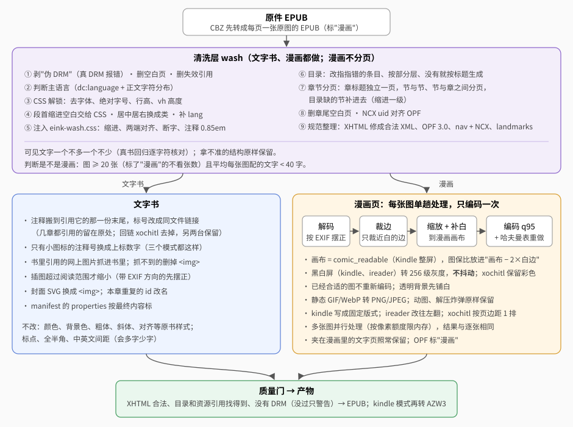
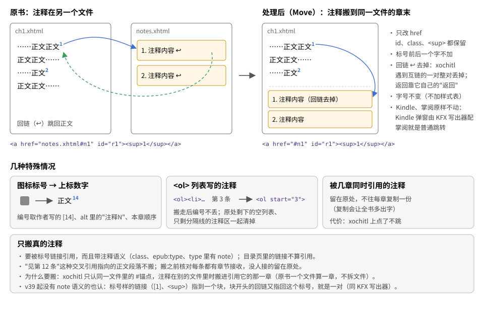
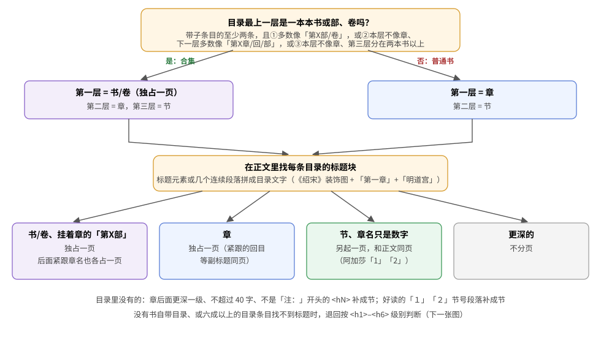
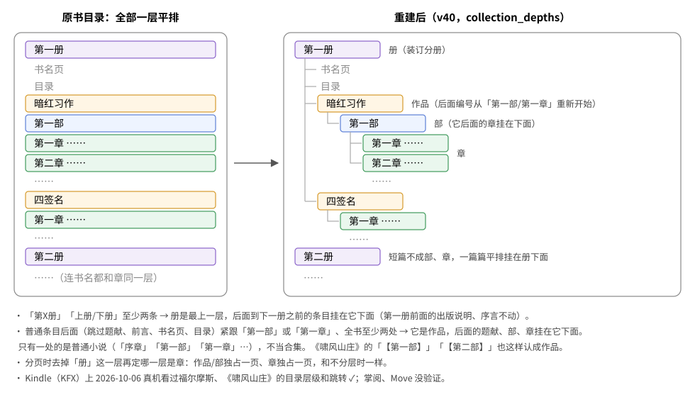
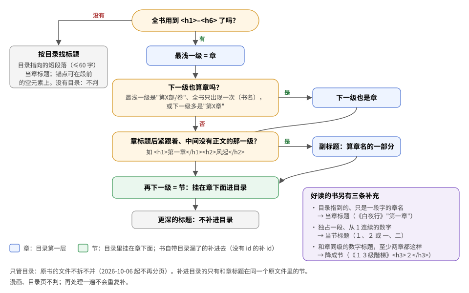
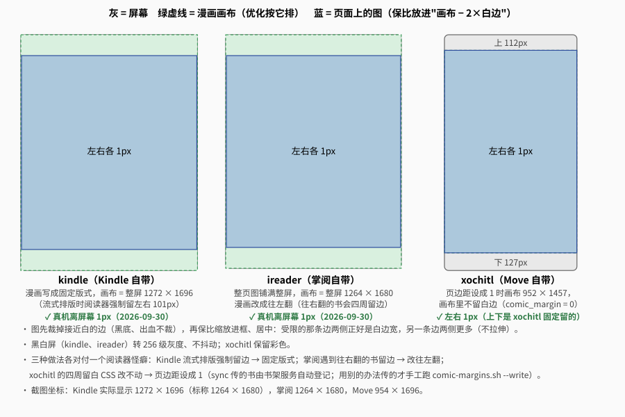

# 排版与优化规则

`booklib sync` 生成时对每本书做了什么、为什么。三个模式用同一套代码，差别都写在模式的配置（profile）里，字段见[设备与阅读模式](devices.md#怪癖--字段)。实现在 `crates/bookconv`：清洗层 `wash/`、优化器 `optimize/`、图片 `imgopt.rs`。

## 现在每个模式做什么

| | Kindle（`kindle`） | 掌阅（`ireader`） | Move（`xochitl`） |
|---|---|---|---|
| **文字书** | [只修复](#只修复三个模式的文字书)，再由 KFX 写出器照 [Send to Kindle 的规则表](kfx.md#send-to-kindle-的样式规则)转成 KFX | 只修复 + [照 Send to Kindle 的规则统一](#照-send-to-kindle-的规则统一掌阅move) | 只修复 + 照 Send to Kindle 的规则统一 + [保证注释能点](#move保证注释能点) |
| **漫画** | [完整处理](#漫画)，写成固定版式 KFX | 完整处理，照书的方向翻，[中间调加深](#中间调加深掌阅move) | 完整处理，按页边距 1 排、保留彩色，黑白页中间调加深 |

- 文字书「只修复」是 2026-10-08 用户定的（profile `text_repair_only`，[决定记录](decisions.md#2026-10-08)）：**书里的文字、图片、格式、样式一概不动**，只修 EPUB 规范层面的错和目录。例外：掌阅、Move 上灰度插图的中间调加深（2026-10-16，见[中间调加深](#中间调加深掌阅move)）。
- 以前文字书走「完整优化」（解锁字体字号、按语言排版、注释弹窗、缩图……）。这些规则留在代码里，内置模式的文字书不再用，见[留在代码里、内置模式的文字书不用的规则](#留在代码里内置模式的文字书不用的规则)；漫画书仍走完整流程。
- `kindle` 模式最后把 EPUB 转成 KFX（文字书流式、漫画固定版式，见 [KFX](kfx.md)）。

## 底线

- **不改书的内容**：文字一个不多、一个不少；图片还是原来那张，只为适配屏幕缩放（例外：掌阅、Move 上灰度的漫画页、插图[加深中间调](#中间调加深掌阅move)，用户 2026-10-16 真机比过后定的）；作者的强调（颜色、加粗）保留。
- **拿不准就不动**：只处理能确认的情况，认不出的结构原样保留。
- **以真机为准**："规范允许"不等于"阅读器能用"；一台上验证过的不能推到另一台（见[验证情况](#验证情况)）。

改了影响正文的规则，要按[开发 · 真书回归](development.md#真书回归)用全部测试书回归。

## 文字书

### 只修复（三个模式的文字书）

代码在 `wash::repair_entries`（清洗层）和 `optimize/streaming.rs`（文字书换成只修复的选项）。做的只有：

- 不是 UTF-8 的 XHTML、OPF、NCX（GBK、Big5、UTF-16）按 BOM 或声明的编码转成 UTF-8，声明跟着改，字一个不变；认不出编码、解码出错的不动（2026-10-09，`wash::encoding`；测试书里没有这种文件，产物不变）；
- 语言标错的改正（2026-10-19，v60，`wash::lang`）：按正文的字判，OPF `dc:language`、`<html>` 的 `lang`/`xml:lang` 和正文对不上的改成判出来的（《福尔摩斯探案全集》OPF 写的 `en`、《狼厅》正文文件 `lang="en"`），拿不准的不改；缺的照旧在规范整理里补；
- 伪 DRM 剥离；文件名里有安卓存储不能用的字符的改名（链接跟着改，见[其它修复](#其它修复)）；
- 指向书里不存在的文件的引用去掉（``、`@font-face` 的 `url()`——文件本来就没有，显示不出来）；
- 一个标签上重复的 `id` 合并、跨文件重复的 id 改名（指向它的链接跟着改）；NCX 的 DOCTYPE、manifest id、`dtb:uid` 修正；
- [章节与目录](#章节与目录)：指错位置的改指、分部重建、没有目录的按标题生成、按目录层级定章节、漏掉的节补进目录；
- [EPUB 3 规范整理](#epub-3-规范整理)（XML 不允许的控制字符去掉——本来就不显示）；
- 网上的图按原图收进书里（不缩），抓不到的 `` 留着（完整优化时是删掉，见[其它修复](#其它修复)）；
- Move：WebP 无损转成 PNG（Move 不认 WebP，2026-10-19，v61，profile `webp = false`）：改名 `.png`，引用、`media-type` 一起改，像素不变；动图取第一帧（v62，用户定，同掌阅）；
- 掌阅、Move：正文里的灰度插图[加深中间调](#中间调加深掌阅move)（2026-10-16，v59）。

**不做**：解锁字体字号行高、按语言排版、注释搬家和弹窗、图标注释号换数字（Move 除外）、删空白页和章尾空白、封面 SVG 换 ``、插图缩放和重压、背景图、`rgba()`、图注宽度、透明图合成白底。这些规则当初都是真机看到问题才加的，现在那些问题会回来（例：掌阅 `rgba()` 声明作废、Kindle 正文透明 PNG 显示成黑底、带图注的竖长图和图注不同页；Move 上段首缩进、居中只认外链样式表，xochitl 不认行内样式和 `<style>`）。用户 2026-10-08 问的时候列过这些代价。

真书回归（2026-10-08）：21 本文字书的样式表、图片、字体对原书逐字节相同（只差去掉的坏引用和改了名的文件），每个 XHTML 可见文字逐字相同（只差《金庸全集》一个 U+0010）、标签和属性除 id 外相同；Kindle 的 21 本都能转成 KFX；Move 全书字符账只多了图标注释号换的数字。

### 照 Send to Kindle 的规则统一（掌阅、Move）

profile `kindle_rules`（`wash::kindle_rules`、`bookconv::uastyle`、`bookconv::color`）。2026-10-08 用户定「三台统一是一套规则」：Kindle 那边由 KFX 写出器按规则表排（[KFX · Send to Kindle 的样式规则](kfx.md#send-to-kindle-的样式规则)），掌阅、Move 的书里只改其中**会让 Kindle 和按 CSS 排的阅读器看起来不一样**的几条。只改值、删声明，不加选择器，文字不动；行内 `style` 同样处理。这是「不动样式」的例外。

| 规则 | 怎么做 | 起因 |
|---|---|---|
| 标签的缺省样式 | `
`、`<dl>`、`<pre>` 上下 1em；`<blockquote>`、`<figure>` 上下 1em、左右 40px；`<h1>`–`<h6>` 粗体、字号 2/1.5/1.17/1/0.83/0.67em。写成 `eink-ua.css`，每章 `<head>` 里第一个挂，书里写了的照样盖过它（`uastyle`，和 KFX 写出器同一张表） | 丢了样式表的《绝叫》在掌阅上段与段挤在一起（掌阅给 `
` 的缺省外边距是 0），Send to Kindle 版有段距 |
| 正文字体用阅读器的字体 | 正文字体（全书层叠、按块统计字数最多的计算字体，`kindle_rules::book_facts`，和 KFX 写出器同口径）的 `font-family` 整条去掉；改完自查，删掉后露出来的被盖住的字体一并去掉（`exposed_fonts`，《嘯風山莊》） | Kindle 写 `default`，用阅读器设置的字体 |
| 字号按正文归一 | 全书正文字号（按块、按字数最多的计算字号，`kindle_rules::book_facts`，层叠和 KFX 写出器同一套 `bookconv::cascade`）不是 1em 时，所有字号乘 1/正文字号：相对字号（em、%）乘在 `body` 上（书里 `body` 的字号直接乘，没写的 `eink-ua.css` 补一条 `body{font-size:…%}`），绝对字号（pt、rem 这些）按 CSS 换算折成 `px` 再乘（正文已经是 1em 的也折）；`html` 上写了字号的书不动，关键字、`calc()` 不动（KINDLE_RULES 5，2026-10-10） | Kindle 拿阅读器的字号设置当正文；掌阅、Move 按书里写的，正文 1.25em 的《疯探》比别的书大。掌阅真机（2026-10-10 测试书）：认 `body` 上的字号、不认 `html` 上的；`px` 是 16px＝阅读器字号、跟着字号设置变、不受 `body` 和父元素影响；`pt` 按 px 的数算（12pt 只有 0.75 倍，《疯探》的 15pt 原来只有 0.94 倍）；`rem` 跟着 `body` 缩——只有 `px` 靠得住 |
| body 左右边距不要 | 只选 `<body>` 的规则里的左右外边距、内边距去掉；有块的计算外边距是负的（同 KFX 写出器）的文件字数占多数时，那一侧照留 | Kindle 不写 body 左右边距（负外边距那侧按文件定） |
| 阅读器不认的颜色写法（掌阅，profile `css_rgba = false`） | 规则、行内样式里的 `rgba()` 按白底合成不透明色（`cssunlock::rgba_to_opaque`；KINDLE_RULES 8） | 掌阅 `rgba()` 整条作废：《飘》「第一卷」标题的半透明白条没了，字压在插图上看不见（2026-10-12 测试书、真机 ✓） |
| 阅读器会平铺的背景图（Move，profile `background_no_repeat = false`） | **整页背景图做成整屏大小的一块**（KINDLE_RULES 10，`bgfit::plan_tiles`、`imgopt::page_tile`）：规则选择器是 `body`（或只用在 `<body>` 上的类）、一张图、写了不平铺、尺寸是 `cover`/`contain`/`100%`/没写、位置是关键字或百分比，图只这样用（没有页面用的模板规则不算），就把图改成 954×1696：左上角 842×1455（内容区）照 Kindle 画——背景色铺底，图按尺寸、位置相对内容区画（`cover` 超出的裁掉，没写尺寸的按 Kindle 上原图大小折算），其余白色；规则照留。JPEG、PNG 才做，图解不开时写一块只有背景色的。整页只有一个块的（卷首、标题页），定位范围是 Kindle 上 body 盒子的高（到那一块的下外边距为止，按内容区高折过来；`cover` 照整页，KINDLE_RULES 12）。别的写了不平铺的背景图照旧去掉，背景色照留，本来就平铺的照留（KINDLE_RULES 8） | xochitl 不认 `no-repeat`、尺寸、位置，大图偏到一边被裁、小图铺满一页（2026-10-12 测试书）；去掉以后《飘》「第一卷」的插图在 Move 上没了（用户 2026-10-12）。量出来的平铺规矩见 [xochitl · 图片](xochitl.md#图片)；《飘》真机 ✓（插图贴内容区底边、满宽，同 Kindle） |
| 大段上外边距排不下就换页（掌阅、Move） | 照 Kindle 的尺寸估算（一 rem 竖直 52.5px，文字按字数估行数，图片按 Kindle 上的显示大小），从文件开头、强制分页起累加；上外边距至少页高 1/4 的块「已排 + 边距 + 自己」超过一页的 90% 时，在它前面强制分页、上外边距写 0（类 `eink-pb`，`eink-pb.css` 写 `html body 标签.eink-pb`；行内 `style` 另接一份）。我们垫的页首空白图不算（KINDLE_RULES 18，`wash/break_margin.rs`） | Kindle 放不下时把块挪到下一页、丢掉那段边距（《飘》Send to Kindle 样本：二维码换到下一页页首）；掌阅、Move 照加边距，二维码推到页底、字掉到下一页 |
| 只有空白的段落折成下一块的上边距（掌阅、Move） | `
&nbsp;
`、`
　
`、`
 
`、块之间单独的 ` `（Kindle 不出节点的那些，写出器 12）：掌阅加类 `eink-blank`（`display:none`），Move 去掉元素（不认 `display:none`，用户定）；接住的那一块加类 `eink-gN`，上外边距写成 Kindle 上折叠后 + 0.6 × 空段行高（`em`，再照竖直间距换算；`eink-blank.css`，掌阅认的行内样式里另接一份）。文件末尾的空段只藏起来；空段里有 `id`、负外边距、同一层后面没块而文件后面还有内容的不动（KINDLE_RULES 19，`wash/blank_fold.rs`） | 2026-10-13 测试书「测试-空段」：Kindle 上空段只空 0.6 行，掌阅一个 `&nbsp;` 空段多 38px、`
 
` 多 97px，Move 多 88px、`
 
` 排成两行多 138px、全角空格的空段一点不空；`height`、`max-height`、`font-size` 两台都不认，`display:none` 只有掌阅认。改后两台和 Kindle 换算值差 ≤1px（Move 141/141、掌阅 158/157）。25 本里 10 本有（《三体》585 处） |
| 块末尾的 ` `（Move） | 块里最后的 ` `（后面到块结束只剩空格换行，可以套在行内元素里）去掉；有 `id` 的、块里套着块的、`pre` 里的不动（KINDLE_RULES 20，`wash/blank_fold.rs`） | Kindle（写出器去掉块文字末尾的换行）、掌阅不排，Move 多排一行（2026-10-13「测试-末尾br」）；《狼厅》759 处、《三体》110 处 |
| 行距照 Kindle 归一（Move，profile `line_height_except_p`） | 全书正文行距照写出器算（每段字按所在块的行高计字数取最多的，没写 1.2，不在 1–3 之间用 1.2）；自己排字的块（`
` 也算：Move 上的现值只算行内写的，没写是 1，KINDLE_RULES 26）（字直接在里面或在行内元素里）在行内 `style` 末尾接 `line-height:本元素行高 ÷ 正文行高`（没写按 1.2，下限 0.6），和 Move 上本来的（自己写的照写，继承的照继承，改过的往下继承改后的，`normal` 是 1）差不到 0.01 的不写（KINDLE_RULES 20，`wash/block_style.rs`，2026-10-13 用户定） | Move 只有 `
` 不认行距，别的块按阅读器缺省行距的倍数认（「测试-行距」）；正文写了行距的书，标题、div 在 Move 上比 Kindle 疏（《三体》body 1.618：标题两行 179px，Kindle 换算 123，改后 110）。23 本里 20 本有改动（《绍宋》441 处、《雪国》333 处）。`
`（2026-10-13 探针 Q83：Move 认行内写的）：10 本有改动，多是单独写了行距的段落（《张居正》引文 1017 处、《嘯風山莊》437 处）；测试书真机外链 `line-height:1` 的段落一行 56 → 35px、行内 `2` 的 112 → 69px，同 Kindle 换算 |
| 块宽度、负外边距、列表项和单元格、行内元素的边距（KINDLE_RULES 28，`wash/box_fix.rs`） | Move（profile `block_width = false`）：定了宽度的块按 Kindle 上能用的宽（内容区减祖先的左右外边距、内边距）折成左右外边距，`margin:auto` 两边居中各一半、只有左边 auto 的放左边、别的放右边，左右有框的照样包框。Move（`negative_margins = false`）：页中间相邻两块之间带负外边距的（折叠链上的拿不到时用两块自己的），照 Kindle 折叠后的间距写成两边非负的外边距，叠在一起的写 0；页首的由垫图管。Move（不认内边距）：列表项的上下内边距并进外边距（带背景色、上下边框的不动）。两台（px 是屏幕像素）：单元格上 px 的内边距四边一起折成 em（行内的删掉）；掌阅另把行内元素、图上 px 的左右内外边距折成 em（Move 一概不认，不改） | 2026-10-13 探针 Q88–Q99 两台量：掌阅行内元素、图、列表项、单元格的内外边距都认、px 是屏幕像素；Move 行内元素和图的边距一概不认、列表项内边距不认外边距认、单元格内边距认。优化后的测试书两台真机：行内 30px 掌阅挪 43（换算 42）、Move 列表项内边距 2em 挪 99（同外边距）、单元格 30px 两台都挪 42/43，上内边距掌阅 65、Move 55（换算 64、56）；《嘯風山莊》年表单元格有了内边距。Move 6 本、掌阅 6 本有改动 |
| 没有项目符号的列表项、单元格竖直对齐（KINDLE_RULES 29，`wash/box_fix.rs`） | Move（不认内边距）：`list-style-type:none`（含继承的）或 `display` 不是 list-item 的列表项，左右内边距并进外边距（有符号的不并）。Move（profile `cell_middle = false`）：一行两格以上、Kindle 上居中（单元格自己没写或写了 top/bottom 以外的值，同 KFX 写出器）而没写 `middle` 的单元格，行内接 `vertical-align:middle`（压过书里 `tr`、类规则的） | 2026-10-14 探针 Q100–Q124（两台）：单元格缺省顶端对齐、`middle` 认（两台一样，掌阅也写）。《海葵》目录页（`li{list-style-type:none;padding-left:2em}`）真机挪 76px（换算 75.6）；优化后的测试书两台没写的单元格同 middle。Move 只《海葵》变（测试书里多格的行都自己写了竖直对齐） |
| 行高照 Kindle 显示的值；Move 横线、空白页（KINDLE_RULES 34） | 照 Kindle 写行高时取 Kindle 显示的值：KFX 里低于 0.744 的行 Kindle 排成 0.744 倍（`kindle_model::shown_line_height_ratio`）。Move：插了下边框横线图的块行距不低于 1、写在行内（profile `line_height_floor`）；文件开头的块上的强制分页行内接 `page-break-before:auto`；往行内 `style` 接声明时不再把 `&quot;` 的分号去掉（`html::style_base`，7 处） | 2026-10-15 三台抽样《人生海海》《三体》《ABC》《绍宋》章首 + 探针 Q135–Q145。《人生海海》第一章「第一章」下沿到首段（字高倍数）：Kindle 8.1，Move 改前 6.6、改后 7.3（用户：肉眼基本分不出）；版权页、目录标题的点线不再压字，「第一部」前不再多一页空白、字号居中照 Kindle。掌阅 2 本、Move 7 本变（相对 33 版另外 14 本是行高下限），文字逐字一致、目录不变；unify 全部 ≥ 99.5% |
| Kindle 上不出页的空页、带框的列表、页首的上横线（KINDLE_RULES 35，`wash/empty_pages.rs`、`wash/box_fix.rs`、`wash/top_spacer.rs`） | 两台：没有看得见内容（不隐藏的字、图片这类媒体、带背景的元素）的页 Kindle 写出器不出版面，去掉、链接改指下一页（`remove_kindle_empty_pages`）。Move：左右有框的 `ol`/`ul` 包进单格表格（列表左右内边距留给符号，单元格只写上下的）；页首的块上边框也插横线图，页首垫图减去横线图的高（`box_fix::page_top_rule_px`，两边共用；块里有行内垫图的不插） | 2026-10-15 版式检查 `tools/kfx/layout.py` 查出：《疯探》`blank.html`、《雪国》注释列表的虚线框（12 处）、《人生海海》三部、《平凡的世界》作者简介和卷名上的线。真机：掌阅《疯探》「重要声明」后直接是「目录」；Move《人生海海》「第一部」、《平凡的世界》「卷一」上下两条虚线都在、《雪国》注释框画出来了（单元格写回外层字号：书里 `td{font-size:0.6em}` 落在我们的表格上，注释字只剩六成，unify 查出来的）。页首垫图前面什么都没有的空元素（`

`，写出器不出节点）照 Kindle 不算（`top_spacer::kindle_nothing`；以前整章不垫），垫图也带 `eink-sp` 类，目录修复不把它当内容（`toc.rs::strip_spacers`，「第二部」前垫了图目录曾改指不过去）：Move《人生海海》「第一部」页，内容区高比例 上线 9.3%、标题 17.7–24.0%、下线 31.7%，Kindle 8.1%、18.4–25.8%、36.9%（标题和线之间的间距差 2–3%：Kindle 行高下限 0.744 加内边距，Move 行距不低于 1，没再追）。《梁羽生》卷名前多一页空背景（33 版就有）：页首块上内边距很大（> 3 rem）时上横线图只画线（`box_fix::page_top_rule_px`/`big_top_pad`），距离只由垫图出；Move 上 HTML 属性 `width="80%"` 的图（《梁羽生》作者页）写成 CSS 类（`kindle_images` 的 `attr_percent`，Move 不认属性；掌阅没量过，不动）。回归：掌阅 1 本、Move 多本变（垫图类名变），文字逐字一致、目录不变，unify 不变差，版式检查两台清零 |
| 只有小图的页去掉强制分页（OPTIMIZE 58 / KINDLE_RULES 37，`wash/break_margin.rs`，三台一并） | 强制分页后的页里只有 Kindle 上小到几乎看不见的图（高不到内容区高 5%）、紧接着的块又被挪到下一页（上外边距放不下）：这页在 Kindle 上是只有一个小点的空白页（《飘》《春雪》版权页后 `page-break-before:always` 的 20×20 小图，再接 `margin-top:55%` 的二维码）。去掉前面的强制分页（行内末尾接 `page-break-before:auto`），小图并到版权页底部，二维码仍单独一页（用户 2026-10-15 要去掉；选「去掉小图页、二维码单独一页」）。Kindle 在 `repair_entries` 里只做这一项（`WashOpts.tiny_page`），掌阅、Move 连同分页估算一起做 | 回归：Kindle、掌阅、Move 只《春雪》《飘》上下册变，文字逐字一致、目录不变，unify 不变差，版式检查清零；三台真机待看 |
| Move 上窄的定宽块（卷名竖排）和字号无关（KINDLE_RULES 38，`box_fix.rs` 的 `narrow`、`frame_open`） | 定了宽度、占能用宽 30% 以内的块（《梁羽生》卷名 `width:1.2em`、只有左边 auto 靠右）不再折成 em 外边距（阅读字号调到 0.8，外边距小了 143px，框宽出 4 个字不再竖排），包进单格表格、表格 `width` 写占外层的百分比（Kindle 上的宽 ÷ 能用宽）、靠哪边写 `align`，外层 div 只留块自己的外边距，块的边框、背景色、内边距写在单元格上（带背景图的也包，色画在单元格上）。表格不会窄过最宽的一个字，一字宽的竖条和字号无关 | 2026-10-15 真机：测试书「测试-宽度表格」4 种写法字号 1.0 都竖排、0.8 下只有 em 外边距那种变成 4 个字一行；精简《梁羽生》字号 1.0、0.8 卷名都是竖条，带边框的青色横幅画出来了（原书设计），作者介绍页 0.8 下一页放下 |
| 标题的 `float`、只有左边 auto 的定宽块、页首的负上外边距（KINDLE_RULES 33，`wash/box_fix.rs`） | Kindle 不浮动、只有左边 auto 的定宽块靠右（写出器写块的对齐）、页首块的负上外边距把盒子推出页面（看不见的那截不占地方）。掌阅（profile `float`）：标题上的 float 写成 `none`（段落上的也是，KINDLE_RULES 39，2026-10-16 探针 Q148，《梁羽生》版本号真机 ✓）；只有左边 auto 的不再写成 0；页首负上外边距配上内边距的写成上外边距 0、上内边距减去推出去的。Move：只有左边 auto 的定宽块折外边距时多出来的放左边；标题上写的 em 换成按根字号的（`root_em` 不管标题）；包成单格表格画框时单元格的上内边距减去负的上外边距 | 2026-10-14 三本武侠全集体检、探针 Q132–Q134 三台真机。《梁羽生》卷名「女帝奇英传」：Kindle 靠右竖排窄条一页放下；改前掌阅拆三页、Move 横排，改后两台都是靠右竖排、一页放下（Move 字小些：标题字号只认关键字）。掌阅 6 本、Move 4 本变（《ABC》《帷幕》《罗杰疑案》章名页首 `margin-top:-2em;padding-top:3em` 合并成 1em；《绍宋》「内容简介」竖排标题靠右），文字逐字一致、目录不变 |
| 单元格宽度、定宽块的 `margin:auto`（KINDLE_RULES 31，`wash/box_fix.rs`；30 写过 Move 的单元格 `width` 属性，撤了） | 单元格的宽度两台照 Send to Kindle 的算法（`kindle_model::column_percents`：写了的宽度 ÷（写了的 + 没写的格的自然宽度））写成百分比：掌阅（profile `cell_width = true`，CSS、属性都认、`width:auto` 不认）写行内 `width:P%`、属性删掉，Move（只认属性）写 `width="P%"`。定宽块的 `margin:auto`：掌阅（`margin_auto`）左边的 auto 写成 0，Move（不认块宽度）折外边距时多出来的都放右边。另：首行缩进 px 按 0.45pt（层叠里改，掌阅折 em 跟着对）、`font-size:large` 1.125；Move 改写成关键字的标题在 `data-eink-fs` 记下 Kindle 上的字号，后面照 Kindle 算位置的 pass 按它算（以前按关键字的 CSS 字号近似，标题前后的间距差几个百分点） | 2026-10-14 Kindle 对照：Send to Kindle 的单元格宽度写成列宽百分比、字横排（Q127–Q129 真机），定宽块 `margin:auto` 不居中（Q124 真机）。优化后的测试书两台真机：Q124 靠左、Q127/Q129 横排（第一格变宽，Move 的比例同 Kindle，掌阅宽一点）、掌阅 Q16 首行缩进 30px 挪 43（换算 42）。Move 19 本、掌阅 6 本变，文字逐字一致、目录不变 |
| 图片的行内宽高（KINDLE_RULES 31，`wash/kindle_images.rs`） | 给 `` 加按 Kindle 折的类时，行内 `style` 里的 `width`、`height`、`max-*`、`min-*` 去掉（两台都认行内样式、压过类规则；以前以为 Move 不认行内样式） | `unify.py` 查出：《克莱因壶》`style="width:12em"` 的图 Move 拉满一行（Kindle 42%），《狼厅》`style="width:769px;max-width:428px"` 的 7 张图掌阅占 66%（Kindle 满宽）。探针 Q130、Q131 优化后两台真机：Move 42.5%、满宽；掌阅满宽（Q130 掌阅照 em 39%，em 写的图不改，同 9 版）。Move 3 本、掌阅 2 本变 |
| Move 左右边距按页宽、body 边距逐文件（KINDLE_RULES 31，用户选） | Move（profile `horizontal_scale`）：最后一步（同竖直换算）把全书样式表、`<style>`、行内 `style` 里左右外边距、内边距的 em、pt 乘「一行的 em 数 ÷ 32」（842 ÷ 37.8 ÷ 32 ≈ 0.70），负的首行缩进跟着乘、正的不动、px 不动；`box_fix` 折出来的左右长度（% 外边距、定宽块、包框的单元格内边距）先按 Kindle 的口径写（`BoxGeometry.h_scale`），乘完正好是占页宽的比例。两台：body 的左右边距按文件——`book_facts` 记下每个文件有没有这一侧的负外边距、body 原来的边距，和全书多数不一样的文件 body 加 `eink-bm*` 类，`eink-body.css` 写 0 或原值（`kindle_rules::per_file_body_margins`） | Move 测试书真机：Q09/Q12 2em 挪 52px（Kindle 6.25% 页宽换算 52.6，以前 76）、Q14/Q71 悬挂缩进第一行对齐。`unify.py`：《帷幕》掌阅 92.1% → 99.8%，《ABC》《帷幕》《罗杰疑案》Move 83% → 99.5%–99.8%。Move 26 本、掌阅 9 本变，文字逐字一致、目录不变 |
| 行内元素的上标下标（掌阅，profile `inline_valign = false`；KINDLE_RULES 29，`wash/sup_sub.rs`） | 写了 `vertical-align:super/sub`（`top`/`text-top` 同写出器算上标）的行内元素，里面整个包一层 ``/``：元素（`<a>` 注释链接、类、行内样式）和字不动；元素自己写了字号的包的这层写 `font-size:100%`（同 `` 作者字号盖过标签缺省）；外层已经是上标下标的、块、空的不包 | 掌阅 `span` 上的不认、`` 标签认（Q100、Q101、Q120–Q123）；Kindle 写出器两种写法写成同一个值。优化后的测试书真机 Q100 同 ``。掌阅 3 本变：《杀死一只知更鸟》69 处、《占星术杀人魔法》32 处、《恶女的告白》21 处，文字逐字一致。顺带：找闭合标签改认嵌套（`html::find_matching_close`，`box_fix` 包框、下边框横线图同样改用；测试书里没有套同名块的，产物不变） |
| 行距照 Kindle 写成 em（掌阅，profile `line_height_numbers = false`、`line_px`） | 全书正文行距同上；样式表、`<style>`、行内 `style` 里 em、%，和倍数（÷ 正文行距，下限 0.6）不是 1 的数、`normal` 改成「Kindle 的倍数 × 缺省行距（58/37.5 ≈ 1.5467）」em，`<body>` 上倍数是 1 的数不改（掌阅当没写就是缺省行距，还随字号缩放）；剩下从祖先继承来的、和 Kindle 差 5% 以上的块（`
` 也算）在行内接 `line-height:Nem`（KINDLE_RULES 25，`wash/block_style.rs`） | 掌阅不认不带单位的行距（`normal` 也算），长度照排（「测试-怪癖-掌阅」Q80–Q84）：正文写 1.84 的书标题、小字块在 Kindle 上收紧、掌阅上是缺省行距；正文写 `1.8em`、`130%` 的书掌阅照写的排，Kindle 是阅读器行距。改后《飘》正文一行 69 → 58–60px（掌阅缺省，同 Kindle 用阅读器行距）、772 页变 681 页，真机 ✓。23 本里 19 本改了样式表，行内只补标题之类（最多《疯探》95 处）。写成长度后掌阅里改行距设置这些块不跟着变 |
| rem、`!important`（掌阅，profile `rem`、`important` = false） | 字号以外的 rem 改成 em（Kindle 的层叠也按本元素 em 算），字号的折成 px（16px 一 rem）；`!important`：先按 Kindle 的层叠和去掉以后的层叠（`Sheet::cascade_flat`）逐个元素比，不一样的属性把 Kindle 的值接进行内 `style`（值里有 `url()` 的不接），再把全书的 `!important` 去掉；在 `kindle_rules` 之后、别的 pass 之前做（KINDLE_RULES 25，`wash/css_compat.rs`） | 掌阅 rem 整条当没写、带 `!important` 的声明一概不起作用（Q28、Q53、Q85、Q86）。《克莱因壶》首行缩进（`2rem`）、引文署名靠右（`!important`）真机 ✓；《春雪》《飘》注释链接的 `text-decoration:none!important` 生效 |
| 标题字号写成关键字（Move，profile `heading_font_keywords`） | 每个标题取 Kindle 上的字号（标题里的字按所在元素的计算字号计字数取最多的；`kindle_rules` 已照正文归一），挑比例最接近的 `small`/`medium`/`large`/`x-large`/`xx-large`（Move 上量的 0.784/1/1.216/1.514/2.018），和 Move 上本来的（写了认的关键字照写的，没写照标签固定的）不同就在行内 `style` 末尾接 `font-size:关键字`（KINDLE_RULES 21，`wash/block_style.rs`） | xochitl 的标题只认这几个关键字（「测试-标题字号」）；23 本里 18 本有改动（《绍宋》436 处、《平凡的世界》163 处 2em 的章名）。《平凡的世界》章名、《飘》「第一卷」真机 ✓ |
| 行内 style、`<style>` 里的 em 挪进外链（Move，profile `inline_css_lengths = false`） | 写了 em 的 `<style>` 内容挪进和这一章同目录的外链 `eink-style-<哈希>.css`（原位置换 `<link>`，`media` 照带，内容一样的合用一份）；行内 `style` 里写 em 的外边距、内边距、首行缩进、字号、字距（`font-size` 还有 %）搬进 `eink-inline.css` 的 `html body 标签.eink-iN{… !important}`（行内元素上的首行缩进、`font-size:1em` 这种不起作用的不搬，标题的字号不搬）；外链规则最后一条写 em、不带分号、紧挨着 `}` 的补分号（KINDLE_RULES 22，`wash/inline_css.rs`） | xochitl 这几种写法走另一套解析：em 按 23px、字号和首行缩进的 em 不认（「测试-怪癖」）。23 本里 6 本有改动；《狼厅》每章 `<style>` 的首行缩进真机 ✓（以前没有缩进），优化过的怪癖测试书真机：行内、`<style>`、紧挨 `}` 的写法都和外链一样 |
| 内边距、边框、标题外边距照 Kindle（Move，profile `padding`、`borders`、`heading_margins` = false） | 左右内边距并进同侧外边距（悬挂缩进跟着对；带背景色、背景图的块、表格、列表、`margin:auto` 那一侧不动）；同一层相邻两块之间的距离照 Kindle（外边距折叠 + 前一块下内边距 + 后一块上内边距，横线图里画了的不算）写到 Move 认的一侧（后一块不是标题写它的上外边距，是标题写前一块的下外边距；两块都是标题、空块、垫图、页首的标题、有子块又有内边距的不动）；看得见的上下边框在块里最前、最后插同色同粗的横线图（实线 / 点线 / 虚线，连着的内边距画成透明的一截，`eink-rule-N.png`；文件开头的块不插上边框）；规则在 `eink-box.css`（`!important` 类规则），竖直的写 em 再照竖直间距换算（KINDLE_RULES 23，`wash/box_fix.rs`） | xochitl 内边距不认、边框不画、标题外边距不认（「测试-怪癖」）；用户选「上/下边框插横线图」。23 本里 20 本有改动（多是标题后的间距）。优化过的测试书、《罗杰疑案》《平凡的世界》《帷幕》真机 ✓（没和 Kindle 截图逐像素比，按模型换算）。**左右竖线、表格线**（KINDLE_RULES 27，用户选）：左右有看得见边框的块（全框、单边；定了宽度、居中、有背景图的除外）外面包 `
<table class="eink-frame" cellspacing="0" width="100%"><tbody><tr><td style="…">`，书里有的那几边写成单元格行内的边框（粗细照横线图折成屏幕像素、颜色、点线虚线照书），块的内边距写成单元格的内边距、背景色写到单元格，左右外边距写在外层 div 的类规则（表格行内的外边距、宽度会和书里 `table{margin:0 auto}` 搅在一起）；前后的间距同标题写到相邻的块。书里表格、单元格看得见的边框照写进行内、表格加 `cellspacing="0"`。xochitl 普通块的边框外链、行内都不画，只画表格、单元格行内 `style` 写的（外链、类规则里给表格写的不认；单元格里块的外边距、背景色不认；「测试-竖线」1–10）。Move 6 本有改动；《雪国》制作说明框、《风起陇西》版权框和制作说明框、《恶女的告白》注释左竖线、《嘯風山莊》年表真机 ✓ |
| 左右外边距的 px、% 照 Kindle（掌阅 profile `px_margins = false`；Move `px_margins`、`percent_margins` = false） | 块上 px 写的左右外边距按 Kindle 的 0.45pt 一 px 折成 em，Move 上 % 写的按内容区宽折成 em（行内元素、图、表格、列表、`margin:auto` 那一侧不动）；改到的元素行内的外边距删掉、值并进类规则（行内的压过样式表，Move 连外链的 `!important` 都压过）；`eink-box.css` 不写 `!important`（KINDLE_RULES 24，`wash/box_fix.rs`）。掌阅上块的 px 左右内边距（0.45pt）、首行缩进（0.75pt，同写出器）也折成 em（KINDLE_RULES 25；测试书真机：40px 内边距和 1.5em 都在 106px，30px 首行缩进和 1.875em 都在 121px）；Move 上 px 的首行缩进同样折成 em（KINDLE_RULES 40，2026-10-16 探针 Q151：《古龙》居中章名 48px 原来只挪 24px，优化后探针真机 PDF 挪 34px，同计算；《古龙》正式产物 40 版真机只挪 12px：章名还有行内样式，按根换算的 1.8em 写在 `eink-inline.css`，Move 上输给 `eink-box.css` 里靠后的 1.08em，见 [xochitl.md](xochitl.md) `!important` 一条，KINDLE_RULES 41 修，41 版对照书真机挪 33.5px；41 版正式产物真机 PDF《桃花传奇》章名挪 23px，40 版 12px，这本的根字号约 26–30px，按 1.8em 应挪 23–27px） | 两台的 px 是屏幕像素，Kindle 按 0.45pt；Move 的 % 当 px。掌阅 6 本、Move 8 本有改动（《雪国》段落的 1%、《嘯風山莊》的 px）。测试书两台真机 ✓（50px 都挪 71，Kindle 换算 1.875em） |
| 竖直间距照 Kindle（掌阅、Move，profile `em_px`） | 上下外边距、内边距（分项、简写的上下两个值；书里的和 `eink-ua.css`）改写成占内容区高的比例和 Kindle 一样：`em`、`rem` 乘 Kindle 一 rem 像素 × 内容区高之比 / 这台一 em 像素（掌阅 1.52、Move 1.31），`%`（按 32em 页宽）、`px`（0.45pt）、`pt` 照写出器折成 Kindle 像素再折成这台的屏幕像素；0、`auto`、`calc()` 不动；**最后做**，垫图、背景图位置、图片大小都按原来的 CSS 算（KINDLE_RULES 14、15，`kindle_rules::VScale`、`scale_vertical_entries`） | Kindle 按行距排边距（2026-10-12 测试书：一 rem ≈ 52.5px），两台按字号（≈ 37.5px）；用户定照 Kindle。掌阅把 `pt` 当 px、Move 的 `%` 不对，折成 px 一起修了 |
| 背景尺寸的 `auto` 高（掌阅，profile `background_auto_height = false`） | 整页背景图（同 Move 图块的条件）照 Kindle 上的大小、位置（只有一个块的页面相对 body 盒子）算成屏幕像素，在用它的规则末尾接 `background-size:宽px 高px;background-position:左px 上px;`（KINDLE_RULES 13） | 掌阅 `auto` 高把图拉长到整页高（2026-10-12 测试书）；《飘》「第一卷」插图真机 ✓ |
| 页首的上边距（Move，profile `margin_top = false`） | 每章开头第一个有内容的块和外面套的块：上外边距相邻的合并、上内边距照加，照 KFX 写出器折成 Kindle 上的像素（`%` 按 32em 页宽；竖直一 rem＝Kindle 正文一行 / 1.2，profile kindle `line_px`，KINDLE_RULES 12），按内容区高折到 Move、减去 xochitl 在图后自己加的空，在 `<body>` 开头垫一张透明 PNG（`eink-spacer.png`，宽度百分比写在 `eink-spacer.css`）；前面有空元素的、差不到内容区高 5% 的不垫（KINDLE_RULES 11）。垫不了的（要的比 xochitl 自己加的空还小、或者多得不到 5%），第一块开头是字的在块里最前面放一张极窄的透明图（`eink-strut.png` 1×400），图高＝2 × 要挪的 / (1 + 块在 Move 上的行距) + 44px × Move 上的字号（标题按固定字号；KINDLE_RULES 20） | xochitl 不认 `margin-top`、`padding-top`，页首的空元素不占地方（2026-10-12 测试书）；《飘》「第一卷」顶在页首，真机 ✓ 挪到 Kindle 的位置。行内窄图：《三体》获奖感言标题、《平凡的世界》章名真机 ✓（见 [xochitl](xochitl.md)）；25 本里 11 本用上 |
| 图片尺寸（掌阅 profile `image_sizing = "device-px"`、Move `"percent"`） | 按 KFX 写出器的规则算出每张图在 Kindle 上显示多宽（不写宽度的独立图按原图像素、宽过高过内容区的缩进来；em/pt/px 折成 em；行内图片同写出器；整页单图缩到满页；百分比宽但一页放不下的按一页高缩），给 `` 加类 `eink-iw-…`，规则写在挂在每章最后的 `eink-img.css`（`html body img.类`，不用 `!important`）：Move 一律写成占内容区的百分比；掌阅跟着字号走的写 em、固定的写百分比，本来就一样大的不动（KINDLE_RULES 9） | Move 只认百分比宽度，别的拉满一行；掌阅的 px 是屏幕像素；掌阅不按 `!important` 提优先级、带了反而输（2026-10-12 测试书、诊断书）。`unify.py` 按同一套规矩算各台实际显示的宽度比 |
| 文字对比度至少 4.5:1 | 规则里写了背景色的按它算；没写的按白页面，只调亮度 ≤ 0.5 的颜色；深背景没写文字颜色的补一条（`color::ensure_contrast`） | Kindle 照这个阈值调深/调浅 |
| 补封面页 | 原书只在 OPF 声明了封面图、哪一页都没用到它时，spine 最前面补一页 `eink-cover.xhtml`：SVG 按图的宽高写 `viewBox`、`preserveAspectRatio` 等比放进一页（真书最常见的封面页写法，《人生海海》《罗杰疑案》），不加文字（`wash::prepend_cover_page`；2026-10-09，《绍宋》《狼厅》） | Send to Kindle 给没有封面页的书在最前面补一页整页封面（Kindle 由 KFX 写出器 13 补）；掌阅、Move 打开《绍宋》没有封面（2026-10-09 用户：两台都补） |
| 目录页不进阅读顺序 | 原书 spine 里标了 `linear="no"` 的导航文档（目录页）从 spine 拿掉，文件留在 manifest 里（仍是导航文档）；指向它的 `guide`、landmarks 不动（`wash::opf::nonlinear_nav_itemrefs`；Kindle 由 KFX 写出器 14 同样不排） | 阅读器都不理 `linear="no"`：《绍宋》在掌阅上开头排了 14 页目录，末尾还露出原书标了 `hidden`、`display:none` 的「里程碑 / 目录」（掌阅、Move 两层都不认）。2026-10-09 用户定三台都拿掉，和 Send to Kindle 不同（它保留这页）；阅读器菜单里的目录读的是 nav/NCX，不受影响 |

**没统一的**：行高按正文归一（Kindle 拿阅读器的行距设置当正文行高；掌阅不理书里的 `line-height`、一律用自己的行距设置（2026-10-10 测试书：`p`、`body` 上写 1、1.2、2 都和不写一样），本来就是这样；Move 2026-10-13 起 `
` 以外的块照 Kindle 归一，`
` 不认行距、和正文行距不同的段落对不上）；Move 标题字号只有五档（2026-10-13 起取最接近的）；首行缩进写百分比（只在阅读器字号和 32em 不同时才看得出）（空段折边距 2026-10-13 起统一了，见上表）。三台和 Amazon 样本的逐项一致率见 [KFX · 三台和 Send to Kindle 的一致性](kfx.md#三台和-send-to-kindle-的一致性)。电脑上：21 本测试书在掌阅、Move 两个模式下可见文字逐字一致、目录不变、XHTML 合法，22 本共改了 1700 处声明。真机见[验证情况](#验证情况)。

### Move：保证注释能点

profile `repair_note_links`（只有 `xochitl` 开）。xochitl 只认同一文件里的 `#锚点`，只修复时要不搬注释，跨文件的注释就点不动，所以 Move 另外做这一件事（和完整优化里的注释处理是同一套代码，`htmlproc`），别的都不做。

注释搬到本章末尾，正文里的标号改成同一文件里的锚点。**标号原样保留**：只改链接地址（`href`），原来的 `id`、`class`、外面的 `` 都不动，前后一个字不加。

- **为什么要搬**：原书一个文件算一章（不拆文件，见[章节与目录](#章节与目录)），注释在别的文件里时搬进引用它的那一章末尾。`文件名#锚点` 指向本文件的写法先规整成 `#锚点`。
- **回链**（注释里点一下跳回正文）：去掉（`note_backlinks = false`）——xochitl 遇到互相链接的一对会整对丢掉（正向也点不动），返回靠 xochitl 自己的"返回第 X 页"。
- **只有图标的标号换成上标数字**（`note_icons = "number"`）：xochitl 里只有图、没有字的链接点了没反应，CSS 也限不住图标大小。编号依次取注释开头作者写的 `[14]`、图标 alt 里的"注释N"、本章顺序。这是唯一多出来的字（[决定记录](decisions.md#2026-09-29)）。
- **`<ol><li>` 写的注释**搬走后保留编号（写成 `<ol start=N>`）；原处剩下的空列表、只剩分隔线的注释区清掉。
- **被几章同时引用的注释留在原处**：不然每章复制一份，全书多出字。代价是这类注释在 xochitl 上点了不跳（跨文件链接）。
- **同一章里两条注释 id 相同**时只搬第一条，后面的留在原处（v44；以前只放得回一条，《绝叫》丢过一条注释）。
- 只搬**被引用的注释**：块带注释语义（`class`、`epub:type`、`type` 里有 note），**或者和标号互相链接**——标号样的普通链接（`[1]`、`①`、`` 里的）指到这个块，块开头的回链又指回这个标号（v39，和 KFX 写出器同一个认法；《罗杰疑案》的注释是 `
<a id="zhu1" href="#zw1">[1]</a>…`，没有 note 语义）。块的锚点可以在块自己身上，也可以在段首的 `<a id>` 上。目录页里的链接不算引用；"见第 12 条"这种交叉引用指向的正文段落不搬；没人接收的注释留在原处，不会搬丢。
- 同文件的注释留在原处（已经是同文件锚点）。注释块**不缩小字号**（0.85em 那条样式在 `eink-wash.css` 里，只修复不加这个样式表）。

**Kindle、掌阅的注释**：只修复时原样不动。Kindle 上 KFX 写出器自己按"互相链接的一对"认注释、写成弹窗，注释在别的文件里也配得上（见 [KFX · 注释弹窗](kfx.md#注释弹窗)）；掌阅只认 `epub:type="noteref"` + `<aside epub:type="footnote">` 弹窗，原书没这样写的就是普通跳转（profile 里的 `notes = "popup"` 只在完整优化时生效，见[第 3 条](#3-注释完整优化弹窗小一号)）。

### 章节与目录

三个模式的文字书都做（只修复里唯一会动目录和补 `id` 的一步；补的 `id` 不改显示）。

**不分页，原书的文件结构原样保留**（2026-10-06 用户定，[决定记录](decisions.md#2026-10-06)）：一个 XHTML 文件不拆、不并，章标题和正文是不是同一页由原书和阅读器决定。v46 以前按标题把文件拆开（书/卷、章标题独占一页，节与节之间分页），已撤掉。

**目录不变，至少索引到节**：仍按下面的规则定出书/卷、章、节，目录按这几级嵌套，书自带目录漏掉的节补进去。目录条目原来指向拆出来的文件的，现在指向原文件里那个标题的 `#id`（标题没有 id 的补一个：章 `eink-ch-N`、节 `eink-sec-N`）。目录因此常常跳到一个文件的中间；三台都能准确停在锚点那一页（见[验证情况](#验证情况)）。

- **书里自带的目录页列了的标题也补进目录**（v57，2026-10-15 用户报 Kindle 上《三体全集》目录没有章）：链接文字占大半的页（书内目录页）链到的文件，NCX 没指到、文件里的标题和链接文字一样的，补进目录、挂在阅读顺序上前一条下面。《三体全集》NCX 只有三卷、章名是 `<h2 class="sigil_not_in_toc">`（Sigil 的「不进目录」标记）、每章一个文件，以前被「节要跟所属章标题同文件」（《疯探》附页）挡住，现在 4 条 → 55 条；目录页没列的附页照旧不补。
- **看不见的标题不当章标题**：写着 `display:none` 或 `hidden` 的标题只给目录定位（《绍宋》每章开头的 `<h2 style="display:none;">`，看得见的章名是后面的图和段落），不当章、节，也不补进目录。

**哪一级是书/卷、章、节：按书自带目录的层级**（v38，`wash/chapters.rs` 的 `toc_driven`）。

| 目录 | 判定 | 目录里 |
|---|---|---|
| 书/卷 | 最上一层是一本本书或部、卷（下面挂着章）时的最上一层：带子条目的至少两条，并且多数像「第X部/卷」、或最上一层多数不像章名（第X章/回、序、后记……；阿加莎全集的书名 → 「1」「2」）；章那一层或更深处挂着子条目的「第X部/卷」（福尔摩斯全集《恐怖谷》、《白城恶魔》「第一部 凝固的音乐」） | 最外层，章挂在它下面 |
| 章 | 书/卷的下一层（普通书是最上一层）。章名写成普通段落的也认：在正文里从锚点（没锚点就从文件开头）往后拼标题元素或连续段落，拼成目录文字就是标题块，前面只隔着装饰图的图也算进去（《绍宋》） | 只指到文件、标题却在文件中间的（好读的书名页后面才是「第一章」、合集里书名和第一章在同一个文件），补 id、目录改指过去 |
| 副标题 | 目录里没有、紧跟章标题、中间没有正文的 `<hN>`，**这一级在全书每一处都这样**（金庸的回目）；某一处后面是正文就不是（《射雕》附录 `<h2>` 后面紧跟 `<h4>祖先</h4>` 是第一节） | 算章名的一部分，不另成一条 |
| 节 | 章的下一层；目录里没有、跟在章后面的更深一级 `<hN>`（不超过 40 字、不是「注：」开头——金庸用 `<h5>` 排回末注释）；好读的「１」「２」节号段落 | 挂在章下面一层；目录里没有的补进目录 |
| 更深的 | | 不补进目录 |

- **目录里一层的兄弟条目中有「第X部」而它下面没有子条目时**，把它后面到下一个「部」之前的条目缩进到它下面（`nest_parts_among_siblings`；全书一层平排的另由「分部重建」处理）。
- **只按结构判，纯数字不是节的依据**（2026-10-08 用户定：有的书「1」「2」「3」是章）：章名只是数字的照样是章（阿加莎「1」「2」、《月亮和六便士》「二」）；和章平排的数字条目（《13級階梯》「　　２」）、章里独占一段的「１」「２」（好读）都不当节，目录原样。
- **一层平排的合集目录**（福尔摩斯全集：「第一册」「书名页」「目录」「暗红习作」「第一部」「第一章……」…「四签名」「第一章……」…，连书名都和章同一层）认两种信号（v40，`collection_depths`）：
  「第X册」「上册/下册」至少两条时，各册是最上一层，后面到下一册之前的条目挂在它下面（第一册前面的出版说明、序言不动）；
  普通条目后面（跳过题献、前言、书名页、目录这类）紧跟「第一部」或「第一章」——编号从头开始——全书至少两处时，这样的条目是作品，后面的题献、部、章挂在它下面，到下一个普通条目为止（短篇一篇篇平排在册下面）。
  只有一处的是普通小说（「序章」「第一部」「第一章」…），不当合集。部下面挂着它后面的章。结果：册 → 作品 → 部 → 章。《啸风山庄》的「【第一部】」「【第二部】」也这样认成作品，章挂到各部下面。
  定章节时最上一层带子条目的多数是「第X册」，这一层只是装订分册，去掉它再定哪一层是章。

  

**没有书自带目录、或六成以上的目录条目在正文里找不到标题时**，退回按全书实际用到的 `<h1>`–`<h6>` 判断，见下图和下面几条。

| 角色（退路） | 判定 | 目录里 |
|---|---|---|
| 章 | 最浅一级。最浅一级是"第X部/卷"、全书只出现一次（书名），或下一级多是"第X章"时，下一级也算章 | 一条 |
| 副标题 | 紧跟章标题、中间没有正文的那一级（`<h1>第一章</h1><h2>风起</h2>`） | 算章名的一部分 |
| 节 | 章（和副标题）的下一级 | 挂在章下面；漏了的补进去 |
| 更深的标题 | | 不补 |

**没有 `<hN>` 的书**：目录指向的短段落（≤60 字）当标题。锚点可以在段落上，也可以在段落前紧挨着的空元素上（MOBI 转来的书常写成 `
<b>第一章</b>
`）。原书用 ` ` 夹在正文里的"标题"认不出，不处理。

**好读的书**有几种特殊写法，各补一条规则：

- **章名只是一段字，就当章标题**。例：《白夜行》第一个正文文件的 `<h3>` 是书名，"第一章"只是一行字。条件：书自带目录指到这个文件、标签和某一段文字相同、这个文件的 `<hN>` 里又没有这段字。这段前面还有内容（书名页）时补个 id、目录改指到它（`文件#eink-ch-1`）。
- ~~独占一段的连续数字当节标题~~（好读的 `１`、`２`）：2026-10-08 撤掉（纯数字不当节的依据）。
- **只出现在版权页、目录页的那一级不算节**。例：《ABC谋杀案》h2 只用在单独成页的「版权信息」「目录」，真正的节是 h3「1」「2」。节一级的标题一个也没有跟在同文件的章标题后面时，节换成更深一级里跟在章标题后面的那一级（v37）。
- ~~和章同级的数字标题降成节~~（《１３級階梯》）：2026-10-08 撤掉，同上。

**目录里的节**：书没有目录时，生成的目录按标题级别嵌套。书有目录但漏了节，把缺的节按阅读顺序插到所属章下面（只补和章标题在同一个原文件里的节，单独成文件的"内容简介"之类不补），指向 `原文件#节标题的 id`。改目录时只换 NCX 的 `navMap`，原条目的 id、页码表都保留。漫画、目录页不判；再处理一遍不会重复补。

### EPUB 3 规范整理

清洗的最后一步（`wash/normalize.rs`），文字书（只修复也做）和漫画都做，只改格式，可见文字不动：

- **OPF**：`version="3.0"`；补 `dcterms:modified`，值固定 `2000-01-01T00:00:00Z`（原书有就用原书的）——不取当前时间，产物逐字节确定；保证唯一标识指向一个有内容的 `<dc:identifier>`；缺 `dc:language` 就补（标错的在清洗开头已经改正，见上）；EPUB 2 的 `opf:role` 等写法改成 `<meta refines>`。
- **目录**：`toc.ncx` 保留（xochitl 靠它找目录）；没有 nav 的按 NCX 生成 `nav.xhtml`，只有 nav 的反过来生成 NCX；`<guide>` 同时写成 nav 里隐藏的 `landmarks`。
- **manifest 的 `properties`**：按最终内容标 `svg`、`mathml`、`scripted`、`remote-resources`。
- **XHTML 修成合法 XML**（标签未关闭这类语法错误只修复时也修，2026-10-09 用户定）：DOCTYPE 换成 `<!DOCTYPE html>`；命名实体换成数字引用（HTML5 的 2231 个都认；HTML5 也没有的按 HTML 的理解是字面文字，写成 `&amp;foo;`）；裸 `&`、`<` 转义；XML 不允许的控制字符去掉（《金庸全集》原书一处 U+0010）；空元素自闭合、属性补引号、根元素补命名空间；多余的闭合标签去掉、`</body>` 前补上里面没关的元素（《狼厅》版权页，2026-10-08，v53），只在改完整份完全配平时才这样改。
  这样修不好的——交叉嵌套（`
<i>甲
</i>`）、配不平，或者没关的是 `
`、`<li>` 这类结束标签可省的元素（HTML 里遇到下一个同级元素就结束了，补在 `</body>` 前会套成 `
` 里套 `
`）——按 **HTML5 解析算法**重新解析、写回成 XHTML（`wash::html5fix`）：HTML5 规范写死了浏览器、阅读器怎么理解坏掉的 HTML（隐含结束标签、格式元素的收养算法），按它修就是把阅读器本来会看到的结构写成合法 XML，字一个不改；写回的还不合法就不用。测试书现在没有一本要走到这一步（产物逐字节不变）。

### 其它修复

只修复也做的：

- **目录指错位置的改指**：有的书 NCX 整体错位（《占星术杀人魔法》点"第一章"跳进登场人物表）。只改能核实的：目标处文字不是以条目标题开头，而且能找到唯一一处以这个标题开头的地方。核实不了的不动。
- NCX 的 `dtb:uid` 和 OPF 的唯一标识不一致时改成一致（reMarkable 不一致就不显示目录）；NCX 的 manifest id 改成 `ncx`（xochitl 只认这个）。
- 没有目录的书按标题生成目录（标题末尾的数字不拆成节，2026-10-08 起；以前「第一章 1」拆成章、节两级）。
- 自带目录全是一级、里面有"第X部"时，按部重建成两级；已经分好层级的不动。
- 目录文件只认 `*.ncx`、名字正好是 `nav.xhtml`/`nav.html` 的、或 OPF 里标了 nav 的。
- 同一个标签上两个 `id` 合并成一个（xochitl 遇到会整章空白）；跨文件重复的 id，第二个起改名，指向它的链接仍指第一个。
- 删掉指向不存在文件的引用。
- **文件名里有安卓存储不能用的字符**（`*:?"<>|\` 和控制字符）的文件改名（坏字符换 `_`，撞名加 `-2`），OPF 清单、正文链接、CSS 的 `url()` 一起改（v43，`wash::safe_names`）。掌阅上《春雪》《飘》的封面图叫 `**::**::…jpg`，书架没有封面缩略图；改名后真机封面都有了 ✓。原书 nav 里没编码的 `****:*::.xhtml` 链接也要改（通用的改链接工具把带 `:` 的当书外链接跳过）。只改文件名部分，目录名不动。
- **网上的图**（``）：抓下来按原图放进书里；**抓不到的（包括超过 20MB 的）留着这个 ``**。（完整优化时：按 EXIF 摆正、照插图规则缩放，抓不到的删掉 ``——设备不联网，留着只是断图，[决定记录](decisions.md#2026-09-30)。）
- 质量门会报出正文里指向不存在锚点的链接（包括同文件的 `#x`），只告警，不拦。

只在完整优化时做的：删没内容的空白页（见[第 5 条](#5-章尾不多出空白页删空白页)）；封面页是 `<svg>` 包一张图（整页只有这张图）时换成 ``（有的阅读器不显示 SVG 封面；xochitl 会把它拉伸，见 [xochitl · 目录与封面](xochitl.md#目录与封面)）。

## 漫画

漫画三个模式都走**完整处理**（不受 `text_repair_only` 影响）：清洗层全套（含下面[留在代码里的规则](#留在代码里内置模式的文字书不用的规则)，作用在夹着的文字页上）+ 下面的图片处理。

判断标准：图片 ≥ 20 张，且平均每张图配的字少于 40；OPF 标了"漫画"的（CBZ 转出来的都标）不看张数。

**每张图只解码一次、只编码一次**：解码 → 按 EXIF 摆正 → 裁边 → 缩放 → 补白 →（黑白屏转灰度）→ 编码。已经合适的图不重新编码。

### 通用做法

- **按画布排版**：画布是模式的 `[comic_readable]`（没写就是阅读范围）。裁过边的图保比缩放进"画布 − 2×白边"，居中放在画布大小的白底上；白边是模式的 `comic_margin`（缺省 1px）。只按比例缩放，不拉伸不压扁。
- **只裁接近白的边**（各通道 ≥ 235）：扫描页的白框裁掉；黑底页、彩色出血不裁，不会被换成白边。
- **按 EXIF 方向摆正**：带方向标记的扫描页、照片先把像素摆正，再按摆正后的宽高排。不管阅读器认不认 EXIF，看到的都一样。
- **黑白屏（`kindle`、`ireader`）转 256 级灰度，不抖动**：设备显示时自己会换算成屏幕的级数，事先抖动只多一层损失。全彩漫画也转（屏幕是黑白的，早晚要转成灰；《哆啦A夢全彩版》卷01 灰度版小 25%）。用 Rec.709 亮度权重。`epub-optimize --keep-color` 可关掉，用来比较。
- **彩色屏（`xochitl`）保留彩色**。
- **比框小的 JPEG 页放大**到框（Lanczos3，质量 95，最多 3 倍）：按原像素显示的阅读器上，小页就是一小块。
- **PNG 不放大**：按图自己的比例补白到画布的宽高比，阅读器把整页放大到屏幕后白边仍约 1px。
- **已经排好的页原样保留**：再优化一遍不会一代代重编码。
- **JPEG 质量一律 95**，编完把哈夫曼编码表按这张图重做（`jpegopt.rs`）：只改打包方式，解码逐像素相同（逐页按符号流核对，有一点不同就用原来的），同画质小 7%–16%。不换会改像素的编码器（[决定记录](decisions.md#2026-09-29)）。
- 短边不到阅读范围宽度 1/3 的小图（装饰图、页码图）只裁边、转灰度，不缩放不补白。
- 大页照常处理（死亡笔记的跨页有 3600 万像素），只有文件头声明超过 6400 万像素的（多半是解压炸弹）原样保留。
- 静态 GIF 转 PNG，WebP 有损的转 JPEG、无损的转 PNG（条目名不变，OPF 的 `media-type` 跟着改）；动图原样保留。透明背景先铺白底。
- 夹在漫画里的文字页照常保留；OPF 加 `<dc:subject>漫画</dc:subject>`（已有就不加）。
- **CBZ**：图片按文件名自然序（`page_2` 在 `page_10` 前）每页一张；第一页就是封面。

### 中间调加深（掌阅、Move）

2026-10-16 用户在两台真机上比过定的（[决定记录](decisions.md#2026-10-16)）：墨水屏上中间灰显得淡，按伽马把中间调压深，黑（0）和白（255）不动：`v ↦ round(255·(v/255)^γ)`（`imgopt::gamma_lut`）。

| | 漫画页（`comic_gamma`） | 文字书插图（`image_gamma`） |
|---|---|---|
| 伽马 | 1.1（2026-10-16 定 1.45；10-21 先改 1.3，同日掌阅上比过 1.1 / 1.2 / 1.3 选 1.1） | 1.1（2026-10-16 定 1.3，10-21 用户改成 1.1，同漫画） |
| 哪些图 | 内容是灰度的页：掌阅黑白屏上转成灰度的页全算（彩漫也是）；Move 只算本来没颜色的页，彩页原样。装饰小图（短边不到阅读范围宽 1/3）不动 | 正文 ``/SVG `<image>` 用到、不在任何 CSS 里当背景、内容是灰度、短边 ≥ 200 像素、没有透明通道的 JPEG/PNG。书名页的题字图、出版社标志、二维码也算 |
| 什么时候做 | 缩放之后、补白之前（白底不受影响） | 只修复的书也做（「图片不动」的例外）；尺寸、格式不变 |
| 编码 | JPEG 95（同漫画） | JPEG 按原图的质量（从量化表估，最高 95），体积基本不变 |

「内容是灰度」：三个分量相差超过 16 的像素不到千分之二（`Page8::is_gray_content`；存成 RGB 的黑白扫描算灰度，小块彩色水印不影响）。Kindle 不开（还没比过）。正文文字是阅读器画的，不受影响；图里的字只有边缘的灰色过渡变深，笔画略粗。

### 离屏幕边缘 1px：三种做法

1px 指图到**屏幕边缘**的距离，不是到阅读范围边缘。三台阅读器各有一个怪癖挡着，各用一种办法绕过去（测得的具体数字见[设备 · 可阅读范围](devices.md#可阅读范围)）：

| 模式 | 挡着的怪癖 | 做法 |
|---|---|---|
| `kindle` | 流式排版下强制留页边距（最小档左右还有 101px） | 漫画写成**固定版式**（`comic_fixed_layout`，`comicfxl.rs`）：OPF 写上固定版式声明、每页加 `viewport`，画布是整屏 1272×1696；KFX 写出器据此写成固定版式（见 [KFX · 固定版式](kfx.md#固定版式2026-10-05-测试漫画)） |
| `ireader` | 书声明了往右翻（日漫都这样）时，整页图四周留边 | 2026-10-15 起照书的方向翻（profile 不写 `comic_page_direction`；以前改成往左翻换铺满）。留边是阅读器「排版」设置给往右翻的书加的（选「漫画」排版就铺满，和往左翻的书逐像素一样；每本在「本书自定义」里选一次，见[设备 · 各模式的数字](devices.md#各模式的数字)） |
| `xochitl` | 四周留白 CSS 改不动，只有页边距设置管用 | 漫画按**页边距 1** 排（画布 952×1457，画布里不留白边），书里写标记 `META-INF/eink-reader-margins`；`sync` 经书架服务导入时由它登记，别的办法传上去的手工跑 `xochitl/comic-margins.sh --write`（见[使用指南](usage.md#move-上的漫画登记页边距)）。上下留白是 xochitl 固定的，做不到 1px |

xochitl 设成页边距 1 以后，同一本漫画里的文字页也跟着贴边，所以文字页、混排页的字左右补回默认档的留白；有图的页去掉 `<body>` 的类（带类的 body 里图会被吃掉约 20pt 宽）。见 `comicpad.rs`。

## 留在代码里、内置模式的文字书不用的规则

下面是 2026-10-08 以前文字书「完整优化」的规则。现在只有两种情况会用到：

- **漫画**：三个模式照旧走完整流程，书里夹着的文字页按这些规则处理；
- **自定义模式**：书库 `profiles/` 里没写 `text_repair_only = true` 的模式（缺省是 `false`）。

编号沿用旧版，方便旧链接。profile 里 `background_images`、`background_sizing`、`css_rgba`、`caption_fit`、`image_alpha`、`notes = "popup"` 这些字段只在这里生效。每条下面写的真机结论都是当时完整优化产物上看到的。

### 1. 解开字体、字号、行高的锁，别的样式不动

> 内置模式的文字书不用（只修复）；漫画书里的文字页仍按这条。

书自带的 CSS 常把字体、字号、行高写死，阅读器里调了也没用。清洗层只解开这些"锁"，颜色、背景色、粗体、斜体、对齐等原书样式一律保留：

| 声明 | 处理 |
|---|---|
| `font-family` | 去掉，字体交给阅读器；**例外**：书里用 `@font-face` 嵌了文件、又不是正文字体的保留（章名、卷名、书信这些装饰字体，见下面「嵌入字体与批注」） |
| `font-size` | 绝对大小（`px`、`pt`、`medium` 这类）去掉；相对大小（`em`、`%`、`smaller`）保留，标题、小字的层次跟着阅读器字号缩放。例外：作用在正文整体上的（`body`、`html`，不带类的 `p`、`div`）相对大小也去掉，否则阅读器里设的字号不是正文的实际字号 |
| `font` 简写 | 拆开：字体、字号、行高去掉，粗体、斜体、小型大写保留 |
| `line-height` | 去掉（写死的行高让阅读器的行距设置不起作用） |
| 段落（`p`、`div`）的上下边距 | 去掉，段与段之间靠首行缩进区分（`epub-optimize --keep-spacing` 保留）；左右边距保留 |
| `body`、`html` 的边距 | 去掉，页边距交给阅读器 |
| `background` 简写 | 只留颜色，背景图去掉（xochitl 会把背景图平铺满页、盖住正文）。保留背景图的模式（profile 的 `background_images`，kindle、ireader 开着）拆成背景色、背景图、重复、位置等分项（掌阅不认简写；渐变、`image-set()` 也归背景图，v44）；ireader 再去掉尺寸和 `fixed`（`background_sizing = false`：`background-size` 把图挤变形），kindle 保留。KFX 里怎么写见 [KFX · 背景图](kfx.md#背景图2026-10-05绍宋样本) |
| `rgba()` 颜色 | 阅读器不认 `rgba()` 的模式（profile `css_rgba = false`，掌阅）换成 `#rrggbb`：不透明的颜色一点不变，半透明按白底混合，全透明写 `transparent`；分量写成百分比、斜杠语法这类认不准的不动（v49）。掌阅不认时整条声明作废，《绍宋》深红底色显示成白底 |
| `background-image` | 去掉（同上）；保留背景图的模式不动 |
| `background-size`、`background-attachment` | ireader 去掉（同上） |
| 用 `vh` 写的高度 | 去掉（占满一屏的书名页加上页眉页脚会溢出成空白页） |

**整页背景图按原书的尺寸意图预先缩好**（v48，`bgfit.rs`，只在去掉 `background-size` 的模式开，即 ireader）：尺寸去掉以后掌阅按图自身像素显示，2160×3124 的图在 1264×1680 的屏上只露出左上一块。清洗前先从样式表、`<style>` 里读出 `body`/`html` 规则的意图，把图按模式的阅读范围缩好：

| 原书写法 | 缩成 |
|---|---|
| `cover` | 等比缩到刚好盖满阅读范围（宽高两个比例取大者） |
| `contain`；没写尺寸且 `no-repeat` | 等比缩进阅读范围（取小者） |
| `100%`、`100% auto` | 宽撑满阅读范围的宽 |

- **只缩不放**：比目标小的不动（《绍宋》bq.png 宽 1080，比阅读范围 1264 窄，保持原样）。PNG 放大只会糊、文件变大，原图没有更多细节；拿不准就不处理。
- **不超出阅读范围**（v49）：`cover` 也按整张缩进阅读范围，图不被裁掉一截（《雪国》封底 1080×2400 缩成 756×1680；v48 时保留原图、底部对齐，上面一截看不到）——裁掉等于原书内容看不见。
- 缩了就用，不套插图那条"重编码变小才采用"（调色板 PNG 解成 RGBA 再写回常常更大，显示对比体积重要）；带透明的保持透明（按预乘 alpha 缩，透明处的颜色不渗进边缘），不铺白底；格式不变；和文字书插图一样不转灰度。
- 同一张图还被 ``、SVG `<image>`、内联 `style=""`、别的规则（意图不同、不是 `body`/`html`、`border-image` 之类）用，或是封面图的，不处理，照插图规则缩（复制一份要改 manifest、样式表，为少见情况不值得）。多层背景、渐变不处理。漫画不处理。
- kindle 保留 `background-size`，Kindle 自己按尺寸缩，不开这一条（产物不变）。

- 样式表、`<style>` 块、`style=""` 三处都按这张表处理（`cssunlock.rs`）。
- `@import`、`@charset` 原样保留；`@font-face` 不动；规则前的 `/* 注释 */` 不当选择器看。

**嵌入字体与批注**（[决定记录](decisions.md#2026-10-05)，`wash/fonts.rs`）：正文和批注不用嵌入字体，批注比正文小一号；其余内容可以用嵌入字体。

- **正文字体**：全书段落覆盖字数最多的那个字体（《绍宋》是宋体）。它的 `font-family` 照旧去掉。
- **保留的字体**：书里嵌了文件、不是正文字体、而且用在批注以外的地方（《绍宋》保留 juan、letter、bangshu 等 7 个；kuohao 只用在括注上，不留）。系统字体名（楷体、黑体、Times New Roman）没嵌文件，照旧去掉。
- **批注**：①注释块（选择器含 footnote/fnote）字体一律去掉、字号 0.85em（原有规则）；②以「注：」「注1：」「按:」「批注」这类开头的段落；③用了书里嵌入的单独字体、被括号包住（括号在里面或紧挨在外面）的行内元素。②③加 `eink-annot` 类，`eink-wash.css` 里 `span.eink-annot`/`p.eink-annot`/`div.eink-annot` 跟着阅读器字体、字号 0.85em。不用 `!important`（xochitl 不认），靠"标签加类"的优先级和排在最后胜过书里的 `span.kuohao`。
- ③只认嵌入字体：真书回归里系统字体名的括号文字多是正文的一部分——《飘》括号里的心理旁白、各书括号里的外文原名——缩小字号就改了原书。
- 不把灰字改黑、不把细字加粗：那是改颜色字重，不是解锁（[决定记录](decisions.md#2026-09-29)）。

### 2. 按语言排版

> 内置模式的文字书不用；漫画书里的文字页仍按这条。

语言取 OPF 里的 `dc:language`，没有就看正文字符分布。

| | 中文 | 英文等西文 |
|---|---|---|
| 首行缩进 | 2em | 1.2em |
| 每章第一段 | 照常缩进 | 顶格 |
| 对齐 | 两端对齐 | 两端对齐 |
| 自动断字、避免孤行寡行 | — | 规则写着，**三台自带阅读器都不生效** |
| `<html lang>` | 缺了就补 | 缺了就补 |

- 书里用 `align=` 或行内样式写的居中、居右，换成 `eink-center`/`eink-right` 类（xochitl 不认行内样式，这样也能居中）。
- **中文段首的缩进空白去掉**（全角空格、`&nbsp;`），缩进统一由 CSS 给 2em。原因：xochitl 会把段首全角空格折叠掉，全角空格宽度还跟着字体变。这是唯一会去掉的字符，而且只在后面跟着文字或图片时去；**只有空白的段落**（书里当场景空行用的 `
&nbsp;
`）原样保留。
- 全文件没有 `
`、正文全靠 ` ` 换行的（至少 4 个 ` `），按 ` ` 分成段落，首行缩进才有地方加；有一处拿不准就整个文件不动。
- 英文每章第一段换成 `
` 顶格；原书的首字放大、斜体等强调类保留，只去掉写了缩进的类。
- 断字规则单独写成一条 CSS，阅读器不认只丢这一条；不往正文里插软连字符（那是加字符）。英文书词间偶有大空隙，也保持两端对齐。
- **不做**改动正文字符的事：全半角标点纠正、中英文之间加空格。

### 3. 注释（完整优化：弹窗、小一号）

完整优化时三个模式都搬注释（规则同上面 [Move：保证注释能点](#move保证注释能点)），另外：

- 注释正文 `0.85em`（五号→小五），跟着阅读器字号缩放；每条注释不拆到两页（长过一页的照常断开）。
- 回链由模式的 `note_backlinks` 决定：`kindle`、`ireader` 保留，改成同文件锚点——Kindle 点注释后没有可靠的"返回"，要靠它。
- **呈现方式**由模式的 `notes` 决定：`jump`（`kindle`、`xochitl`）是普通链接 + 章末 `
`；`popup`（`ireader`）是标号加 `epub:type="noteref"`、注释写成 `<aside epub:type="footnote">`，掌阅点标号弹窗，章末注释照常显示。**同文件的注释**：跳转模式留在原处；弹窗模式也搬到章末、写成 `<aside>`，阅读器才弹窗。
- `kindle` 虽然是 `jump`，KFX 里照样有弹窗：写出器按"互相链接的一对"自己认注释（见 [KFX · 注释弹窗](kfx.md#注释弹窗)），所以 kindle 保留回链。

### 5. 章尾不多出空白页、删空白页

> 内置模式的文字书不用（只修复连空白页也不删）。

删掉每个文件末尾没有可见内容的空段落和换行（被链接指到的保留）；包住文件结尾的容器去掉下边距和"之后分页"。
找不到完整 `<body>…</body>` 的页（截断的、没有 body 的片段）拿不准，不当空白页删（v51）。

### 8. 插图

> 内置模式的文字书不用（插图原样，`caption_fit`、`image_alpha` 写在 profile 里但只修复时不生效）。

完整优化时插图一律按阅读范围只缩不放（竖向框：宽不超过阅读范围宽、高不超过阅读范围高；重编码变小才采用），格式不变、不转灰度。另有两条按模式开的规则：

- **带图注的竖长图写宽度百分比，图和图注同页**（v50，profile `caption_fit`，kindle、ireader；`capfit.rs`）：掌阅、Kindle 不认多看图集，图一张张排开，《绍宋》简介页 1200×2200 的人物图撑满一页、人名掉到下一页顶上单独一行。限高的写法掌阅都不认（`max-height` 的 %、vh、px、em，`page-break-inside:avoid`）；`height:85%` 有效，宽度 `60%`/`55%`/`50%` 有效、`70%` 不够（2026-10-06 真机 adb 截屏）；KFX 写出器只认图片宽度，所以统一写宽度。
  - 只认三种图注结构：`<figure>` 里只有一张图、文字都在 `<figcaption>` 里；多看图集的一格（`duokan-image-gallery-cell`）里只有一张图、文字都在 `duokan-image-maintitle`/`subtitle` 里；一个块里只有一张 ``（或 `` 本身），紧跟一个短文字段落（`
`/`
`，可见文字不超过 40 字、里面没有图）。拿不准的不处理。
  - 只处理按满宽显示会超出一页的图：图的宽高比比 阅读范围宽 / (阅读范围高 × 0.8) 更竖长时，`` 写行内 `width:P%`，P = ⌊0.8 × 阅读范围高 × 图宽 / 图高 / 阅读范围宽 × 100⌋，不小于 20。0.8 留给图注和页边距（依据：掌阅 60% 有效、70% 不够，按 1264×1680 算 0.8 对应约 58%）。阅读范围用模式的（掌阅 1264×1680 → 《绍宋》人物图 57%；Kindle 1104×1546 → 61%）。
  - 原书已经定的宽度（行内样式、`width` 属性、样式表；样式表按真的选择器匹配，取匹配到的最小百分比）不比 P 大的照旧——阿加莎全集的 `image-60`、《深夜小狗》的 `kindle-cn-bodycontent-image-alone40` 本来就不超页，不能放大；宽度不是百分比、写了高度的不动。图片字节不动（不缩放、不删图）。
  - **只缩不放**：按图原尺寸（宽过阅读范围时按满宽）算显示高度，放得下的不动；写的宽度也不超过图原尺寸占的宽度，小图不会被放大。
  - xochitl 不开（没测过；它也不认行内样式）。
- **正文图片的透明处合成白底**（v50，profile `image_alpha = false`，kindle；`imgalpha.rs`）：Kindle（KFX）把正文图片透明的地方显示成黑色，《绍宋》章标题图 logo.png（580×1062 RGBA，82% 像素全透明、透明像素存的是黑色）成了黑底，掌阅正确。正文 ``、SVG `<image>` 用到的、确实有透明像素的 PNG 先合成到白底（先合成再缩，透明处的颜色不渗进边缘），仍写成 PNG。CSS 背景图不动（它下面有背景色）；同一张图既当 `` 又在 CSS 里被引用的不动；全不透明的 RGBA 图不改；GIF（可能是动图、重编码要量化颜色）不处理。漫画本来就合成白底，不归这条管。

## 验证情况

**这张表是"验证过没有"的唯一出处。** 三台都是设备自带的阅读器。分两张：现在还在用的规则，和 2026-10-08 文字书改成只修复以前的结果（那些规则文字书已经不用，留作参考）。

### 现在的规则

| 规则 | Kindle | 掌阅 | Move（xochitl） |
|---|---|---|---|
| 文字书只修复 + 照 Send to Kindle 的规则（2026-10-08；Kindle 是 KFX 写出器 11/12） | ✓（2026-10-09 用户真机；只有《绍宋》开书没封面，见下一行） | ✓（罗杰疑案、人生海海、疯探、雪国、绝叫，adb 截屏） | ✓（2026-10-09 用户真机） |
| 字号按正文归一（KINDLE_RULES 5，2026-10-10） | —（KFX 写出器本来就这样） | ✓（2026-10-10 adb：《疯探》正文和不写字号的测试章一样大，原来 0.94 倍） | 未验证 |
| spine 里没有封面页的书补一页整页封面（照 Send to Kindle；Kindle 是 KFX 写出器 13，掌阅、Move 是 `kindle_rules` 第 2 版） | ✓（2026-10-09《绍宋》：打开停在封面后一页，往前翻是封面，同 Amazon 版） | ✓（2026-10-09《绍宋》adb 截屏：第一页整屏封面） | ✓（2026-10-09《绍宋》，原地替换后显示新内容） |
| 原书 `linear="no"` 的目录页不进阅读顺序（KFX 写出器 14；`kindle_rules` 第 3 版） | ✓（2026-10-09《绍宋》，三台一致） | ✓ | ✓ |
| 标签没关、交叉嵌套的章按 HTML5 重新解析写回合法 XHTML（`wash::html5fix`，2026-10-09） | ✓（样本书 KFX，截屏） | ✓（样本书，adb 截屏） | ✓（样本书，取 xochitl 排出的 PDF 渲染看） |
| KFX 写出器 15：`<a>` 里套块的链接、行内区间不含前面的空格（2026-10-09 审计） | ✓（《克莱因壶》目录页链接、《福尔摩斯》注释跳转与弹窗） | — | — |
| 和原书相同的字体原样拷压缩数据（v54） | — | ✓（《绍宋》字体正常） | ✓（《绍宋》字体正常） |
| `sync` 传书：MTP 直接写正式文件名、原件换内容原地换新、Move 一轮只查一次在不在、Move 正在替换时等它做完（2026-10-09） | ✓（30 本完整、无残留临时文件） | ✓（同左） | ✓（批量查询生效；被打断后重跑等替换做完再交） |
| Move 只修复时注释仍能点（`repair_note_links`） | — | — | ✓（2026-10-09 用户真机） |
| 不分页、目录跳到文件中间的锚点（章、节准确停在标题那一页，v46） | ✓（KFX，2026-10-06） | ✓（2026-10-06） | ✓（2026-10-09《人生海海》点第三章停在标题那页） |
| 不分页后的观感：章标题跟原书一样排、不再独占一页（v46） | ✓（2026-10-06 用户：比以前好） | ✓（同左） | ✓（2026-10-09 取 xochitl 排出的 PDF 看：章标题下面接着正文） |
| 一层平排的合集目录重建成册 → 作品 → 部 → 章（v40） | ✓（KFX，2026-10-06 福尔摩斯、《啸风山庄》） | ✓（2026-10-09 adb 截屏：福尔摩斯 第一册 → 暗红习作 → 第一部 → 章；《嘯風山莊》部 → 章） | ✓（2026-10-09 用户真机） |
| 文件名里的 `*`、`:` 改名后书架有封面（v43） | ✓（2026-10-09 用户真机《春雪》《飘》） | ✓（2026-10-06《春雪》《飘》） | ✓（2026-10-09 取书库缩略图看：《春雪》《飘》上下册都是封面） |
| 章节只按目录层级判、纯数字不当节（v52） | ✓（2026-10-09 用户真机，同右三本） | ✓（2026-10-09 adb：《人生海海》第一章下不再挂「一」…「五」；《克莱因壶》解说下有「一」…「五」，点「三」停在「三」那页；福尔摩斯第七册「目录」下没有「一」「二」） | ✓（2026-10-09 用户真机） |
| EPUB 3 | —（读 KFX） | ✓ | ✓（目录在，隐藏的 landmarks 不显示） |
| 注释弹窗（KFX 写出器按互相链接的一对配） | ✓（2026-10-05《罗杰疑案》） | — | — |
| 没有文字的元素当锚点（KFX 写出器 7） | ✓（2026-10-06 福尔摩斯目录与跳转） | — | — |
| 图片写 CSS 百分比宽度（KFX 写出器 9） | ✓（2026-10-09《绍宋》章标题图约四成页宽） | — | — |
| 背景图（KFX 只在内容范围画，Amazon 版同样） | ✓ | — | — |
| 英文自动断字 | ✗ 不认 | ✗ 不认 | ✗ 不认 |
| 漫画离屏幕 1px | ✓ 固定版式（测试书截图逐像素对齐） | ✓ 往左翻（截图 0–1px） | ✓ 左右 1px（上下做不到；2026-10-09 `sync` 经书架服务导入、自动登记的也 ✓） |
| 日漫从右往左翻 | ✓（固定版式） | 改成往左翻 | — |
| 漫画、灰度插图中间调加深 1.1（2026-10-16 定漫画 1.45、插图 1.3；10-21 漫画改 1.3 再改 1.1，插图跟着改 1.1） | 没比过、不开 | ✓（测试书比过四档选的；2026-10-16 用户真机看过正式产物） | ✓ 测试书（用户比过四档选的；正式产物还没上真机看） |

- 只修复以后书里写死的字号、行距不再解开，阅读器里调字号、行距可能不起作用；2026-10-09 用户真机看过 Kindle、Move 的只修复产物，有没有专门试调字号没说。
- 标签修复没有真书样本（测试真书一本都没触发过）：单测 `broken_markup_book_repaired_in_all_modes` 造了一本走完整流程；同一本生成在 `target/samples/标签修复样本*.epub`（不进版本库，生成方法见该测试）。2026-10-09 三台真机第一章完整：交叉嵌套的斜体、没关的两段和换行、粗/粗斜/斜三种字形、HTML5 实体 ★、认不出的 `&foo;` 照字面、两个列表项都在。Move 不用看屏幕：xochitl 把 EPUB 排成的 PDF（`<uuid>.pdf`）拉回来渲染就是它显示的样子。
- Move 原地替换后的阅读进度由书架服务找回（2026-10-09 起），见[设备 · 重拷书以后进度还在不在](devices.md#重拷书以后进度还在不在)。
- KFX 写出器 9 起图片写书里 CSS 的百分比宽度（以前一律按图自身大小）：《绍宋》每章的标题图按 `width:40%`、《揭露人性的推理神作》阿加莎全集《雪国》等大部分插图也带上了宽度（见 [KFX · 写出器](kfx.md#写出器kfxwriteepub-to-kfx)）；2026-10-09 Kindle 真机看过《绍宋》，大小对。
- 比框小的 JPEG 漫画页：Kindle、掌阅自带阅读器会不会自己放大，没单独看过（我们事先放大了，所以不影响结果）。
- 不用处理的实测行为（掌阅弯引号全角宽、xochitl 每本书末尾多一页空白等）见[设备 · 怪癖 → 字段](devices.md#怪癖--字段)表下的「其它实测行为」。

### 完整优化时的结果（2026-10-08 以前，文字书现在不用这些规则）

| 规则 | Kindle | 掌阅 | Move（xochitl） |
|---|---|---|---|
| 字号字体可调（解锁） | ✓ | ✓ | ✓ |
| 章标题独立一页、节分页（v45 及以前；v46 起不分页） | ✓ | ✓ | ✓ |
| 目录里节缩进、跳转（v45 及以前：节是拆出来的单独文件） | ✓ | ✓ | ✓ |
| 注释跳转与返回 | ✓（靠原书回链） | ✓ | ✓（返回靠 xochitl 自己的"返回"） |
| 注释弹窗（优化器写 `noteref` + `<aside>`） | — | ✓（2026-10-05《春雪》弹窗版，章末注释照常显示；v39 起靠回链配对的注释也弹：《罗杰疑案》） | — |
| 场景空行保留 | ✓（AZW3 时；KFX 写出器 12 起照 Amazon 折成下一段的上边距，见 [KFX](kfx.md#send-to-kindle-的样式规则)） | ✓ | ✓ |
| 图标注释号换成数字（Move 现在仍做） | ✓ | ✓ | ✓ |
| 英文首段顶格、缩进 1.2em | ✓ | ✓ | ✓ |
| 隐藏标题不切空白页（v38） | ✓（KFX） | ✓ | 未验证 |
| 装饰字体保留、批注跟正文字体小一号（v38） | ✓（KFX） | ✓ | 未验证 |
| 按目录层级分页：书/卷、章独占一页，节和数字章同页，目录三层（v38；v46 起不分页，目录层级不变） | ✓（KFX） | ✓ | 未验证 |
| 背景图拆成分项（掌阅不认简写） | — | ✓（整页显示） | —（去掉） |
| 整页背景图按原书尺寸意图预先缩好、整张看得见（v48、v49；《绍宋》卷首 juan、卷首语 jsy） | —（不开） | ✓（2026-10-06 adb 截屏：卷首页人物整张、卷首语铺满） | —（去掉） |
| `rgba()` 颜色换成 `#rrggbb`（v49） | —（KFX 认 rgba） | ✓（2026-10-06 测试书 + 《绍宋》制作说明页、卷首页深色底色显示） | —（认 rgba） |
| 带图注的竖长图写宽度百分比、图和图注同页（v50） | 未验证 | 测试书 ✓（adb 截屏：宽 60%/55%/50% 同页、70% 不够） | —（不开） |
| 正文图片透明处合成白底（v50） | 未验证 | —（不开，透明显示正确） | —（不开） |

- Kindle 一列：2026-10-05 起读 KFX；前几行（到"英文首段顶格"）是 2026-09-30 AZW3 时代看的，KFX 上文字书 v37/v38 另外看过（见 [KFX](kfx.md)），没有逐行重看。
- 文字书各行是 2026-09-30 用当时的产物看的（《疯探》《桥头楼上》《绝叫》《克莱因壶》《占星术杀人魔法》《哆啦A夢》）；Move 另外读了它排出的 PDF 核对。英文是 2026-10-01 用 Gutenberg 的 *The Adventures of Sherlock Holmes* 看的。
- 场景空行只对 `&nbsp;`、全角空格的空段落有效：原书写成 `
 
`（普通空格）的按 CSS 标准高度就是 0，哪台都不显示（《克莱因壶》），这是原书的写法，没改。
- v38 三行是 2026-10-05 用《绍宋》（卷 → 章，章名是装饰图加段落）和《揭露人性的推理神作》9 册合集（书 → 章 → 节，含数字章名的《深夜小狗》）看的。
- 当时没来得及看的：2026-10-03 注释标号保留原 `id`、`<ol>` 注释保留编号；v50 图注同页（《绍宋》简介页）、Kindle 透明图合成白底（《绍宋》章标题图）。文字书改成只修复后这些不再做。

**电脑上已核对**（不算真机验证）：测试书里全部文字书和一卷漫画，三个模式的产物可见文字和原书逐字符对得上、XHTML 全部合法；AZW3 时代 `kindle` 模式的 AZW3 和优化后的 EPUB 可见文字逐字一致（2026-09-30）。KFX 没有逐字比对的工具，靠写出器的单元测试和新旧写出器产物逐字节比（见[开发 · KFX](development.md#kfx)）。
