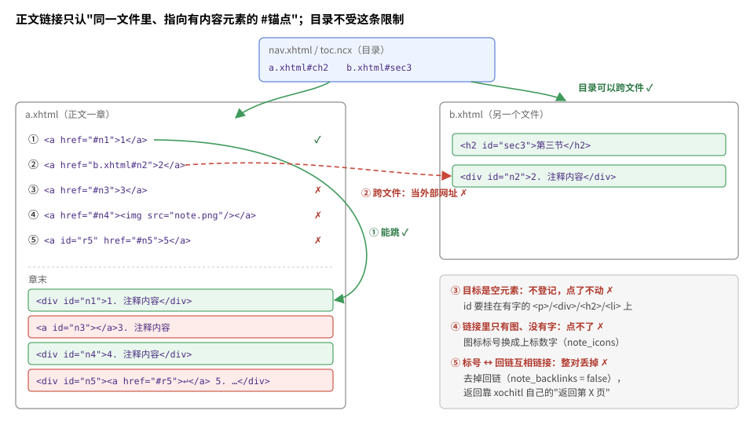

# xochitl 阅读器踩坑

Move 自带的阅读器 xochitl 不开源，排 EPUB 的方式和规范、和别的阅读器都不太一样。这一篇把它的脾气集中记下来：**事实是什么、我们怎么应对、验证到什么程度**。

- 大部分条目是上游设备增强项目 2026-08～09 在 Move 上踩出来的（那时书在 Move 上直接优化，2026-10 起改成在电脑上用本仓库优化）。CSS 和跳转那几批是在固件 3.28.0.172 上测的，系统更新后可能变。
- 已经做成 profile 字段的怪癖（注释回链、图标标号、背景图、漫画页边距等），字段和理由在[设备 · 怪癖 → 字段](devices.md#怪癖--字段)，这里只补来由和细节，不重复。
- 「验证」一栏：**真机** = 在 Move 上看过，或量过 xochitl 自己排出的 PDF；**推断** = 从现象或反编译推出来，没单独验证；**未复核** = 有过结论但后来存疑、没重测。
- **「我们怎么做」以现在为准**：2026-10-08 起 Move 的文字书**只修复**（profile `text_repair_only`），只另外保证注释能点（`repair_note_links`）和照 Send to Kindle 的规则统一（`kindle_rules`），见[排版 · 现在每个模式做什么](typesetting.md#现在每个模式做什么)。下面写「完整优化时」的做法，现在只用在漫画（和没开只修复的自定义模式）上；文字书上那些怪癖又会露出来。

## 先知道它怎么排书

导入 EPUB 时，xochitl 按当前排版设置把整本书排成一份 PDF（`<uuid>.pdf`），屏幕上显示的就是它（存储方式见[设备 · 附录](devices.md#xochitl-怎么存-epub-和阅读进度2026-09-29-真机摸底只读)）。

- 这份 PDF 每页 303×538pt，和屏幕 954×1696 同比例：**1px = 303/954 ≈ 0.318pt**。下文的 pt 都是这份 PDF 里的尺寸。
- 导入时就排（经网页上传的书，导入完 `.content` 里已经有 `pageCount`）；改字号、字体、页边距整本重排。
- 好处是很多事不用肉眼看：把这份 PDF 拷回电脑量就行，见最后的[怎么验证](#怎么验证不用肉眼)。

## 样式（CSS）

| 事实 | 我们怎么做 | 验证 |
|---|---|---|
| **只认外链 `.css` 文件里的规则**：`<style>` 块不认，`style=""` 属性也不认（**2026-10-13 复测和这条矛盾**：`
`、`<h1>` 上 `style=""` 里的 `line-height`、`text-align` 都认，而且压过类规则（「测试-行距2」）；`page-break` 行内也认（下面「强制分页」）。哪些属性行内认、是不是换了固件，没复核全） | 我们加的样式一律写成外链样式表（`eink-ua.css`；完整优化时还有 `eink-wash.css`），每章 `<link>`、OPF 里登记。完整优化时行内写的居中、居右换成类；只修复不换，原书写在 `<style>`、`style=""` 里的样式在 Move 上照旧失效 | 真机（2026-09-04 七版诊断书 + 《飘》；09-06 再测 `style=""`） |
| ~~`!important` 不认，带它的声明作废~~ **2026-10-13 探针复测：认**（外链里 `margin-left:2em !important;` 挪 76px，同不带的；「测试-怪癖」Q28）。**但不提优先级**，而且**优先级一样时不按链接先后，先比规则在各自那份样式表里是第几条**（靠后的胜，条数一样才是后链接的胜；2026-10-16「测试-规则顺序」1–5：A 表第 6 条 `div.x{text-indent:3em}` 压过后链接的 B 表第 1 条 `div.x{text-indent:1em !important}`；类名重复、`:root`、id、属性选择器提了优先级的照样胜。《古龙》40 版 `eink-inline.css` 第 8 条的 `1.8em !important` 输给 `eink-box.css` 靠后的 `1.08em`，章名只挪 12px） | 不写（掌阅带了反而输，见 devices.md）；要压过书的样式靠优先级（"元素名+类"）。`eink-inline.css`（行内样式搬出来的）的类名重复到比全书哪个选择器的类都多（KINDLE_RULES 41，`wash/inline_css.rs`，41 版《古龙》章名挪 33.5px，合 1.8em）；产物里照 CSS 和照 Move 层叠算出来不一样的，用 `cargo run --release -p bookconv --example xochitl_order -- 产物.epub` 查（41 版剩下的：标题上的外边距（Move 本来不认）、页首的上外边距（不认）、《嘯風山莊》书自己样式表之间 3 处、《占星术》版权页 3px（Move 这边反而对）） | 真机；10-13、10-16 探针 |
| 规则里**最后一条声明没写分号、值紧挨着 `}`**（`margin-left:2em}`，中间没有空白）：不是丢掉，是走了另一套解析（见下一条），em 写的首行缩进、字号不认，所以 `p{text-indent:2em}` 看着像没生效；中间有空格、换行就正常（2026-10-13 探针 Q45、Q61–Q64） | 写出的每条声明都带分号；书里最后一条写 em 又紧挨 `}` 的补分号（KINDLE_RULES 22） | 真机（09-06 诊断书）；10-13 探针 |
| ~~值写 `0` 当作没设~~ **2026-10-13 探针复测：外链样式表里带分号的 `0` 认**（上一段下边距 0、这段上边距 0 比没写的近 12px，Q55；行内 `margin-left:0` 也压过类规则，Q57）。以前的 `text-indent:0` 多半是不带分号那种情况 | 还是顶格写 `text-indent:0.01em`（不改） | 真机；10-13 探针 |
| 类选择器认，而且压过元素选择器；~~优先级相同时先出现的胜~~ **2026-10-13 探针复测：后出现的胜，同 CSS 标准**（`.t{margin-left:2em;} .t{margin-left:0;}` 排成 0，Q44；以前的结论可能也是缺分号的误读） | 几份样式表改同一个选择器时照 CSS 规范排先后 | 真机；10-13 探针 |
| **em 一律按根字号算（2026-10-14 探针「测试-div探针」4–6，外链、带分号）**：字号、外边距、首行缩进的 em（字号的 % 也是）都按阅读器字号（根）算，不按父元素、也不按自己的字号——外层 2em 里写 `font-size:0.5em` 的 `
`、``、`
` 排成 0.5 倍（CSS 是 1 倍），`200%` 里的 `50%` 同样；1.75em 的块写 `margin-top:1em`、`margin-left:2em`、`text-indent:2em` 只挪 38、76、76px（CSS 66、131、131px）。不写字号、直接继承的照常（2em 里的 `
` 是 2 倍）；边距的 px 照常，**字号的 px 是屏幕像素**（`<body>` 上的也是：`body{font-size:24px}` 只有 0.65 倍，探针 7；《疯探》目录 `14.9333px` 只有四成大）。以前怪癖表记「字号 em 同 CSS」只在最外层测过（那里父元素就是根）。另：**行距多出来的空白全加在行的下面**（CSS 上下各一半）：1em 的 div `line-height:2` 上一段到它 56px、它到下一段 112px（行内写的 `
` 一样） | **KINDLE_RULES 32 修了（用户 2026-10-14 定，`wash/root_em.rs`，profile `em_root`）**：最后逐个元素比按 CSS 算的和 Move 按根读的，字号（em、%、px）、外边距、内边距、首行缩进不一样的写成按根的 em（接进行内，`inline_css` 挪进样式表；`<body>` 也算）；标题和标题里的不动。unify 工具同样按根算（`epub-to-kfx --styles --device=xochitl`），修前《人生复本》《嘯風山莊》82%，修后 29 本 ≥ 99.5%。真机：《疯探》目录字号正常了；《人生海海》小节标题「一」到首段 1.70 → 2.36 行（按 Kindle 估 2.70，差的可能是「行距空白加在下面」那条，等 Kindle 截图）。行距那条没处理 | 真机 PDF |
| **两套解析（2026-10-13「测试-怪癖」探针）**：外链样式表里带分号的声明照 CSS 排（1em 37.8px）；**行内 `style`、`<style>` 里的、规则最后一条不带分号又紧挨着 `}` 的声明走另一套**：em、rem 的长度按 **1em＝23px**（约 0.61 倍：`margin-left:1em/2em/4em` 挪 23/46/92px），`font-size`、`text-indent` 写 em、% **不认**，写 px 认（Q26、Q27、Q29、Q45–Q52、Q58、Q60）。《狼厅》每章 `<style>` 里的 `text-indent:2em`（17299 段）因此在 Move 上多半没有首行缩进 | KINDLE_RULES 22（`wash/inline_css.rs`，profile `inline_css_lengths = false`）：写了 em 的 `<style>` 挪进同目录的外链，行内写 em 的长度搬进 `eink-inline.css` 的 `!important` 类规则（空段折叠另接在行内的 `margin-top` 一起搬），紧挨 `}` 的补分号。《狼厅》首行缩进真机 ✓；优化过的怪癖测试书真机：行内、`<style>` 的 1/2/4em 挪 38/76/151px、字号 1.5em、首行缩进 2em 都和外链一样 | 10-13 探针 |
| **怪癖测试书的别的结论**（2026-10-13 探针，`tools/quirks/probe.py`）：左右内边距、上下内边距不认（Q12、Q06、Q39，悬挂缩进的首行伸进页边距 Q14）；**边框根本不画**（Q07、Q40）；`%` 的左右外边距当 px（10% 挪 10px，Q11、Q54），`%` 的首行缩进不认（Q15）；负外边距不认（Q08）；块的 `width` 不认（Q30）；`
` 自己的上下外边距只有约 12px（Q04、Q36）；`<li>` 缩进 40px 带圆点、`<blockquote>` 左右各 40px（Q31、Q32）；`letter-spacing`、`text-align`、外链里的 em/%/pt/关键字字号、em/px 首行缩进、`text-indent` 继承都认 | 记进怪癖表 `crates/bookconv/data/css-quirks.toml`，体检报；除已有的规则外没处理 | 10-13 探针 |
| **内边距、边框、标题外边距**（2026-10-13 探针 Q65–Q74）：h1–h6 的**下外边距也不认**（Q65，上外边距 Q05、Q67），标题前后**自带一段空**（前面约标题字号 1em、后面约半个），和前一块的下外边距、后一块的上外边距折叠（那两个认：Q66 前一段 `margin-bottom:2em` 多 30px、Q74 后一段 `margin-top:2em` 多 53px）；块的**背景色照画**（Q68）；横线图放在段落后、标题里 `display:block` 都画满宽（Q69、Q70）；`margin-left:2em; text-indent:-2em` 排得出悬挂缩进（Q71） | KINDLE_RULES 23（`wash/box_fix.rs`，profile `padding`、`borders`、`heading_margins` 写 `false`）：左右内边距并进外边距（带背景色的块、表格、列表、行内元素不动）；同一层相邻两块之间照 Kindle 的距离（外边距折叠 + 下内边距 + 上内边距）写到 Move 认的那一侧（后一块不是标题写它的上外边距，是标题写前一块的下外边距；页首的标题、空块、垫图不配对）；上下边框插同色同粗的横线图（实线 / 点线 / 虚线，连着的内边距画成透明的一截；用户选的；文件开头的块以前不插上边框，KINDLE_RULES 35 起也插、页首垫图减去横线图的高（`box_fix::page_top_rule_px`），左右有框的列表也包进单格表格）。优化过的测试书真机：左内边距同左外边距 76px、悬挂缩进首行顶格、上下内边距 2em 多 100px（同 Kindle 换算）、6px 上下边框画成约 11px 的线；《罗杰疑案》版权页标题下点线、《平凡的世界》「作者简介」下虚线、《帷幕》《罗杰疑案》章名后正文落到 Kindle 换算的位置（色条本身照旧不含内边距） | 10-13 探针、真机 |
| **行内元素、图、列表项、单元格的边距**（2026-10-13 探针 Q88–Q99，`probe.py --only=88-99`）：行内元素（``）的左右外边距、内边距一概不认（em、px、行内写都不认），行内图的外边距也不认；列表项的上内边距不认、上外边距认；单元格的内边距类规则、行内都认（px 是屏幕像素）。→ 列表项内边距并进外边距、单元格 px 内边距折成 em（KINDLE_RULES 28）；行内元素的不处理（只能插字） | 10-13 探针、优化后测试书真机 |
| **竖直对齐、列表符号、块高、flex、定位**（2026-10-14 探针 Q100–Q119，`probe.py --only=100-119`）：单元格缺省**顶端对齐**（Kindle 居中），`middle` 认 → Kindle 上居中的写 `vertical-align:middle`（KINDLE_RULES 29，profile `cell_middle`）；行内 `super`/`sub` 认（抬高或压低、字缩小）；行内图的 `middle` 认、`top` 当成 `middle`、数值不认；`decimal`、`none`、`<ol>` 认，`cjk-ideographic` 画成圆点；块的 `height`、`min-height`、flex、`position` 都不认；`
` 画一条细实线，CSS 写的点线、颜色不管；单元格类规则写的边框这次画了（简单表格；《雪国》那种和书里 `table`/`td` 规则搅在一起的不画，所以照旧写进行内）、`border-collapse` 认；块的 `height` Kindle 当 `min-height` 写（Send to Kindle 同），Move 不认，测试书里影响小，不管。单元格 CSS 写的宽度（类规则、行内）不认、HTML `width` 属性认（Q127–Q129）→ 写成属性（KINDLE_RULES 30，profile `cell_width`；《雪国》译者竖排格真机）；空的 `inline-block`（《狼厅》注释图标）不画，同 Kindle（Q125）。没有项目符号的列表项左右内边距并进外边距（KINDLE_RULES 29，《海葵》目录页真机） | 10-14 探针、优化后测试书和《海葵》真机 |
| **表格、单元格行内的边框画**（2026-10-13 测试书「测试-竖线」1–10）：普通块的边框外链、行内、`outline`、`box-shadow`、渐变背景、背景色拼接一概画不出；表格的 `border` 属性画灰色细线（`frame`、`rules` 不认，总是全部格子线），**表格、单元格行内 `style` 写的 CSS 边框照画**（分边、点线虚线、颜色；超过 1px 的表格边框画成外框加一圈单元格线），外链、类规则里给表格、单元格写的不认；表格行内的外边距、`width` 属性认，但和书里 `table{margin:0 auto}` 这类规则搅在一起位置不对；单元格里块的外边距、背景色不认。→ 左右有框的块包进单格表格、框写在单元格行内，外层 div 管外边距（KINDLE_RULES 27，用户选；单边竖线原来记成"做不了"，这次推翻） | 10-13 测试书、真机 |
| **左右外边距的 px、%**：px 是屏幕像素（50px 挪 50，Q10、Q48），Kindle 写出器按 0.45pt 一 px（约 73 个 Kindle 屏幕像素）；% 当成 px（10% 挪 10px，Q11、Q54）。**行内 `style` 压过外链的 `!important`**（同一属性行内写了 `margin-left:50px`，外链类规则 `!important` 不起作用，KINDLE_RULES 24 修第一版时 Q48 量的） | KINDLE_RULES 24（`wash/box_fix.rs`，profile `px_margins`、`percent_margins` 写 `false`）：块上 px 的左右外边距按 0.45pt 折成 em、% 按内容区宽折成 em；改到的元素行内的外边距删掉、并进类规则；`eink-box.css` 不写 `!important`（掌阅带了反而输）。优化过的测试书真机：50px 挪 71、10% 挪 84、25% 挪 210，行内的 50px 也挪 71；内边距、边框、悬挂缩进同 23 版 | 10-13 探针、真机 |
| **负的左右外边距不认**（2026-10-13 探针 Q75–Q79）：`margin-left:-2em`、两侧 `-2em`、`-30px` 都和 0 一样，字不挪，背景色块也不往外伸 | 不处理（用户定）：没法模拟（只能把其余内容都往里推）；真书里是章名色条（《罗杰疑案》《帷幕》《ABC 谋杀案》，字居中、位置不受影响）、分隔线（《飘》《春雪》）、几段引文（《平凡的世界》）往页边距里伸，影响很小；怪癖表记 accept | 10-13 探针 |
| **`
` 行内 `style` 写的行距认**（2026-10-13 探针 Q83：外链 `p{line-height:2}` 不认，`
` 行距翻倍）；下划线带不带 `!important` 都画（Q85、Q87） | 没处理（体检报：Kindle 按正文行距归一） | 10-13 探针 |
| 只写 `.x{}` 压不过书自带的类规则（`.calibre7{margin:1em 0}`），**要写成"元素名+类" `p.x{}`** | 漫画混排页的文字留边写 `p.eink-tx{}`、`h1.eink-tx{}` 等，每个标签一条 | 真机（09-21 诊断书） |
| `text-indent` 会从外层的 `div` 继承下来 | 顶格段去掉写了缩进的外层类 | 真机 |
| 裸的 `div{}` 规则不生效 | 不靠 `div{}` 排版 | 真机（09-06） |
| `padding-left/right` 怎么写都无效；**`margin-left/right` 用 pt、em 精确生效**，用 `%` 换算很怪（写 6% 只多出约 1.9pt） | 补留白用 `margin`，单位用 pt 或 em | 真机（09-21 诊断书 12 种写法） |
| 书里写的 `body` 边距、段落上下边距**会叠加**在阅读器页边距上：某本书段距 0.5em/1em 吃掉对话页约四分之一的竖向空间 | 只修复：`kindle_rules` 去掉只选 `<body>` 的规则里的左右边距（[排版 · 照 Send to Kindle 的规则统一](typesetting.md#照-send-to-kindle-的规则统一掌阅move)），段落上下边距照原书。完整优化时还去掉段落上下边距（[排版 · 1](typesetting.md#1-解开字体字号行高的锁别的样式不动)） | 真机（09-02，同一本书两版对比：每页 22.5 行 → 26 行） |
| **标题的 `margin-top` 不认、页首的 `margin-top` 不认**（0.01em 到 300px、`%`、`em` 排出来逐像素一样；段落在页中间的 `margin-top` 认，见下面「竖直间距」），`padding-top`、`border-top`、`position:relative; top` 也不认；**前一个元素的 `margin-bottom` 认**（200px 时间距从 156 变 225）。标题前面有它自己固定的一段空（段落后接 `<h1>` 约 156px，和书里写的无关） | 原书靠上外边距把标题压到页面中下部的（《飘》「第一卷」`margin-top:47%`），Move 上顶在页首，Kindle、掌阅在约三分之一处：每章开头写了上边距的垫一张透明空白图（KINDLE_RULES 11，`wash/top_spacer.rs`）；垫图后面 xochitl 自己加一段空：标题约 91px × 字号 em，段落、div 约 46px | 真机（2026-10-12「测试-标题位置」1–5，读排出的 PDF 量） |
| **页首的空白一概丢掉**：空 `
`/`
`（写了下外边距也不算）、`body` 的上内边距都不占地方；只有真内容能把下面的东西推下去——十个 `
&#160;
` 推到 864px，一段十个 ` ` 推到 806px，**一张空白图**（842×396，白的、透明的、写不写宽度都一样）推到 652px | 要在 Move 上照原书把页首标题往下放，只能垫内容（空格字符会多出字，空白图不多字） | 同上 |
| **竖直间距**（2026-10-12「测试-竖直间距」三台对照）：段落的 `margin-top`、`margin-bottom` 在页中间认，1em ≈ 37.8px；`px` 是屏幕像素；`pt` 是真的点（24pt ≈ 76px）；**`%` 只有十来像素**（10% 量出 10px），不对；段落的 `line-height` 不认（1.5、2 和正文一样按阅读器行距，一行 56px） | 三台对照见 [设备 · 竖直间距](devices.md#竖直间距2026-10-12) | 真机 PDF |
| **`display:none` 不认**：行内的、外链样式表里的都不认（2026-10-12「测试-隐藏」） | 去掉 `display:none` 的元素，`id` 留成空 ``（KINDLE_RULES 16，profile `display_none = false`） | 真机 PDF |
| **只有空白的段落占一整行，CSS 藏不住**（2026-10-13「测试-空段」）：上下 1em 的两段之间夹 `
&nbsp;
` 多 88px，`
 
` 排成两行多 138px，段间单独的 ` ` 同样；**全角空格的空段当空白吞掉、一点不空**；空段上写 `height`、`max-height`、`font-size`、`display:none`、`float` 都没用。**外边距照 CSS 折叠**（下 2em 接上 1em 量出 2em） | 照 Kindle 去掉空段元素、下一块上外边距写 Kindle 上的距离（KINDLE_RULES 19，`wash/blank_fold.rs`，用户定）。《三体》「克拉克奖获奖感言」段间空段三台对上（占内容区高 Kindle 0.113、Move 0.105）；标题附近的两处另外修了（下面「块末尾的 ` `」「页首的行内垫图」，KINDLE_RULES 20） | 真机 PDF |
| **块末尾的 ` ` 多排一行**（2026-10-13「测试-末尾br」）：`
字 
` 多 50px，两个多 100px，`<h2>字 </h2>` 多 75px，套在 `` 里的一样；块开头的 ` ` 也排一行（Kindle 同样，不管）。Kindle（写出器去掉块文字末尾的换行）、掌阅不排 | 去掉块末尾的 ` `（后面到块结束只剩空格换行；有 `id` 的、块里套着块的、`pre` 里的不动；KINDLE_RULES 20，`wash/blank_fold.rs`）。《三体》获奖感言标题下多出的 179px 是它 | 真机 PDF |
| **行距：只有 `
` 不认，别的块都认**（2026-10-13「测试-行距」）：body `line-height:1.618` 时 `
` 一行 56px（写 2 也是 56，`
` 里 `` 写的也不认），`
`、`<li>`、`<blockquote>`、`<td>`、`<h4>` 90px，h1 179px、h2 134px；倍数是乘在**阅读器自己的缺省行距**上（h1 写 `normal` 111px、`2`/`2em` 222px，div 写 0.8 是 45px），不是乘字号 | 照 Kindle 归一：`
` 以外、自己排字的块在行内 `style` 末尾接 `line-height:本元素行高 ÷ 全书正文行高`（下限 0.744，同 Kindle 显示的，KINDLE_RULES 34），和 Move 上本来的差不到 0.01 的不写（KINDLE_RULES 20，`wash/block_style.rs`，profile `line_height_except_p`，用户定）。《三体》标题两行从隔 179px 变成 110px（Kindle 换算 123） | 真机 PDF |
| **行距少出来的空白全从行的下面扣**（2026-10-15 探针 Q143–Q145）：h1、2em 的 div 末尾放横线图，行内 `line-height:0.744` 时横线压在字的下半截（行盒从下面少 28px），写 1 和不写一样；《人生海海》版权页、目录的大字标题写 0.85 还压着字下沿。Kindle 上下平分，压到 0.744 也不叠 | 插了下边框横线图的块行距不低于 1（profile `line_height_floor`，接在行内；别的块照 Kindle 压，段落里行与行之间不叠——全书一律不压过，《古龙》正文 Move 从 100% 掉到 96.4%，撤了；KINDLE_RULES 34） | 真机 PDF |
| **外链样式表里一条不带单位的 `line-height`（`line-height:1`）会让排在它后面的规则全部失效**（2026-10-15《人生海海》：`eink-box.css` 里先写了 `h1.eink-b1{line-height:1;}`，后面「一」的外边距规则就不起作用，挪到最前面就好了；原书的行高都带 em，没碰到过） | 我们往外链里写的行高一律带单位或写行内（box_fix 的行距下限写行内） | 真机 PDF（一次，换着顺序、删规则复现） |
| **文件开头的块写了强制分页，多出一张空白页**（2026-10-15《人生海海》「第一部」`

<h1 style="page-break-before:always">`；以前这条声明被分号的问题吞了，没发现）。Kindle 不多翻页 | 文件里前面还没有内容的块，行内末尾接 `page-break-before:auto`（两台都做；写成类规则时会连带把行内的外边距搬进类规则，下一章的间距跟着变了，所以写行内；KINDLE_RULES 34） | 真机 PDF |
| **标题的字号只认关键字**（2026-10-13「测试-标题字号」1–4）：h1–h6 上 em、px、pt、%、`font` 简写一概不认（类规则、行内 `style`、`!important`、标题里的 ``/`
`/`
` 写的都不认），固定按标签排：h1 2.018、h2 1.514、h3 1.216、h4 1、h5 0.784、**h6 1**（以正文 1em 为 1）；只认 `small` 0.784、`medium` 1、`large` 1.216、`x-large` 1.514、`xx-large` 2.018（类规则、行内都认，绝对大小、不随外层字号变；`xx-small`、`x-small`、`xxx-large`、`smaller`、`larger` 不认）；标题里的 `` 是 0.72/0.78/1/1.22/1.51/2.02/2.41，`<big>`、`<small>` 也变。`
`、`
` 上的字号照常认 | 标题字号照 Kindle 取最接近的关键字写进行内 `style`（KINDLE_RULES 21，`wash/block_style.rs`，profile `heading_font_keywords`）：《平凡的世界》章名 2em 的 h2 从 1.5em 变成 2em、《飘》章名 1.35em 从 2em 变成 1.2em；行内垫图的高按这个字号算。**最近的关键字也差 3% 以上的标题改成 `
`**（2026-10-14 用户定，KINDLE_RULES 32，`wash/heading_div.rs`）：层叠出来的声明写进行内、字号写 Kindle 上的 em，目录处理完以后才改标签；书里有光写 `div` 的规则、标题的类也有 `div.类` 规则、这一级标题出现在组合选择器前面的不改。《人生海海》小节标题 1.75em（xx-large 2.018 差 15%）等 27 本里 410 个 | 真机 PDF；改 div 没真机看 |
| **页首的行内垫图**（2026-10-13「测试-行内垫图」1–5）：块里最前面放一张极窄的透明图（1×400，宽度百分比），第一行被撑高，字往下挪「图高 − 44px × 字号 em」（图高不到这个数不挪），横向挪不到 1px，标题前不会多出 xochitl 自己加的那段空；块的行距是 L 时后面的内容挪 L 倍（L＝0.74、1、1.618 量过）。包一层 ``、`vertical-align` 都改不了 | 页首要垫的比那段空还小、或者多得不到 5% 的，在第一块里放行内窄图，Δ = 2 × 要挪的 / (1 + L)（L＝1 时正好）。《三体》获奖感言标题首行 248（Kindle 换算 242，以前 134）；《平凡的世界》章名 222、下面正文多挪 69（各差约 12px，以前顶在页首） | 真机 PDF |
| **强制分页**：`page-break-before/after: always` 认（外链的、**行内的也认**，行内样式里只有这项认）；`break-before: page` 不认（2026-10-12「测试-分页」） | 不用改 | 真机 PDF |
| 逗号并列的选择器 `.a, .b{}` 会不会让整条失效，没复核 | 保守：一条规则只写一个选择器 | 未复核 |

**首行缩进只有外链 CSS 的 `text-indent` 准**（用 em，跟字体无关）。试过都不行的：段首全角空格 U+3000、em 空格 U+2003（被当成段首空白折叠掉）；`&nbsp;`（宽度跟着字体变，连续几个也会被折叠）；`inline-block` 占位（不认）。真机量到 2em = 24.1pt（缺省字号）；英文 1.2em 量出来是 1.184em。

## 严格 XML：一处不合法，整章或整本不显示

xochitl 把 EPUB 当严格的 XML 解析，不像浏览器那样容错。出错时**不报错、只是悄悄少了内容**，所以最好的检查是比页数（见[页数对不上](#页数对不上就是有章没排出来)）。

| 事实 | 我们怎么做 | 验证 |
|---|---|---|
| **同一个标签上出现两个同名属性**（典型是两个 `id`）→ 这一章整章解析失败、一片空白。Calibre 转的 AZW3/MOBI 元素常同时带 `aid` 和 `id`，转换时再生成一个 `id` 就成了两个 | 每个标签只留第一个 `id`（`collapse_dup_id_attrs`），质量门也查；产物的 XHTML 一律修成合法 XML（[排版 · EPUB 3 规范整理](typesetting.md#epub-3-规范整理)；只修复也做） | 真机（《消失的爱人》长篇只排出 7 页） |
| **OPF 不是合法 XML**（书名里混进一个 `\0` 就够）→ 整本只排出 1 页；日志里只有 `Asked for unknown item ""`，看不出原因 | OPF 输出合法 XML，质量门查 | 真机（2026-09-23，一本 PDF 转来的书，书名按 UTF-8 误解出 `\0`） |
| `

…

` 这类无效嵌套成串挨着时，xochitl 自动闭合多出一个 `
`，**吞掉或合并一条** | 注释容器用 `
`，不往 `
` 里套块 | 真机（08-30，多看格式注释"少一条"） |
| 写在 `</body>` 之后的元素，`id` 不登记，指过去的链接点不动 | 往页面里插内容一律插在 `</body>` 之前 | 真机（08-21） |
| 流式 zip（本地文件头里不写大小、靠末尾的数据描述符）的 EPUB 打不开 | 重新打包。`EpubWriter` 写到可回写的文件，大小写在本地文件头里，产物应该不受影响 | 真机（原书打不开、重打包后正常）；我们的产物是推断 |

## 书内跳转

| 事实 | 我们怎么做 | 验证 |
|---|---|---|
| 正文链接**只有同一个文件里的 `#锚点`** 算书内跳转；`b.xhtml#x`、`./b.xhtml#x`、不带 `#` 的一律当外部网址，点了没反应 | 注释搬到同一文件的章末（只修复也做，`repair_note_links`，[排版 · Move：保证注释能点](typesetting.md#move保证注释能点)）；被几章同时引用的注释留在原处，点不了 | 真机（09-23 三章测试书，读排出 PDF 里的链接） |
| **目录不受上面这条限制**：nav 里写 `a.xhtml#x` 能准确停到那一页 | 目录改指原文件里的锚点（v46） | 真机（09-23） |
| **跳转目标必须是有内容的元素**：空的 `` 不登记，指向它的链接点了没反应；`
`、`
`、`<h2 id>`、`<li>` 都可以 | 补的锚点挂在标题、段落本身上。注意"目录能跳"不代表"正文链接能跳"，两套机制 | 真机（09-23 对照《甲午》331 个目标；09-29 `<li>` 当目标能跳） |
| 链接里只有图、没有字的点不了；标号和回链互相链接的一对整对丢掉 | 见 profile 的 `note_icons`、`note_backlinks` | 真机 |
| **没有弹窗注释**：`epub:type="noteref"`/`<aside epub:type="footnote">`、ARIA 的 `doc-noteref`/`doc-footnote` 全当普通跳转 | `notes = "jump"` | 真机（08-21 对照书穷举） |
| 跳过去以后，"返回第 X 页"的浮标只停 8 秒 | 阅读器自己的行为，本仓库管不到（上游用补丁延到 20 秒） | 真机 |
| 外部网址点了没反应（没有浏览器） | 原样保留，不删 | 真机 |

## 目录与封面

| 事实 | 我们怎么做 | 验证 |
|---|---|---|
| **找 NCX 只认 manifest 里 `id="ncx"` 的那一项**（二进制里写死的），不看 `<spine toc="…">`。合乎规范的 `id="toc"` 会让原生目录入口整个不出现 | NCX 的 manifest id 改成 `ncx`（`fix_ncx_manifest_id`；新生成的也叫 `ncx`） | 真机 + 反编译（《疯探》：只改这一处，94 条目录全出来） |
| **封面条目 id 带点**（如 `x00000001.jpg`）又**只有 `<meta name="cover">`** 时取不到封面（日志 `failed extracting cover: got null cover image`）；加上 `properties="cover-image"` 就好。`<meta name="cover">` 指向不是图片的条目（Calibre 产物里的 `cover.txt`）也取不到 | 两种声明同时写，而且要指向真图片（`ensure_cover_declared`） | 真机（09-20：同一张图做 3 个最小 EPUB，只改声明写法对照） |
| **书架缩略图在导入时生成，之后不再生成**；改了封面要重新导入 | — | 真机 |
| Calibre 的封面页是 `<svg>` 包一张图（`preserveAspectRatio="none"`），会被拉伸放大；改 `preserveAspectRatio` 不管用 | 完整优化时整页只有这张图换成 ``；只修复不换（[排版 · 其它修复](typesetting.md#其它修复)），这个问题在 Move 的文字书上会回来 | 真机（08-22《喜鹊谋杀案》） |
| 排出的 PDF 里**没有书签**（目录不写进去） | 验目录读 `.epubindex`，不看 PDF 书签 | 真机 |

## 图片

| 事实 | 我们怎么做 | 验证 |
|---|---|---|
| **块级图默认宽度撑满栏宽**：小图也放大到栏宽（400px 到 2400px 宽的图都画成栏宽），大图缩到栏宽。CSS 里只有 `width` 起作用，`height`、`max-height`/`max-width`、`vw`/`vh`、`display:table` 都不认 | 完整优化时插图按阅读范围只缩不放；只修复不缩。不靠 CSS 限高 | 真机（09-02 探针；09-19 五种写法逐像素对比） |
| **竖向可用高度固定 462.1pt**（上留 35.5、下留 40.3，和页边距设置无关）。图按"栏宽、高度上限哪个先到"缩；**比栏窄时靠左**，不居中 | 文字书阅读范围的高 1455 就是这么换算的（[设备 · 可阅读范围](devices.md#可阅读范围)）；漫画补白到画布比例，图正好铺满 | 真机（09-21） |
| **行内图按图自身的像素画、不认 CSS**：70×95 的图标标号变成一大块；1696×630 的行内横幅溢出屏幕 | 图标注释标号换成数字（只修复也做）；完整优化时插图缩进阅读范围（宽不超过 842），只修复不缩 | 真机（09-04《飘》） |
| **图块在页尾放不下就整个挪到下一页，剩下的空白不回填**：连着几张大图的网文会大片留白 | 没办法：改 CSS 前后排出来逐页像素一致。别再查 | 真机（09-10，25 页 A/B） |
| 网上的图（`src="http…"`）设备离线时画成一个**巨大的放大镜**破图；它按 `src` 直接画，不查 manifest | 抓下来放进书里；抓不到的：只修复时留着（会显示放大镜），完整优化时删掉这个 ``（[排版 · 其它修复](typesetting.md#其它修复)） | 真机 |
| **CSS 背景图从内容区左上角起按原始像素（1 CSS px = 1 屏幕像素）向四面平铺、铺满整页**（页边距里也画）；`no-repeat`、`background-size`、`background-position`、`background-attachment` 都不管；`body` 的外边距、内边距不影响起点；`html` 上的背景根本不画；正文跨页时图块按整页高（1696）接着往下排（7 页漂 9px） | 整页背景图做成 954×1696 一块，内容区那部分照 Kindle 画、其余白色，每页正好一份（[排版 · 照 Send to Kindle 的规则](typesetting.md)，KINDLE_RULES 10）。页边距设置改了起点会跟着变，图块就错位（同阅读范围一样，要同步改 profile） | 真机（2026-10-12「测试-背景图3」：带坐标网格的 954×1696、842×1455 图，读排出的 PDF 量红框和底边蓝块；《飘》真机 ✓） |
| 每章开头一张的装饰图（横幅、logo）是正常内容 | 不做"跨章重复图"去重（上游误删过一次，用户照片纠正后撤回） | 真机（用户确认） |

## 页边距与漫画

页边距 1、画布 952×1457、登记脚本这些做法见[排版 · 离屏幕边缘 1px](typesetting.md#离屏幕边缘-1px三种做法)和[使用指南](usage.md#move-上的漫画登记页边距)，这里补几条来由：

| 事实 | 验证 |
|---|---|
| 页边距是**每本书单独**的设置，存在 `.content` 的 `margins`。设置界面只给 28/56/112 三档，点了调的是阅读器内部的 `setMargins`（界面右上角的保存按钮不写任何数据）；`setMargins` 收任意数，0 也行（0 时图离左 0.0、右 0.4pt），用户选了 1 | 真机 + 读固件里的 QML（09-21） |
| **从外面改 `.content` 的 `margins` 不可靠**：试了 5 次只成功 1 次，其余都在用户打开书时被 xochitl 用内存里的值写回 56 | 真机（09-21） |
| 漫画页的宽高比要和"栏宽 : 462.1"对得很准：一张比框窄 1.6% 的页，图少 4.5pt 宽、左右留白不对称（8.9 / 13.4pt）。上游的容差收到 0.3% | 真机（09-21） |
| 不补白时，xochitl 把图贴在页顶、空当全堆到底下（上 6.6%、下 22.3%） | 真机（09-21） |
| PDF 不走这套排版：页面正好 954×1696 的 PDF 左右留白 0，它的 `.content` 里根本没有 `margins`。本仓库只出 EPUB，记着备查 | 真机（09-19） |

## 翻页方向

| 事实 | 我们怎么做 | 验证 |
|---|---|---|
| xochitl 自己不按 OPF 的 `page-progression-direction="rtl"` 从右往左翻：上游是靠补丁对调左右点击和滑动，读的正是 OPF 里这个标记 | `xochitl` 模式照原书写，不改（profile 不写 `comic_page_direction`） | 推断 |
| 2026-10-16 用户在 cang-jie 恢复了日漫翻页补丁（推翻 10-07 删补丁的决定；三台都照书自己写的方向翻） | 本仓库不用改：照原书写的 `rtl` 就是补丁读的 | 用户：「move已恢复日漫翻页」 |
| Calibre 转的日漫大多没写 `rtl`（《亂馬》《镖人》、东立版《火影》），Kmoe 版写了 | 不替书判方向：漫画识别分不出日漫和国漫、美漫，自动设 `rtl` 会把它们翻反 | 看过样本 |

## 墨水屏刷新（波形）

Move 翻页时的刷新方式**跟页面内容走**，不是整机固定一档（2026-09-01 真机，同一本漫画关掉"翻页清残影"后肉眼对比）：

| 页面内容 | 刷新 |
|---|---|
| 彩色 | 最重：整屏黑白闪好几下，慢 |
| 256 级灰 | 中等 |
| 不超过 16 级灰（抖动） | 轻，快 |
| 1 位黑白（抖动） | 最轻最快 |

- **只对纯图页有效**：有文字的页，字是 xochitl 自己带灰边（抗锯齿）画的，整页仍走灰度那一档。文字书没有从内容上减闪的办法（推断）。
- 16 级灰的样本用 JPEG（质量 88）编码后也触发了轻档，面板看的也许是色调复杂度、不是严格的级数（推断）。真要做，少级灰度应存 PNG。
- 抖动不省体积，反而更大（抖动图压不动，《镖人》283→687MB）。
- 本仓库现在 `xochitl` 模式保留彩色（用户定），黑白屏模式转 256 级灰、不抖动（[排版 · 漫画](typesetting.md#漫画)）；降灰阶减闪没有做。

## 传书与上传

| 事实 | 验证 |
|---|---|
| **网页上传有体积上限**。上游二分测得是 100,000,000 字节（超了直接断开）；本仓库遇到过 88MB 的书回 413（[设备](devices.md#怪癖--字段)下的"其它实测行为"）。两个数对不上，没复核 | 真机（两次结论不一致） |
| **USB 网页界面开着也可能没在听**：2026-10-15 拔插 USB 线后 `xochitl.conf` 里 `WebInterfaceEnabled=true`，80 端口却没监听，书架服务的大文件通道（超过网页上传上限的书，那次是 133MB 的《金庸》）报 `http://10.11.99.1/upload ... Connection refused`；在设置 → 存储里把 USB 网页界面关了再开，重传成功。小书走导入接口的另一条路，不受影响 | 真机（一次） |
| **上传到指定文件夹**：先 `GET /documents/<文件夹的 uuid>` 把"当前文件夹"设好（服务端的全局状态，不用同一个连接），再 `POST /upload` 就落进那个文件夹；表单里写 `parent` 没用，一律落在根目录 | 真机（08-26） |
| 书架上显示的书名取 EPUB 里的 `dc:title`，不是上传的文件名（PDF 才用文件名） | 真机 |
| 每次上传都是一本新书：同名的再传一份就是两本，旧书的进度、批注不会过去 | 真机 |
| 开着云同步时，每导入一本书，xochitl 马上把书连同排出的 PDF 传到云上（出站约 0.8–1.9MB/s，持续 2–3 秒）；弱热点上传书会显得卡 | 真机（09-04；09-29 摸底时用户已关云同步） |
| **已经排过版的书原地换文件不可靠**：覆盖 `.epub`、删掉排版缓存后，xochitl 仍显示旧内容，重开也一样 | 真机（08-22《喜鹊谋杀案》）；10-09 经书架服务原地替换没复现（见下一段） |

**`booklib sync` 怎么传 Move**（2026-10-07 起）：经 SSH 端口转发调 Move 上书架服务的导入接口，流程见[使用指南 · 产物放在哪](usage.md#产物放在哪)和[架构 · 生成](architecture.md#生成sync-的第二步generaters)。用到的接口：

| 接口 | 做什么 |
|---|---|
| `POST /import?name=&folder=` | 新加一本，马上回任务号；超过上传上限的自动走下面的占位 + 磁盘替换 |
| `POST /import?uuid=` | 原地替换（保留 uuid、文件夹）；这本正在替换时回 409（旧版 400），booklib 等它做完再交 |
| `GET /import/jobs/<号>` | 查任务进度，做完回 uuid |
| `POST /import/states` | 一次查一批 uuid 还在不在（没删、没进回收站；2026-10-09；旧版没有时退回逐本 `GET /import/<uuid>`） |
| 回收站队列 | 删书（能恢复） |

**2026-10-09 真机**：《绍宋》排过版、开着的时候原地替换两次，再打开都是新内容 ✓（xochitl 先把开着的书关掉，再打开时重新排版）；进度由书架服务找回，见[设备 · 重拷书以后进度还在不在](devices.md#重拷书以后进度还在不在)。

**2026-10-07 真机（sync 38 本）**：按层建文件夹 ✓（xochitl 的 `createCollection(上级 uuid, 名字)` 传非空上级能建进上一级：「漫画」里的「死亡筆記(愛藏版)」「哆啦A夢」「北鬥之拳(究極版)」）；异步导入 ✓（38 本全部加入、记录齐全、无重复）；同一文件夹同字节认回 ✓（《阿加莎全集》上一轮没记下的那本被认回原 uuid）。原地替换 10-07 时还没在真机上走到（这一轮都是新加）；10-09 已走到（见上一段）。

**超过上限的大书：占位 + 磁盘替换**（上游的做法，要在 Move 上运行能写书库目录的程序；书架服务的导入接口用它）：

1. 先经网页上传一个几 KB 的占位书，让 xochitl 建好条目。**占位要带真书名和真封面**：书名和缩略图在导入时定下，替换后不会更新。
2. 在磁盘上把 `<uuid>.epub` 原子替换成真书，删掉占位的 `<uuid>.pdf`、`<uuid>.epubindex`。不用重启 xochitl。
3. 第一次打开时 xochitl 自己重新排：146MB 约 25 秒；156.5MB 约 74 秒排出 349 页。之后走缓存。
4. PDF 还要同时改 `.content` 里的 `pageCount`、`originalPageCount`、逐页 UUID 表、`redirectionPageMap`、`sizeInBytes`；列表里的页数打开一次才刷新。

真机验证过 154MB 的 PDF、153MB 的 EPUB（2026-09-20）。这和上一行"原地换文件不可靠"看起来矛盾，推断区别在于占位书还没被打开过、xochitl 内存里没有它的排版，没验证。

**手工删书**：xochitl 运行时直接删文件会被它写回去。要 `systemctl stop xochitl` → 删 `<uuid>` 目录和 `<uuid>.*` → `systemctl start xochitl`（2026-09-30 删测试书时这样做的）。`sync` 删书不走这条，经书架服务进回收站。

**停掉 xochitl 有概率让整机重启**：xochitl 退出时自己有概率崩溃（上游收集到 5 份崩溃栈，其中 3 份反编译看是退出时数据先析构、刷新屏幕的线程池后停），崩了会触发系统的应急处理、整机重启（会自己回来，没丢过数据）。照上面[手工删书](#传书与上传)停掉 xochitl 时要知道这一点。真机（2026-09-20～09-25，装着上游扩展的 Move 上多次）；"跟扩展无关"是反编译推断。

## 超大的书：打开要算一分多钟，会被当成卡死

几万页的合集，打开时 xochitl 的主线程要连续算一分多钟。系统的看门狗规定它 60 秒没响应就当卡死、强制杀掉重拉，用户看到的是"一打开这本书就重启"（整机没重启，重启的是 xochitl；日志 `xochitl.service: Watchdog timeout (limit 1min)!`）。2026-10-15 真机，固件 3.28.0.172：

| 书 | 正文 | 页数（缺省排版） | 结果 |
|---|---|---|---|
| 《梁羽生武侠全集》 | 55MB，1454 个 xhtml | 40492 | 打开就被杀（复现两次） |
| 《古龙作品全集》 | 54MB，1507 个 | 28128 | 被杀过 |
| 《金庸全集（旧版）》 | 34MB，170 个 | 14809 | 被杀过一次 |
| 《金庸作品集》 | 28MB，580 个 | 12637 | 打开、改字号都正常 |

| 事实 | 我们怎么做 | 验证 |
|---|---|---|
| **卡的是全书总量，不是单章太大**：上面几本单个 xhtml 都不超过 330KB。临界大约在一万多页、正文三十来 MB（只有四本书，粗估） | 不拆书（用户定：不想把全集拆成单部）。要稳就按部拆成几千页以内的书 | 真机 |
| **不是死循环，算完就好**：上游临时关掉看门狗（`systemctl service-watchdogs no`），《梁羽生》开书时主线程满负荷算了约 66 秒，之后正常翻页。采样 `/proc/<pid>/task/<pid>/stat`：一直是 R、用户态 CPU、几乎没有系统调用、内存平稳（约 545MB），不是等磁盘、也不是内存不够 | 上游把 xochitl 的看门狗放宽到 300 秒（装在 xovi 的服务目录里，整机重启生效），《梁羽生》真机能打开。**没装上游的 Move 仍是 60 秒**，这几本照样打不开 | 真机 |
| 页数和计算量跟着排版设置走：改字号、页边距会整本重排，耗时多半比开书还长 | 超过 300 秒照样会被杀；没测过 | 推断 |
| 被杀的那一刻 memfault 抓到的栈只有两三帧，落在不相干的代码上（Qt 注册类型那段），**看不出卡在哪** | 定位靠上面那种 `/proc` 采样，别信这个栈 | 真机 |

## 页数对不上，就是有章没排出来

严格 XML 出错时 xochitl 不报错，只是少排几页甚至整章，所以**比页数**是最省事的检查：

- 默认排版设置下，**中文每页约 460 字，英文每页约 960 个字符**（上游两本真书，估算和实际比 0.99）。期望页数 = 正文字符数 ÷ 每页字符数，跟 `.content` 里的 `pageCount` 比。
- **实际不到期望的一半，就当有章没排出来**：好的测试书 25/29 页，带 3 章双 `id` 的坏书只有 10/29 页；那本书名里有 `\0` 的书只排了 1 页。
- 漫画字少，估出来只有两三页，这个比法没意义。改了字号等设置，每页字数跟着变。
- 日志里的 `pdfrenderer_unix.cpp:141 logErrors` 平时就有成百条，多是噪声；`epubindex … failed to open` 也是良性的。看页数，别看这些日志。

## 怎么验证（不用肉眼）

| 想确认 | 方法 |
|---|---|
| 版面、图的位置大小 | 把 `<uuid>.pdf` 拷回电脑，PyMuPDF 读 `page.get_image_info()[0]['bbox']` 拿图的真实位置（别量非白像素，会把画面自己的留白算进去）；量每段首行的 x 偏移看缩进；比每页行数、行距 |
| **正文链接能不能跳** | 读那份 PDF 的跳转目标表（catalog 的 `/Dests` 名字树），每个链接的目标名都要在表里，再比对目标页的文字；PyMuPDF 的 `get_links()` 里命名目标是好的，`URI`/`launch` 是被当成外链的 |
| 目录跳到哪页 | 读 `<uuid>.epubindex`：Qt 二进制，每条是 u32 字节长 + UTF-16BE 的 `OEBPS/…#锚点` + u32 页号（从 0 起） |
| 书排全了没有 | `.content` 的 `pageCount` 跟期望页数比（上一节） |

- **目录和正文链接是两套机制**：上游曾拿 `.epubindex`（目录用的）核对正文链接、得出"能跳"，用户一点不跳。两样都要过才算能跳。
- **诊断书**：一本小 EPUB，每页只改一个变量、旁边放一段对照，投上去量排出的 PDF。CSS 覆盖类的写法连着几次都无效时，别再换写法，改成只动结构（比如去掉 `body` 的类）。
- **有在真机上生效的活样本，先拆开看它怎么写的**，比凭空造几版诊断书快（上游的缩进问题就是这样绕了远路：《飘》自带的外链 `p{text-indent}` 早就是答案）。
- 看不到屏幕别猜观感：让用户拍照，或直接说看到了什么。
- 测试副本先改掉 `dc:title`，免得和原书同名、点错本。
- 要读 xochitl 的界面代码：二进制里的 Qt 资源是 zstd 压缩的，扫魔数 `28 b5 2f fd` 逐块解压，含 `import Qt` 的就是 QML 源（3.28.0.172 上 553 个文件）；`strings` 要带上 UTF-16LE。

## 所有 em 换算都按缺省字号（2026-10-15 真机，《梁羽生》卷名竖排）

xochitl 的阅读字号（`.content` 的 `textScale`，设置里「文字与布局」）缺省 1.0；本仓库所有 em 换算（profile `em_px` 37.8、`horizontal_scale`、竖直间距换算、卷名这类**靠 em 外边距压窄的块**）都按缺省字号标定。字号调小以后，em 外边距跟着变小、压窄的框变宽：《梁羽生》卷名「女帝奇英传」靠左外边距 18.88em 压成一字宽的竖条，`textScale = 0.8` 时框宽多约 143px，一行放 4 个字、不再竖排（设备上 26965 页，缺省字号 40458 页）。Kindle 的行距、边距同样按字号换算，只是卷名这种靠 em 外边距撑出的窄框在 Move 上更脆（Move 不认块的 `width`、% 外边距坏）。2026-10-15 对窄的定宽块（卷名竖排）换了写法（KINDLE_RULES 38）：包进单格表格、表格 `width="14%"` `align="right"`（百分比相对页宽；表格不会窄过里面最宽的一个字，一字宽的竖条写 1%–12% 都一样），真机字号 1.0 和 0.8 都竖排；其余 em 换算（行距、竖直间距、左右边距）仍按缺省字号。
